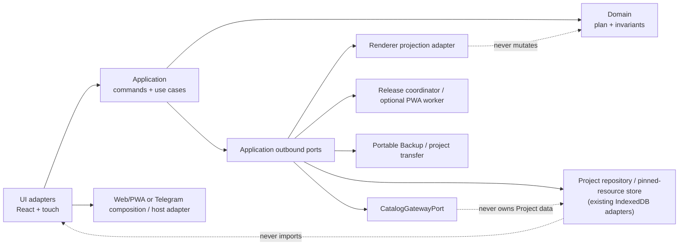
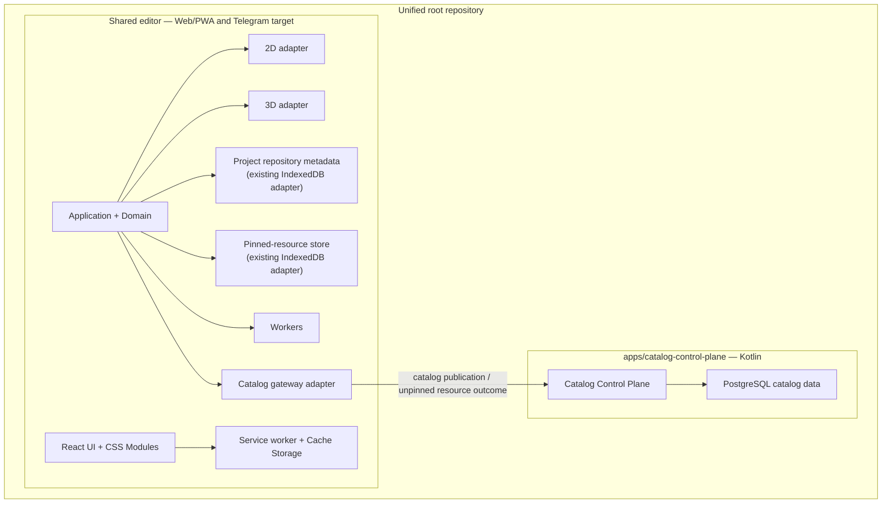

# Architecture Spine — InteriorsEditor Alpha

## Design Paradigm

Hexagonal architecture отделяет чистую доменную модель плана от React,
renderer, browser storage и host lifecycle Web/PWA и Telegram. Все пользовательские изменения
входят через Commands в application layer; порты связывают persistence,
catalog, export, diagnostics и rendering. 2D и 3D — однонаправленные
проекции целостной Revision.



Разрешённое направление зависимостей:
`adapters → application → domain`; инфраструктура реализует объявленные внутри
application outbound ports. Domain не импортирует React, Three.js, IndexedDB, service worker или
platform API.

## Invariants & Rules

### AD-1 — Канонический 2D planar graph в целых миллиметрах [ADOPTED]

- **Binds:** CAP-2, CAP-3, CAP-4, CAP-5; FR-6–FR-25; NFR-1–NFR-4
- **Prevents:** float drift, расхождение 2D/3D и renderer-owned geometry
- **Rule:** Vertex и все физические размеры хранятся целыми мм в domain;
  renderer adapter переводит `1000 mm` в `1 scene metre`. WallSegment задаёт
  **центральную reference line**, а толщина распределяется поровну по обе
  стороны. Topological Face строится по reference lines; usable Room polygon,
  площадь и периметр выводятся детерминированным inward offset до чистовых
  внутренних поверхностей. Face, usable polygon, mesh и spatial indices
  являются пересоздаваемыми projections.

  Каждый resolved Room face является derived planar component с ровно одним
  simple outer boundary и нулём или несколькими simple, строго вложенными,
  непересекающимися void boundaries. Usable geometry выводится только из этого
  face и existing offset/join rule. Repeated bounded walk, touching/nested ring
  или non-simple component не создаёт Room и не даёт частичной mutation;
  repeated darts unbounded exterior остаются свойством embedding, а не
  альтернативной Room identity. Ни face, ни usable geometry не становятся
  второй редактируемой или durable истиной.

### AD-2 — Domain не зависит от UI, renderer и browser infrastructure [ADOPTED]

- **Binds:** all
- **Prevents:** невозможность тестировать topology без браузера и менять
  renderer/storage без переписывания продукта
- **Rule:** domain и application не импортируют React, Three.js, Dexie,
  service-worker code, DOM APIs или network client; интеграция идёт через typed
  ports и plain
  serializable values. Domain компилируется без DOM lib, слои открывают только
  public entrypoints, а static dependency rule отклоняет forbidden imports
  `domain → infrastructure/UI`, `application → concrete adapter` и
  `UI → persistence adapter`. `CatalogGatewayPort` — application-owned
  outbound port: только catalog adapter может зависеть от remote transport;
  Project/Revision/History/Portable Backup values через него не проходят.

### AD-3 — Каждая мутация атомарна и выражена Command [ADOPTED]

- **Binds:** CAP-1–CAP-8, CAP-10, CAP-12
- **Prevents:** частичные планы, несогласованный undo и autosave во время drag
- **Rule:** Command строит и валидирует полный ChangeSet; rejected command не
  меняет state. После validation candidate получает состояние
  `PendingDurability`, но не называется committed/saved. Только успешная
  staging-write + checksum + atomic pointer swap создаёт `Durable Revision`,
  публикует HistoryEntry и разрешает следующую mutating Command. Draft gesture
  не попадает в history. При persistence failure последняя Durable Revision
  остаётся current, candidate доступен только для retry/recovery export и не
  маскируется как сохранённый.

  Discovery до materialization allocation-free. Valid AddWall Room split
  детерминированно переносит predecessor `heightMm` на каждого successor и не
  требует Room-metadata выбора. Если merge reconciliation, Opening или host
  требует пользовательского safety-выбора, application создаёт только
  transient conflict preview: без ID allocation, Command, complete ChangeSet,
  inverse, resource pin или PendingDurability. Подтверждение повторно проверяет
  base Revision и writer fence, заново запускает discovery/validation и лишь
  затем может materialize один complete candidate. Cancel, stale base или lost
  fence не оставляют partial candidate. Semantic ChangeSet и inverse существуют
  только внутри validated candidate и никогда не являются independently durable
  records.

### AD-4 — Local-first persistence с версионируемыми адаптерами [ADOPTED]

- **Binds:** CAP-1, CAP-9, CAP-10; NFR-10–NFR-15
- **Prevents:** зависимость базовой работы от backend и невосстановимую
  привязку проекта к одному browser storage
- **Rule:** domain metadata/revisions сохраняются через ProjectRepositoryPort;
  большие blobs — через AssetBlobStorePort. Один Project имеет один
  writer-lease с fencing token; второй tab/standalone context открывается
  read-only до явного takeover. Каждый pointer, Revision, writer fence,
  root/lease и recovery record привязан к своему `ProjectId`; shortcut по
  «первому» pointer или staging record запрещён. Миграции copy-on-write,
  portable backup всегда
  self-contained и валидируется в staging до публикации. Browser и iOS Home
  Screen app считаются разными local contexts; handoff идёт через backup.
  Явно подтверждённое удаление Project в одном fenced transition окончательно
  удаляет его metadata и owned Revision; промежуточного delete-state и undo
  маршрута нет. Blob GC
  удаляет только недостижимые из current, recovery, staging, custom definitions
  и обеих веток активной session History
  ресурсы. Новая команда после undo освобождает ресурсы отброшенной redo-ветки
  только после своей Durable publication; history boundary освобождает
  session roots только при читаемых current/recovery Revision.
  `BackupFeasibilityPolicy` и pinned referenced-resource bytes гарантируют, что
  каждый non-corrupt Durable Project текущей policy помещается в complete
  offline backup; mutation, нарушающая envelope, не публикуется.
  `SessionRetentionPolicy` до publication ограничивает объединение
  current+undo+redo resources. Missing/corrupt referenced hash переводит
  Project в read-only `ResourceRecoveryRequired`: разрешены exact-byte repair
  либо один атомарный `RecoveryChangeSet`, чей результат полностью
  backup-ready; обычные Commands и частично повреждённые Durable Revision
  запрещены. History-only issue допускает ещё только явно подтверждённый
  `DiscardSessionHistory` при healthy current Project; он не создаёт Project
  Revision и никогда не выполняется автоматически.
  Текущий browser staging не доказывает все эти history/fence гарантии: он
  может менять Revision до проверки fence/base. Это отдельный pre-existing
  source risk, а не исправление в additive registered-transfer scope; AD-4
  не ослаблен. История, старые данные и старые установленные PWA сохраняются.
  `CatalogGatewayPort` и его remote adapter не могут реализовать
  `ProjectRepositoryPort` или `AssetBlobStorePort`: Catalog Control Plane не
  получает Project, Revision, session History, Portable Backup или user-owned
  pinned blobs.

  Fenced logical publication охватывает verified candidate Revision, swap
  current pointer, переход History roots, новый pin/staging root и eligibility
  его release. Stale/lost fence не создаёт новую Durable Revision, pointer,
  History/root transition или publish-visible resource. В substrate с общей
  транзакцией adapter проверяет `ProjectId` и current writer fencing token в
  **той же** transaction, которая создаёт staging Revision, обновляет root
  inventory и swap-ит current pointer. Если substrate
  пересекает физические stores без общей транзакции, adapter обязан
  вести recoverable journal/reconciliation: до GC или новой записи startup
  приводит состояние ровно к `published` либо `no-publish`. Выбор между
  IndexedDB Blob, OPFS и hybrid исторически оставался deferred до physical
  lifecycle/quota corpus. Текущий baseline уже содержит IndexedDB adapters для
  Project/Revision и resource/library bytes; это наблюдение само по себе не
  закрывает physical lifecycle/quota evidence.

  Один `Project-scoped fenced transition` обязателен для каждого изменения
  accessibility, current pointer, schema/recovery/History/root inventory:
  Command publication, explicit takeover, copy-on-write migration
  publication/failure handling, recovery, `DiscardSessionHistory`,
  confirmed permanent delete и journal completion. Такой transition
  проверяет current Project state и writer fence в своей atomic/journal
  boundary; stale work не может publish, resurrect, rewind или release root.
  Cross-store journal record включает `ProjectId`, expected base/current
  generation, candidate Revision checksum, acquired fence generation и target
  root manifest. Reconciliation применяет idempotent `published`/`no-publish`
  только по этому predicate и не меняет newer fenced generation; release
  допустим только после proven `no-publish` и проверки актуального root
  inventory.

  Repository создаёт fenced logical recoverable staging/pin-lease root вместе
  с newly pinned exact bytes; в одном transactional substrate это одна
  transaction, а cross-store path подчиняется journal/reconciliation выше.
  Этот root имеет явные paths success to durable manifest, reject/cancel/
  fence-loss to safe release, and startup crash recovery before GC; он не
  сериализуется в Project, History или Portable Backup. Fenced
  recovery и history-only repair используют тот же root accounting. Explicit
  DiscardSessionHistory сначала доказывает healthy current Project, atomically
  drops both session branches without a Project Revision и никогда не выполняется
  автоматически. Root inventory явно включает current Revision, обе session
  History branches, recovery, staging/pin lease и custom definitions;
  GC вправе удалять exact resource bytes только после доказательства
  недостижимости из всего этого inventory.

### AD-5 — WebGL2 является baseline, WebGPU только progressive enhancement [ADOPTED]

- **Binds:** CAP-5, CAP-9, CAP-11
- **Prevents:** исключение поддерживаемых мобильных браузеров и две обязательные
  renderer-архитектуры в альфе
- **Rule:** все alpha acceptance scenes должны работать через WebGL2.
  WebGPU path не может быть единственным для capability и не блокирует alpha.

### AD-6 — Один Level, derived Room и wall-hosted Opening [ADOPTED]

- **Binds:** CAP-3, CAP-4; FR-17, FR-18, FR-19
- **Prevents:** преждевременную многоэтажную модель, Opening вне topology и
  отдельные Alpha-модели доступа к Door
- **Rule:** Project alpha содержит один Level. Room выводится из Face, а
  Opening проходит validation после reconciliation Room. Door и Window не
  создают navigation graph или transition. В Alpha нет полей или команд
  `passable`, `locked`, access control, key, lock/unlock либо open/close в
  Door, domain ports, API или UI. Визуальные swing/hinge остаются невыбранным
  дизайном и не могут менять геометрию/host semantics.
  `Room.heightMm` — единственный пользовательский источник высоты помещения;
  отдельная редактируемая высота Wall в Alpha отсутствует. Shared wall
  экструзится до максимума высот соседних Room, opening обязан помещаться в
  минимальную доступную высоту обеих сторон.

### AD-7 — Детерминированная constrained geometry [ADOPTED]

- **Binds:** CAP-2, CAP-3, CAP-4; FR-7–FR-15, FR-19; NFR-1–NFR-4, NFR-26
- **Prevents:** платформозависимые результаты snapping и принятие невалидного
  плана, global-grid storage и скрытый выбор X-intersection библиотекой
- **Rule:** canonical geometry reaches topology arithmetic only as safe integer
  millimetres: coordinates, dimensions, offsets and resolved endpoints. No
  visual-grid step, floating endpoint or mutable construction policy enters
  Project, Revision, History, persisted Command or Portable Backup. For
  persisted/imported canonical geometry, a schema-aware decoder retains each
  raw JSON numeric token and validates it before any host IEEE `Number`
  coercion; canonical Project JSON is the mandatory `project/project.json`
  member inside a `.interiors` bundle. The exact grammar, path allowlist and
  stable serialization/import reasons remain owned by the SPEC geometry and
  Project/Backup contracts, not by a renderer or library. Any wider
  representation used only for exact geometry arithmetic is ephemeral and never
  becomes canonical serialized state.

  Gesture adapter получает screen-to-plan conversion только через fakeable
  PlanProjectionPort. Его session-only contract фиксирует coordinate convention,
  forward projection, inverse hit conversion, finite/invertible result,
  precision boundary, tie/hysteresis inputs и revision/fence identity. Failed
  projection остаётся transient selection-unavailable/retry state retaining
  current draft; он не подменяется INVALID_DIMENSION, не создаёт Command,
  ChangeSet, Revision или History. Worker result с другой Revision, checksum,
  fence или cancelled job discard-ится before UI or materialization.

  Touch and numeric input share one detached, allocation-free preflight path:
  normalize integer input, derive contacts/faces/host effects and run the
  applicable non-materializing invariants. A valid AddWall Room split assigns
  predecessor `heightMm` to every successor automatically. A preflight that
  needs a merge, Opening or host choice enters AD-3 conflict preview with no
  ChangeSet or inverse. Only a preflight with no unresolved choice, or an explicit choice
  followed by base/fence recheck and repeated preflight, may construct one
  complete ChangeSet, run all Plan/Room/Opening/host invariants and enter AD-3.
  A rejected
  candidate creates no `PendingDurability`, History entry, autosave or canonical
  projection publication. A library cannot silently supply product geometry
  semantics.

  A non-zero delta is allowed only when exactly one component is zero or
  `abs(dxMm) = abs(dzMm)`; it is therefore a positive multiple of one of the
  four cardinal or four diagonal unit directions. Other deltas reject rather
  than rounding to a nearest angle. Exact endpoint/delta input preserves its
  supplied signs. A length-only diagonal request requires an explicit quadrant;
  for positive integer length `L`, it resolves integer magnitude
  `n = round(L / sqrt(2))` by deterministic exact-integer comparison, builds
  `start + n × direction`, and previews the selected signed delta together with
  the quantized actual length before confirmation. Only the resolved integer
  endpoint can enter a Command.

  The 100-mm gesture base candidate is relative to the active gesture origin,
  never a global-coordinate lattice: after direction selection it is
  `origin + (100 × k) × direction`, where `k` is a positive integer and
  `direction` is one of the eight cardinal/45-degree unit directions. `UiState`
  alone owns the 100/500/1,000-mm visible-grid presentation. Changing zoom or
  the visible cell never validates, rounds, persists, rewrites or re-normalizes
  an endpoint. The construction class order is eligible exact existing Vertex,
  eligible exact intersection/end, constrained-direction candidate, then the
  origin-relative 100-mm candidate. Valid integer-mm numeric input bypasses
  this gesture selection, including for off-grid endpoints, but never bypasses
  topology normalization or full validation. `SnapPolicy` is construction-only;
  a live `DraftCommand` is current-session-only and no later policy can
  reinterpret a Durable Revision.

  Total exact-contact normalization before full validation groups by coordinate:
  candidate endpoint/existing Vertex, candidate endpoint/existing WallSegment
  interior, candidate interior/existing Vertex (including a junction), and
  candidate interior/existing WallSegment interior. One existing Vertex is
  reused when present; otherwise exactly one shared Vertex is created. Every
  candidate or existing WallSegment whose interior contains a grouped contact is
  atomically partitioned at all distinct ordered contacts into non-zero
  consecutive pieces. Thus an exact T splits the crossed segment, and an
  otherwise valid exact X creates one shared Vertex and the four canonical
  WallSegment pieces in the same ChangeSet. A non-integer or out-of-limit
  contact, collinear overlap, self-intersection, duplicate, zero/too-short
  partition or any other failed invariant rejects the complete candidate before
  Command or Revision mutation.

  Preview, 2D, 3D and export obtain diagonal display text only through one
  product-owned `MeasurementFormatPolicy`, fed the same exact squared length
  (`2n²` for a normalized diagonal). A renderer, export adapter or UI component
  cannot choose independent rounding, and formatted display text never re-enters
  a Command or Revision. Precision and locale remain deferred to the PRD, SPEC
  and UX owners.

  MeasurementRequest имеет только ephemeral scope и bound to one Revision plus
  checksum. Он задаёт named operation и one/two typed targets: plan point or
  Vertex, WallSegment centerline, Room inner boundary либо Item footprint
  boundary. Tie, nearest-point и boundary-locator semantics принадлежат
  source-owned geometry corpus; stale result означает visible reselection/retry,
  never persistence. Одна MeasurementFormatPolicy владеет identical text в
  preview, 2D, 3D и export.

### AD-8 — Определения ассетов отделены от экземпляров [ADOPTED]

- **Binds:** CAP-6, CAP-7, CAP-12
- **Prevents:** дублирование бинарных ресурсов, потерю физических габаритов и
  смешение каталога с размещением
- **Rule:** AssetDefinition неизменяемо описывает ресурс, габариты, footprint,
  anchors и variants; AssetInstance хранит ссылку и discriminated placement:
  `FloorPlacement` или `WallPlacement`. Floor placement адресует конкретную
  Room, а wall placement — семантическую сторону
  WallSegment. `xMm`/`zMm` floor placement живут в canonical integer-mm plan frame
  единственного Level: `roomId` — address host, а не неопределённый локальный
  origin. Wall placement использует свои declared offset/elevation coordinates.
  Topology Command автоматически переносит placement только по one-to-one
  compatible same-root lineage; Floor transfer сохраняет exact
  plan-coordinate point и повторно проверяет compatibility, но не
  пере-выражает его в recomputed room frame. Иначе команда через conflict
  preview/re-entry атомарно rehost-ит, удаляет либо переводит asset в явный
  orphan route. Runtime mesh не сериализуется как instance state.

  AssetPlacement — единственная user-managed привязка к host. Нейтральная
  проекция пола и стен не создаёт отдельной persistent сущности или
  reconciliation route. Cross-anchor или cross-root transfer требует compatible
  asset metadata и conflict preview/re-entry; incompatible, ambiguous или
  deleted host никогда не даёт silent rehost или partial commit.

### AD-9 — Пользовательский GLB находится за отдельной validation boundary [ADOPTED FOR ALPHA+]

- **Binds:** CAP-12
- **Prevents:** network fetch из ассета, memory bomb и частично импортированный
  проект
- **Rule:** до loader/decoder ограниченный byte-level parser проверяет GLB
  header и JSON chunk, запрещает external/data URI и unknown required
  extensions и оценивает declared resources. Loader использует deny-all
  resource resolver и только локально pinned decoders. Worker обеспечивает
  отмену/отзывчивость, но не считается memory sandbox; decoded limits
  подтверждаются hostile-device corpus. Commit AssetDefinition выполняется
  после успешной проверки и явного подтверждения размеров и anchor.

### AD-10 — Деградация renderer не меняет domain accuracy [ADOPTED]

- **Binds:** CAP-5, CAP-11
- **Prevents:** «ускорение» путём округления размеров или удаления доменных
  объектов, а также потерю пользовательского состояния при renderer lifecycle
- **Rule:** renderer получает только disposable canonical projections.
  Render-on-demand обязателен для статической сцены; performance ladder может
  менять DPR, shadows, texture/detail tiers и hydration, но не canonical
  geometry, properties, history или persistence. Unsupported WebGL2, context
  loss, dispose/open и recreate никогда не меняют и не теряют Project, Draft,
  PendingDurability, History, writer fence или recovery state. Первая потеря
  запускает одну recreate attempt из current canonical projection; repeated
  failure переводит renderer в low-quality tier, а следующая неудача — в
  доступный 2D fallback. Diagnostics фиксируют только backend/probe,
  lifecycle outcome, ordinal loss, quality/fallback tier и stable reason code;
  в них не попадают geometry, asset bytes, file paths или user names.
  Camera/cutaway остаются transient: `Авто cutaway` меняет только
  camera-relative visibility exterior Wall, `Показать все стены` её отменяет,
  и ни одно из этих состояний не входит в Project или Revision.

### AD-11 — PWA update координируется с Revision и schema [ADOPTED]

- **Binds:** CAP-1, CAP-9, CAP-10
- **Prevents:** активацию несовместимого shell посреди команды и silent data
  loss после service-worker update
- **Rule:** корректность не зависит от возможности удержать service worker в
  waiting: браузер может активировать его после закрытия clients. Каждый
  startup выполняет handshake versioned `ReleaseManifest`:
  `appBuildId`, worker protocol, readable/writable Project schema,
  catalog/asset schema и minimum capabilities. Активная сессия предлагает
  user-mediated reload только после Durable Revision, но автоматическая
  activation также безопасна благодаря idempotent copy-on-write migration,
  version-tolerant read и сохранению предыдущих immutable artifacts для
  rollback/recovery. Failed migration не заменяет readable source: Project
  остаётся на read-only/exportable recovery path до successful copy-on-write
  publication. Handshake детерминированно выбирает ровно один режим для пары
  local Project schema/release capabilities: `writable`, `read-only/exportable`
  или `migration-in-progress`. Только manifest-authorized writable client может
  начать fenced publication или copy-on-write migration; previous immutable
  source остаётся AD-4 recovery root до successful outcome, а incompatible/stale
  client не может write. AD-28 распространяет этот же handshake на Telegram
  без service worker; отсутствие worker не отменяет shell/schema guards.

### AD-12 — Архитектура обязана сохранять тестовые seams [ADOPTED]

- **Binds:** all
- **Prevents:** зависимость correctness от visual snapshots и реального GPU
- **Rule:** Commands, geometry kernel, migrations, asset validation и backup
  тестируются без UI; clock, ids, storage, catalog, renderer, worker scheduler
  и diagnostics доступны как ports/fakes. Worker job содержит `jobId`,
  `baseRevisionId` и cancellation token; stale result всегда discard-ится,
  auto-rebase в Alpha запрещён. `EditorQueryModel` даёт gesture и доступному
  DOM inspector одни IDs, values, reason codes и actions. Browser/device tests
  проверяют интеграцию, а не заменяют domain tests. AD-16 закрепляет Rstest для
  TypeScript domain/application и DOM-independent UI-state seams через Rspack adapter и
  Playwright для browser/PWA/offline regression; они не заменяют Product Owner
  functional-acceptance `NFR-15` на принятых физических телефонах.

### AD-13 — Direct Three.js/WebGL2 renderer за disposable port [ADOPTED]

- **Binds:** CAP-5, CAP-6, CAP-7, CAP-11
- **Prevents:** неосознанный renderer abstraction level, необратимую связь
  domain с engine scene graph и второй путь mutation через canvas.
- **Rule:** Alpha использует direct **Three.js `0.185.1` `WebGLRenderer`** за
  `WebGl2SceneRenderer`/`WebGl2RoomRendererController` port. React Three Fiber
  и Babylon.js не входят в Alpha renderer dependency graph. Ни одна
  domain/persistence сущность не содержит engine type; `Object3D`, camera,
  mesh, GPU resources и загрузочные roots являются disposable adapter state.
  WebGL2 — обязательный baseline, а WebGPU остаётся только progressive
  enhancement по NFR-14.

  Принятый current-product corpus покрывает WebGL2 probe, init → context loss
  → dispose → restore/recreate, repeated-loss reduced-quality/2D fallback,
  camera/cutaway и one/two-finger/numeric semantic paths. Он запускается через
  existing renderer/persistence/UI regression suite; Product Owner подтвердил
  NFR-15 mobile acceptance для browser и installed-PWA contexts 2026-08-30.
  `WebGl2RoomRendererController` не публикует Command/Revision, а touch,
  numeric и list alternatives передают одно semantic intent в shared AD-7/AD-3
  preflight. Camera/orbit/pinch/cutaway и reduced-motion animation остаются
  transient UX-owned behaviour.

  Recovery contract relies on the platform `webglcontextlost` and
  `webglcontextrestored` events. The controller prevents the default loss
  action, disposes the disposable renderer, then performs standard recovery,
  reduced-quality retry and finally an explicit 2D fallback. Deterministic
  regression tests inject these platform events through the canvas port; they
  do not claim support for `WEBGL_lose_context`, synthetic GPU benchmarks or a
  timeout/cancellation protocol that is not implemented.

  Mutating touch, numeric и list alternative передают одно semantic intent в
  shared AD-7/AD-3 preflight; renderer не создаёт альтернативный Command path.
  Camera/orbit/pinch/cutaway и reduced-motion animation остаются transient
  UX-owned behavior и не меняют эту semantic/durability boundary.

### AD-14 — Catalog assets проходят technical offline pipeline [ADOPTED; PROFILE VIA S-6]

- **Binds:** CAP-6, CAP-7, CAP-9, CAP-11
- **Prevents:** cache explosion и случайное исчезновение предметов
- **Rule:** каждый AssetDefinition и resource-backed AssetVariant имеют semantic metadata,
  technical resource descriptors/hashes, optimization profile и cache tier; app
  shell не precache-ит весь каталог. Licensing, provenance, grant/declaration,
  attribution и notice не являются Alpha model, port или admission gate.
  Admission input — immutable versioned `CatalogVersion` descriptor bundle,
  который связывает catalog identifier, resource/subresource hashes,
  metadata и bytes до local pin; раздельно полученные metadata и bytes не могут быть silently assembled в
  Durable manifest.
  Ресурс проходит `metadata-ready → loading → offline-ready/backup-ready |
  missing/stale/failed`. Preview требует metadata; Durable placement требует
  pinned exact bytes и успешный BackupFeasibilityPolicy; то же правило
  применяется к Durable resource-backed AssetVariant selection. Missing resource существующего
  Project отображается стабильным placeholder и recovery state, но не
  считается export-ready. Remote catalog publication проходит только через
  `CatalogGatewayPort`; его unavailable/download outcome остаётся catalog
  state. Он не может изменить Project durability/recovery policy или заменить
  локальную проверку exact bytes, hash и backup envelope.

  Catalog и Custom static GLB используют один technical admission: exact pin,
  manifest/backup feasibility и AD-4 staging root before Durable publication.

### AD-15 — Focus/native fullscreen [RETIRED 2026-08-24]

- **Binds:** retired CAP-5/CAP-9 Focus scope, retired FR-53/NFR-27 identifiers
- **Prevents:** reuse of retired identifiers or accidental restoration of a
  Focus/fullscreen subsystem into Alpha
- **Former scope:** CAP-5/CAP-9 Focus layout, native fullscreen and `FR-53`/`NFR-27`.
- **Rule:** The identifiers remain retired and are never reused. The ordinary AppShell owns only the normal Plan/3D layout; no Focus controller, fullscreen platform port or Focus-specific evidence is part of Alpha.

### AD-16 — Unified-root bootstrap, web toolchain and test boundary [ADOPTED]

- **Binds:** CAP-5, CAP-9; FR-41, FR-47, FR-54; NFR-10, NFR-14–NFR-16,
  NFR-21, NFR-26
- **Prevents:** divergent frontend scaffolds, host-Node drift, an unpinned
  dependency graph, hidden backend ownership of Project data and a test runner
  that exercises a different build configuration from the web app
- **Rule:** only after the current project readiness authorization, the one
  planned repository root contains two independent build roots:
  `apps/web` is React + TypeScript + Rspack + CSS Modules, and
  `apps/catalog-control-plane` is the Kotlin control-plane implementation from
  AD-17. The repository root, not a waiver/evidence subtree such as `S-*`, owns
  every production manifest, build/test configuration, runtime asset and source
  module. `apps/*` are internal build roots of this one repository, never
  separately delivered projects; no S-* prototype source may be promoted by
  copying it into production. The `S-*` naming pattern grants no evidence-write
  authority: only the exact roots named by the active waiver may be used.
  `pnpm@11.20.0` governs only the JavaScript workspace; it does not
  pretend to build or package Kotlin. The web seed is the exact
  `create-rspack@2.1.8` `react-ts` template on Node.js `v24.19.0` LTS. The
  architecture-selected web dependencies resolve to the exact AD-16 pins; the
  template's remaining support dependencies are accepted only after review into
  the same committed `pnpm-lock.yaml`. CI installs from that frozen lockfile.
  `latest`, a second JavaScript lockfile and an unpinned host Node are forbidden.
  `@rspack/core@2.1.8` and `@rspack/cli@2.1.8` build the web app;
  `React@19.2.8`, `react-dom@19.2.8` and `TypeScript@7.0.2` are its starting
  runtime/type baseline.
  `*.module.css` owns component/page styling; global CSS is limited to reset,
  tokens and AppShell-wide platform constraints.

  `@rstest/core@0.11.5` with `@rstest/adapter-rspack@0.11.5` owns TypeScript
  domain, application and DOM-independent UI-state seams and reuses the
  Rspack-facing configuration. `@playwright/test@1.62.1` owns automated browser/mobile/PWA,
  offline and end-to-end regression; он не заменяет зафиксированную
  двухустройственную `NFR-15` functional acceptance. Kotlin tests, the Kotlin build system and control-plane
  contract tests are deliberately not assigned to a JavaScript runner before
  the backend build/transport decision.

  For phones released in 2021+, initial local Project authoring must remain a
  separate load boundary from renderer, catalog browse/resource loading and
  optional PWA work: those modules are composed lazily after an actionable
  local screen, while AD-10 retains render-on-demand and adaptive quality.
  Build reports, automated regressions and the recorded two-device NFR-15
  functional acceptance, not a bundler syntax target or emulator, подтверждают
  Alpha compatibility outcome. The exact Rspack
  browser-output target is intentionally deferred to the first scaffold and
  floor-device validation; no target is a WebGL, PWA or device
  compatibility claim.

### AD-17 — Catalog Control Plane is a narrow remote perimeter [ADOPTED]

- **Binds:** CAP-6, CAP-7, CAP-9; FR-42, FR-54; NFR-10, NFR-13, NFR-21
- **Prevents:** remote Project ownership, catalog outage turning into project
  recovery, unverified bytes entering a Durable Revision and a Kotlin/PostgreSQL
  service silently becoming sync, account or backup infrastructure
- **Rule:** the only alpha backend is a Catalog Control Plane implemented with
  Kotlin `2.4.10` and PostgreSQL `18.4`. It may publish curated, versioned
  catalog metadata and resource descriptors/bytes together with content
  version/hash. PostgreSQL may contain only that control-plane catalog data. It must not create
  account identity or accept, store, synchronize, recover or own a User
  Project, Revision, session History, Portable Backup or user-owned pinned
  resource bytes.

  The web app reaches the perimeter only through `CatalogGatewayPort` and a
  catalog adapter. A healthy local Project with all exact referenced bytes
  pinned opens, edits, publishes Durable Revisions, performs local undo/redo
  and creates Portable Backup with the control plane unavailable. Outage can
  produce only the non-blocking catalog states `control-plane-unavailable` or
  `unpinned-download-unavailable`; a proposed placement remains cancelable and
  cannot become Durable until local exact-byte pinning and
  `BackupFeasibilityPolicy` succeed. Missing/corrupt referenced bytes still
  enter `ResourceRecoveryRequired` regardless of control-plane availability;
  the service is at most one verified exact-byte repair source.

  `CatalogGatewayPort` carries only versioned catalog identifiers,
  descriptors/resource bytes and hashes
  and typed availability, cancellation or failure outcomes. It never carries
  Project, Revision, session History, Portable Backup, account or user-pinned
  blob data; only the local adapter validates, pins, backs up and publishes.
  Remote catalog availability never participates in local Project publication,
  writer fencing, root accounting, migration or recovery-state choice.
  A catalog-only contract and negative corpus must prove that prohibited input
  is rejected before it becomes an application value and is never reflected,
  persisted, application-logged or cached.

  AD-24 selects the bounded internal-Alpha API/transport, byte delivery,
  seed-publisher authentication, Kotlin build/test, loopback topology and
  database rebuild policy while preserving this boundary. Public deployment,
  provider/IAM, CDN/object storage, SLA, telemetry, retention and production
  backup/restore remain absent and require a release-time decision without
  expanding AD-17.

### AD-18 — Root phone POC is a bounded delivery exception [ADOPTED]

- **Binds:** CAP-5, CAP-9, CAP-11; FR-41, FR-47; NFR-10, NFR-14–NFR-16,
  NFR-21, NFR-26
- **Prevents:** a phone demonstration being mistaken for production entry,
  reuse of spike code as product code, remote ownership of a User Project, and
  a POC claiming mobile certification it has not measured
- **Rule:** `W-POC-2026-08-04` authorizes one local, runnable root POC only in
  the exact paths it names. The POC is a phone-first React/Rspack application
  with source-controlled synthetic data and ephemeral UI state only. Its
  AppShell exposes a truthful `POC · demo data · not saved` state and has no
  browser-store, service-worker, network/API or remote-asset path. It must be testable through
  its compiled POC web build and Playwright flows, and visual captures must be
  labelled POC browser evidence. No `S-*` source or artifact enters it by copy,
  import, re-export, symlink, dependency or runtime serving. AD-24 now selects
  the separate Kotlin/PostgreSQL internal-Alpha build/test and transport
  boundary; no POC code is promoted into it. The waiver's single hashed handoff record is the only
  closure trigger; on closure each named POC module is read-only evidence until
  a later `READY` path explicitly reviews, accepts or replaces it. `G-READY`,
  every `V-*` entry and release remain closed until their existing gates
  independently pass; `NFR-15` follows the Product Owner two-device acceptance.

### AD-19 — D-022 source-owner reconciliation is an architectural gate [ADOPTED]

- **Binds:** CAP-1–CAP-12; FR-7–FR-19, FR-28, FR-34–FR-37; NFR-1–NFR-4,
  NFR-10–NFR-15, NFR-26
- **Prevents:** independent renderer/input semantics, partial conflict commits,
  separately durable ChangeSets, placement/surface conflation, unrooted pins
  and implementation before policy/corpus ownership is explicit
- **Rule:** D22-01 through D22-10 bind the architecture-only seams in AD-1,
  AD-3, AD-4, AD-7, AD-8, AD-12 and AD-14: ephemeral projection/job and paired
  measurement requests; multi-component derived Room faces; allocation-free
  conflict preview/re-entry; total fence-bound allocation/lineage; pure
  semantic replay separate from publication; placement separate from surface
  assignment; staging pin roots; and fenced recovery/history discard. The
  Architecture Spine, domain model and solution design own only these
  cross-unit boundaries and their acceptance corpus register.

  Geometry semantics/reason union belong to the Geometry and Project/Backup
  companions, requirements to the PRD, and visible interaction semantics to UX.
  A source-owner row names the exact canonical artifact, stable section/ID,
  BMAD workflow, corpus and adoption exit. Canonical adoption of every required
  source row and versioned corpus evidence precedes implementation and any
  favorable independent re-review; this AD does not make R8, a port name or a
  draft state an alternative authority.

### AD-20 — Domain-owned exact PlanGraph kernel и test-only oracle boundary [ADOPTED]

- **Binds:** CAP-2–CAP-4, CAP-8; FR-6–FR-25; NFR-1–NFR-4, NFR-26
- **Prevents:** renderer, geometry library или legacy implementation becoming
  the canonical topology authority; ID/reason-code drift and silent promotion
  of characterization material
- **Rule:** domain-owned constrained PlanGraph kernel является единственным
  authority для `SafeIntegerMm` ingress, permitted 0°/45° directions, total
  exact-contact normalization, derived Face/usable geometry, Room/Opening
  lineage, allocation intent/inverse и application-facing stable reason
  outcomes. Canonical state остаётся integer-mm; `BigInt`, rational predicates/
  intersections и `2×mm` intermediates допускаются только ephemeral и никогда
  не входят в Project, Revision, History, Command payload или Portable Backup.
  Geometry and Project/Backup companions остаются owner exact offset/join,
  raw grammar и reason-union semantics; kernel не создаёт альтернативный
  contract. Любой external geometry engine допускается только как immutable
  test-only oracle/fixture adapter: без ID allocation, Command/publication
  path, reason-code authority или canonical mutation. Existing V1/V2 остаются
  characterization fixtures и не могут быть silently reinterpreted, discarded
  или promoted.

### AD-21 — Первый materialized wall route — только immutable EmptyPlanGraph [ADOPTED]

- **Binds:** CAP-2, CAP-8; FR-7–FR-9, FR-19; NFR-1–NFR-4, NFR-26
- **Prevents:** выдачу detached preview за PlanGraph mutation, раннюю ID
  allocation, частичный inverse и преждевременное подключение V1/V2, UI,
  storage или publication к новому kernel
- **Rule:** первый executable kernel route называется
  `MaterializeInitialWallSegment`. Его normative records находятся в
  `domain-model.md`: `InitialWallIntent` contains canonical Level, immutable
  `InitialWallLimits` projection of the source-owned `ProjectLimitsPolicy`, its
  exact hash, endpoints and validated thickness; `EmptyPlanGraph` has matching
  Level/limits and no Vertex or WallSegment; its base digest is IWM-D1-derived.
  `MaterializedInitialWall` fixes the exact ID tuple, next graph, ChangeSet,
  allocation intent and inverse.
  `MaterializationPermit` carries the immutable limits snapshot with that same
  hash. A missing, unknown or identity-mismatched snapshot is private
  `InitialRouteUnavailable` before permit consumption; otherwise the kernel validates
  input wall plus resulting empty-graph counts against that snapshot; numeric
  thresholds and stable reject semantics remain owned by Geometry and
  Project/Backup. IWM-D1 in the Domain Model fixes the candidate-only canonical
  UTF-8 bytes and lowercase SHA-256 `ContentHash` of every intent, limits,
  graph, ChangeSet and inverse binding; supplied hashes are always rederived.
  Raw lexeme parsing and its stable rejects remain exclusively upstream in S2-01;
  this route never parses raw input.

  `MaterializationPermit` is immutable, branded and one-shot. It binds the
  ProjectId, base RevisionId/checksum and PlanGraph digest, exact intent digest,
  observed writer-fence generation and cancellation generation. The only
  linearization point is `IdReservationPort.consumeIfCurrent(permit, labels)`:
  it consumes a still-current permit and atomically returns a pairwise-distinct
  `{ startVertexId, endVertexId, wallSegmentId }`, or returns no reservation.
  At that point cancellation wins, then a base/checksum/graph/intent mismatch,
  then fence loss; the corresponding result is respectively `Cancelled`,
  `StaleBase` or `LostFence`. Any non-`Reserved` result, consumed/replayed
  permit, malformed/non-empty base or invalid/throwing port reply returns no
  materialization, unchanged base and empty allocation intent. A malformed or
  non-empty base is the private `InitialRouteUnavailable` diagnostic before
  permit consumption; it is neither a persisted field nor an application stable
  reason code.

  After a `Reserved` tuple, the kernel verifies the tuple's brands/distinctness,
  builds and revalidates the complete next graph and exact ChangeSet, freezes all
  public records without mutable aliases, and returns the semantic inverse only
  if it is guarded by the IWM-D1 post-graph digest and removes exactly that
  WallSegment and its two specified Vertex IDs. It is never `ResetToEmpty`.
  The accepted candidate carries `InitialWallAllocationIntent` in fixed
  `[startVertex, endVertex, wall]` order with the returned IDs. Each ChangeSet
  and inverse returns its derived `bindingDigest`, which is excluded from its
  own IWM-D1 preimage to avoid a self-referential record. A valid reservation
  exposes a port-owned terminal `retireUnpublished() -> Retired` capability;
  `Retired` confirms permanent port-level retirement. If that confirmation is
  absent, the materializer defensively fences the bounded reservation authority
  before any later `consumeIfCurrent` call. Wrappers over one allocator must expose the same
  opaque `authorityKey`; an unwrapped port instance is its own authority.
  Reserved IDs are
  non-public candidate identities: a later AD-3 envelope/publication retains the
  same IDs; discard, including any post-reservation build/revalidation/freeze/
  inverse failure, invokes that terminal capability, leaves them irrevocably
  unreachable and they are never reused.
  The failed result exposes no allocation intent. Reservation creates no Project,
  Revision, History, writer state, resource root or publication-visible identity.

  The route is a real constrained materialization for the first wall, but not a
  general `AddWallSegment`: contacts/T/X, non-empty PlanGraph, faces,
  Room/Opening/host reconciliation are unavailable and cannot be hidden under a
  fallback reason or legacy adapter. Before this route can report corpus
  validation, a new TCC-A1 revision must prove deterministic injected reservation
  slot order/refusal and invalid-tuple or post-reservation-failure handling;
  IWM-D1 recomputation and limits-snapshot mismatch; cardinal plus four signed
  45° accepts; raw-ingress/bounds/zero/direction rejects upstream; exact inverse
  to empty; private empty-route guard; one-shot permit replay/intent mismatch;
  and cancel/stale/fence linearization with no allocation. Existing detached seed,
  V1/V2 or an oracle cannot substitute. The general command remains unavailable
  until its TCC-A1 contact, face, lineage/host and lifecycle families are adopted
  and pass. `RemoveInitialWall` is a session-private, non-serializable capability
  for this initial route: the issued object identity/provenance receipt, not a
  copied or rehydrated canonical record, authorizes its pure inverse calculation.
  IWM-D1 binding proves integrity only; AD-3 will own any future durable inverse
  envelope.

### AD-22 — General PlanGraph wall, deletion и Opening route [ADOPTED]

- **Binds:** CAP-2–CAP-4, CAP-8; FR-7–FR-10, FR-17–FR-19; NFR-1–NFR-4, NFR-26
- **Prevents:** legacy partition defaults, exterior-wall deletion bans,
  renderer/UI-owned free geometry and partial Room/Opening/host effects
- **Rule:** после отдельной adopted TCC-A1 revision `AddWallSegment` принимает
  только explicit non-zero 0°/45° semantic intent и может materialize
  detached или connected segment в valid free PlanGraph; derived Room возникает
  только из closed Face. Tap или incomplete draft не создаёт intent, permit,
  allocation или mutation. `DeleteWallSegment` доступен для каждого selected
  WallSegment, включая exterior/face-closing segment: resulting Plan, faces,
  Room/Opening/surface/Asset hosts проходят full discovery и либо дают один
  complete candidate. A valid AddWall Room split is a complete candidate with
  automatic predecessor-`heightMm` inheritance; only merge or unresolved
  Opening/surface/Asset host consequences produce `ConflictPreview` with fresh
  revalidated explicit resolution. Closed Face не является ban. `AddOpening`/move/resize/delete
  всегда wall-hosted и проходит полную host/geometry validation; никакой
  Opening не создаёт navigation edge или transition.

  Before reservation every proposed wall validates its closed swept body
  against retained rotated FloorPlacement footprints and required clearance.
  Positive overlap returns stable `WALL_ITEM_COLLISION` with unchanged base and
  empty allocation intent; the route never silently moves, deletes, clips or
  rehosts an item. Contacts, face/usable geometry, lineage and host effects,
  allocation labels/inverse, cancellation/base/fence linearization and all
  rejects are domain-owned. V1/V2 code cannot supply any part of this route.

### AD-23 — Canonical floor placement yaw и projection parity [ADOPTED]

- **Binds:** CAP-5, CAP-6, CAP-8; FR-21–FR-25; NFR-1–NFR-4
- **Prevents:** inconsistent 2D/3D front direction, renderer-only rotation,
  divergent move/rotate collision validation and gesture persistence
- **Rule:** `FloorPlacement.yawStep` is the one durable orientation authority:
  `RotationStep V1 0..7` maps asset-local `+Z` to plan `+Z` by positive
  right-hand 45-degree steps. `MoveFloorPlacement` and
  `RotateFloorPlacement` share one base/intent/fence/cancel-bound preflight,
  rotated-footprint/host validation, allocation intent and inverse/publication
  route. 2D front markers, 3D mesh transforms, picking, reachability and
  gestures are disposable projections; none can own or serialize a transform.
  A corpus row proves identical forward, inverse and reload projection in both
  views before UI integration.

**Уточнение панели и жестов, 22 ноября.** Видимый экранный трек вращения
проецируется поверх 2D/3D представления. Второй контакт отменяет только
преходящий transform, восстанавливая позу до первого касания, и получает
camera intent. Ревизия сохраняется по обычному atomic command. Включение
нового точного угла требует отдельно проверяемого дополнения к AD-23 и
AD-30. Пока сохранение работает по действующему RotationStep.

### AD-24 — Minimal Alpha Catalog Control Plane [ADOPTED FOR INTERNAL ALPHA]

- **Binds:** CAP-6, CAP-7, CAP-9; FR-26, FR-28, FR-42, FR-54; NFR-10,
  NFR-13, NFR-21, NFR-24, NFR-26
- **Prevents:** a second Project owner, transport/database leakage into the
  application, incompatible catalog versions, unverified resource delivery and
  speculative cloud/operator scope blocking the executable Alpha slice
- **Rule:** `apps/catalog-control-plane` is an independently built Kotlin
  `2.4.10`/Ktor `3.5.2`/PostgreSQL `18.4` read-only perimeter whose complete
  selected stack and contract live in
  `catalog-control-plane-alpha-decision-2026-08-26.md`. Only a separate
  seed/migration role atomically publishes normalized immutable metadata and
  exact hash-bound catalog bytes; the runtime has `SELECT` only and exposes
  the closed same-origin REST allowlist through application-owned
  `CatalogGatewayPort`. Prohibited input never becomes a catalog application
  value and is never reflected, persisted, application-logged or placed in an
  application-owned cache. Typed
  catalog outage/cancel/integrity outcomes never select Project recovery or
  read-only state. Internal Alpha runs locally behind the single web tunnel;
  public hosting/IAM/SLA/backup-retention remain absent and release-deferred.

### AD-25 — Две изолированные оболочки, одно ядро [ADOPTED]

- **Binds:** CAP-1, CAP-2, CAP-5, CAP-8–CAP-11; FR-55, FR-58; NFR-28; UXF-8
- **Prevents:** PWA regression, Telegram dependency в ядре и разрушение другого target при сборке или очистке.
- **Rule:** Web/PWA и Telegram используют общие domain/application, codecs, renderer, editor UI и browser crypto/UUID/time/IndexedDB и release coordinator. Telegram SDK и `window.Telegram` доступны только UI/composition host adapter; domain/application не импортируют их. Отдельные entry, output и стабильные origins (в development — разные ports) изолируют worker и storage. Сохраняются существующие browser DB names/data, URL, manifest, install, root worker, offline/update и проверки. Telegram не регистрирует PWA worker, не импортирует `main.tsx` с DEV bulk unregister/cache deletion и не чистит чужие caches/DB/output; Telegram chunks не попадают автоматически в PWA precache. Fallback маршрута не выдаёт HTML за отсутствующий JS/API/manifest. Browser не зависит от Telegram SDK. Общие browser APIs/coordinator и draft-safety сигналы остаются после возможного retirement. На S0–S7 Web/PWA полноценны; удаление browser-owned оболочки возможно лишь после owner functional check, подтверждённого доступа к старым данным/внешним backup, rollback и отдельного retirement gate; silent wipe запрещён. Общая папка не делает всё её содержимое удаляемым.

### AD-26 — Проверенная локальная Telegram identity и immutable scope [ASSUMPTION]

Чтение публичного HTML не допускает Telegram scope. Квитанция о лицензии действует в пределах проверенного аккаунта, устройства и редакции, без миграции в Project, историю или backup. До неё для старых данных допускается только существующий путь чтения и выгрузки. См. [решение владельца от 22 ноября](../../sprint-change-proposal-2026-11-22.md).

- **Binds:** CAP-1, CAP-8–CAP-10; FR-55–FR-58; NFR-21–NFR-23, NFR-28; UXF-8
- **Prevents:** общий writable fallback, смешение ресурсов/истории между аккаунтами и публикацию поздней работы старого runtime.
- **Rule:** До создания runtime, открытия/миграции DB, journal reconciliation и GC composition валидирует raw `initData` по [Telegram third-party Ed25519](https://core.telegram.org/bots/webapps#validating-data-for-third-party-use): конфигурированные environment и decimal bot ID, соответствующий официальный production/test public key; строгий однократный query decoding с отказом на malformed percent/UTF-8, повторных ключах, CR/LF в декодированных полях и duplicate ключах подписанного user JSON; обязательные signature, auth_date и подписанный user с положительным безопасным integer ID; base64url signature, сортировка полей и `bot_id:WebAppData` строго по протоколу; positive known-answer и negative vectors проверяют [независимо опубликованный Telegram-signed vector](https://github.com/Telegram-Mini-Apps/tma.js/blob/9350703debf015ff6b5fa751fdf1f72ae8ae250a/apps/docs/platform/init-data.md) (это не официальный Telegram SDK), malformed encoding, duplicate decoded keys/user ID и invalid signature до доступа к storage; протокол и public keys — из официальной Telegram documentation. Фиксированный старый auth_date требует отдельного injected test clock, а не отключения freshness в production. Web Crypto Ed25519 и SHA-256 требуют capability probe; без них, при неверной подписи, отсутствующей identity, устаревшем времени, невалидных часах или неподдержанном launch — понятное unsupported/retry состояние без открытия writable fallback. При первом запуске `auth_date` не старше 300 секунд и не более чем на 60 секунд в будущем относительно локальных часов; проверка заново выполняется при новом bootstrap. Время является локальной защитой от устаревшего запуска, не доказательством отсутствия replay. Используется только проверенный подписанный user ID, не `initDataUnsafe` и не факт наличия SDK object; ключ/бот берутся из trusted release configuration, не из запуска. Никаких bot token, передачи initData, PII logs или Project-сервера. Владелец устройства/скрипт в origin и replay свежих данных вне этого доверительного периметра; namespace не является авторизацией, шифрованием или изоляцией от них.

  Выбран ровно один scope: `tma-v1-` + lowercase hex SHA-256 от UTF-8 строки `tma-v1:<environment>:<bot-id>:<user-id>`, где environment — `production` или `test`, ID — канонические decimal без ведущих нулей. Scope неизменен в течение runtime; identity не входит в Project/backup. Все Project/Revision, pinned/custom resources, library, staging/pin journal, history/GC roots, writer/takeover и project preferences адресуются этим scope, включая IDB names и coordination keys. Browser names не меняются. На смене запуска/identity composition сперва запрещает новые действия, отзывает generation, отменяет работу и отписывается, освобождает renderer, завершает владение lease безопасным способом ниже и закрывает handles; затем только создаёт новый runtime. Каждый async результат проверяет scope и generation; Project base и writer fence проверяются по AD-4. Для commit/GC/cleanup один runtime-owned serialized barrier допускает операцию только после проверки generation и удерживается до завершения transaction либо journal reconciliation; switch сначала отзывает generation, запрещает новые входы и ждёт завершения уже допущенных операций до открытия нового runtime. Async работа вне barrier при позднем возврате повторно запрашивает допуск и получает отказ. Межконтекстный writer fence и journal AD-4 остаются обязательны; простой JS check перед асинхронным commit недостаточен. A→B→A не оживляет старую generation; проверка включает гонку teardown с отложенным commit, journal reconciliation и destructive exclusive pin cleanup. Общий scope-wide GC в текущем baseline отсутствует и в S2 не вводится: bytes сохраняются, кроме уже разрешённого exclusive pin cancellation cleanup. `sessionRetentionRoots()` одного controller не является inventory всех contexts. Если GC будет добавлен позже, до запуска он обязан иметь полную scope-level root inventory, cross-context coordination и тот же serialized barrier; отсутствие реализации GC не выдаётся за его доказательство. До первой writable S2 [fencing disposition](telegram-s2-fencing-disposition-2026-11-04.md) выбирает единую scoped IndexedDB для Project/revision/fence/journal/resource/library с атомарным v1→v2 upgrade уже существующей metadata без сброса counter; требует exclusive scope Web Lock, atomic cross-context fence/stage predicates, no-overwrite IDs, durable publication receipt, conditional no-publish cleanup и conservative retention при неизвестном результате; при недоступном lock запись не разрешается; runtime-local barrier сам по себе недостаточен. Existing browser `recover()` и неполный pin journal не доказывают эти гарантии. При отсутствии безопасного conditional lease release runtime прекращает renewal и ждёт expiry, не удаляя счётчик или token. Старый scope никогда не удаляется при switch. Действующая сессия не разлогинивается только из-за истечения 300 секунд после bootstrap; при resume проверяются fence/base и целостность текущего runtime; если он уничтожен, identity обновлена или есть признак неоднозначной смены host context, запись останавливается до нового свежего signed bootstrap. События `activated`/`deactivated`, сохранённый initData и наличие SDK не удостоверяют текущий аккаунт: незаметную смену аккаунта внутри того же живого runtime этот design гарантированно не обнаруживает. Предположение об изоляции host lifecycle и доступность signed data/crypto на целевых клиентах требуют physical evidence до release; если безопасное разделение аккаунтов не доказано, соответствующий клиент не допускается к writable release; запуск из keyboard/inline без initData не поддерживается.

### AD-27 — Общие host lifecycle и безопасность draft [ADOPTED]

- **Binds:** CAP-1, CAP-2, CAP-5, CAP-8–CAP-11; FR-55, FR-56; NFR-16–NFR-20, NFR-28; UXF-8
- **Prevents:** ложное сохранение, stale gesture, потерю recoverable candidate и повторные host handlers.
- **Rule:** UI/composition управляет Telegram theme, viewport, Back/Close и lifecycle через узкие подменяемые seams; все Project commands и safety state общие с Web. UXF-8/TMA-07 и ноябрьские REL/FUP задают приоритет наиболее защитного состояния для собственного и host Back: draft/conflict требует явного решения, cancel сохраняет draft/selection/focus; PendingDurability откладывает управляемый выход до результата; persist-failed сохраняет retry и recovery export; read-only recovery не делает mutation; Projects закрывается только по явному Back. Системное закрытие нельзя гарантированно запретить; warning не заменяет atomic recovery. Временно ограниченные host swipes восстанавливаются при выходе. Theme/layout/lifecycle не создают Revision. Viewport/keyboard invalidates screen→plan; stale gesture не публикуется, второй pointer отменяет draft перед pinch. Resume перепроверяет fence/base и generation, subscriptions и disposable renderer освобождаются без дублирования; WebGL failure сохраняет Project и даёт безопасный 2D fallback. Готовность offline определяется отдельно по реально доступным editor/2D/3D lazy modules, codecs и exact resources: после подготовки доступны локальные edit/save/undo, а catalog outage не означает повреждение healthy Project. Telegram cold start может требовать сеть; PWA cold offline сохраняется.

### AD-28 — ReleaseManifest и доставка двух target [ASSUMPTION]

Публичные HTML и сохранённая неизменяемая редакция имеют проверяемую связь с выпуском. При смене текста новая квитанция не выводится из старой. Закрытие старого маршрута возвратов на сервере предшествует включению нового; откат клиента не возвращает допуск прежнего формата.

- **Binds:** CAP-1, CAP-6, CAP-9, CAP-10; FR-42, FR-54, FR-58; NFR-21, NFR-24, NFR-26, NFR-28
- **Prevents:** несовместимую запись без SW, потерю lazy chunks при release/rollback и изменение каталожной границы.
- **Rule:** Каждый target публикует соответствующий загруженной оболочке versioned ReleaseManifest и выполняет AD-11 handshake и schema/capability guards до записи; Telegram штатно не имеет worker, но не обходит manifest, миграцию, read-only/exportable и fenced publication. Несовместимый, отсутствующий или непроверяемый manifest не делает клиент writable. Worker сверяется там, где он есть; выпуск Telegram не принуждает активную PWA к reload. Каждый опубликованный immutable JS/CSS и lazy module URL каждого target, включая rollback версии, сохраняется без автоматического срока удаления; размер текущей сборки и её budget определяются по текущему HTML/APP_SHELL, а не по filesystem glob с retained chunks; содержимое URL неизменно. Удаление допускается только отдельным release/retirement решением после доказанного безопасного завершения зависимости поддерживаемых клиентов, доступности их данных и rollback; до этого storage budget планируется под неограниченное сохранение. До переключения shell/manifest полный набор адресуемых immutable файлов нового release опубликован и проверен; rollback выбирает только целостный сохранённый набор. Публикация и rollback атомарно переключают shell/manifest и не удаляют старые URLs; проверять старый открытый клиент с ещё не загруженным режимом после release и rollback. Каждый origin маршрутизирует `/catalog-api` к существующему catalog-only perimeter без user backend; gateway сохраняет `credentials: omit`, hash/size/Range validation, cancel, pin и BackupFeasibilityPolicy. Отказ каталога не переводит healthy Project в recovery.

### AD-29 — Честный file handoff и disposition формата [ASSUMPTION]

- **Binds:** CAP-1, CAP-10; FR-44, FR-45, FR-47, FR-57; NFR-12, NFR-21, NFR-28; UXF-8
- **Prevents:** ложное подтверждение внешнего backup, небезопасный import и неявное ослабление нормативного decoder.
- **Rule:** Общий codec/staging подключён через узкий host file seam; browser сохраняет собственный способ выдачи. Результаты различают подготовку bytes, запуск локального системного handoff и доказанный внешний roundtrip; callback/click не доказывает сохранение. Recovery export неопубликованного candidate не называется complete Portable Backup. Размер файла проверяется до полного чтения; превышение/cancel/error не публикуют Project и не оставляют опасные staging roots. Import создаёт новый Project ID, сохраняет source, проверяет schema/limits, точные hashes и 0 mm semantic drift; session history не portable. HTTPS-only Telegram `downloadFile` не принимает `blob:`. Upload проекта/backup/GLB, bot file delivery и cloud sync не разрешены. На физических iOS и Android необходимо доказать внешний file roundtrip Web/PWA→Telegram и Telegram→Web/PWA с повторным import; при невозможности локальной выдачи Product Owner отдельно выбирает альтернативу и privacy/retention до зависимой приёмки.

  Существующий export V1 маркирует `interiors.project/alpha-1@1`, но root/geometry/assets сериализации отличаются от PPJ-A1; raw ZIP checks частично используются, а PPJ staged Project-member ingress не подключён к production import. Совпадение label не доказывает compliance/legacy support. AD-30 фиксирует ограниченную архитектурную disposition и таблицу build/schema; SPEC зарегистрировал V1-wire, V1-legacy и консервативный witness-dispatch. Доказательства совместимости и приёмки остаются отдельными. До доказательств переносимость не заявляется. Не ослаблять decoder, не округлять и не делать скрытую migration; неизвестные/повреждённые файлы не публикуются. Широкая перепись geometry/codecs не входит в решение.

### AD-30 — Portable V1 отделён от внутренней Revision [ASSUMPTION]

- **Binds:** CAP-1, CAP-8, CAP-10, CAP-13; FR-44, FR-45, FR-47, FR-57, FR-58; NFR-1, NFR-12, NFR-21, NFR-28
- **Prevents:** collision wire selectors, потери фактических V1 полей, перезапись существующих IDB revisions и неявный permissive import.
- **Rule:** [S3 disposition](telegram-portable-v1-disposition-2026-11-04.md) фиксирует отдельный closed `interiors.project/runtime-v1-wire@1`, а также явную синтаксическую ветвь legacy V1 для исторического `interiors.project/alpha-1@1` с отсутствующим root selector. Прежний PPJ-A1 остаётся строгим и независимым; после bounded checksum и raw AST dispatch ровно один, без decoder fallback. Legacy без строго зарегистрированного PPJ-disjoint witness и неподдающееся точному представлению содержимое отклоняются с сохранением оригинала; отсутствие root не доказывает provenance. Ветвь legacy и новый selector зарегистрированы владельцем SPEC; сама регистрация не доказывает реализацию или совместимость конкретных файлов. FR-57 допускает консервативный отказ, но если для неоднозначной единственной копии нет проверенного пути восстановления, её приёмка остаётся pending; при подтверждённом отсутствии пути отдельный вопрос Product Owner остаётся открытым. Старый контекст и файл сохраняются; producer authenticity не заявляется.

  `ProjectV1` internal serializer, IDB schema/names, хранимые revision bytes и checksums не меняются из-за wire. Успешный portable import делает только проверенную точную copy-on-write публикацию нового Project ID через действующую repository/composition boundary и проверенный для данного route publication path; export отдельным codec включает все представимые V1 fields и exact referenced resources. Portable-only GLB technical preflight использует явный envelope cap до 50 MiB без изменения default 25 MiB custom/catalog и остальных security checks; он не отменяет применимую custom admission policy. Strict V1 SHA-256 aliases сравниваются по всем 256 bits с сохранением исходных keys и exact bytes на всём пути; PPJ lowercase не меняется. V1-wire сохраняет конечные legacy `yawRadians`, включая 0.5 и -0, как исходное binary64 значение и не материализует округлённый yawStep; отдельные обратимые формы сохраняют -0 на всех разрешённых numeric fields, own-undefined и непарные UTF-16 code units; existing V1 semantics и приоритет `yawStep` сохраняются. После wire/schema и policy limits read-only domain validation проверяет конечность текущей disposable floor yaw projection до placement/collision; неконечная projection даёт существующий `INVALID_DIMENSION` без изменения source, а конечная проверяется текущим assessor с временным step по companion. Finite wire values не становятся codec error, core projection не переписывается. Ни PPJ↔V1 mapping, ни legacy не получают fabricated metadata, float rounding, silent migration, upload или overwrite; невыразимые данные приводят к явному отказу без изменения источника. Прежний internal JSON.stringify по-прежнему превращает `-0` в `0`, а wire получает знак из сохранённого raw candidate; когда доступна только legacy JSON `0`, потерянный знак не восстанавливается. Trusted Telegram V1 composition может внедрить format-specific BackupFeasibilityPolicyPort: он оценивает actual registered wire member и те же limits/resources через `repository.resources` данного scope, сохраняя SessionRetention и atomic fences; PPJ AST-R1 не применяется к internal V1 JSON вместо wire. Прежние browser checks и checksum сохраняются; exact snapshot и полный envelope по companion обязательны. Замена прежнего browser export не допускается, пока новый путь не доказал backup-ready представимость всех non-corrupt Durable Projects, включая состояния вне closed V1 grammar, и сохранность current BackupFeasibilityPolicy. Конкретная grammar, error precedence, build/file matrix и evidence перечислены в companion; отдельно сохраняются prior-version Web/PWA и recovery. Новый selector старым decoder не поддерживается: требуется обновление Web/PWA, не объявление обратной совместимости.

  Только явно выбранный registered Web ingress допускает V1 candidate после доказанной точной представимости прежним browser backup и сообщает policy refusal до Durable с сохранением source. Browser default feasibility, прежние команды/history и browser codecs не получают новый общий guard; прежняя browser SHA-семантика должна сохраняться на всех старых путях, а Telegram V1 alias semantics остаётся отдельной. Повторная попытка этого ingress не обходит его проверку. Полная V1↔browser roundtrip совместимость и baseline FR-44 остаются недоказанными; границы и evidence — в S3 disposition и SPEC companion §1.4.

  Ранее оценённые collision-safe пути внутри прежней browser DB и UUID/allocator risk остаются документированным исследованием, но для нового registered ingress owner выбрал изолированный browser storage по AD-31. SPEC/PRD приняли scoped identity и правила FR-45; это не доказывает прежний history protocol или реализацию нового и не снимает CAP/FR. Поставка требует применимого readiness и evidence.

  Owner direction допускает **дополнительное** явно выбранное Web/PWA действие экспорта файла для переноса через registered V1 writer, отдельно от прежнего browser export. Оно read-only и применимо только к доказуемо представимому Durable snapshot с exact pinned resources; не заменяет прежний exporter и не доказывает его FR-44 replacement gate. Новый wire старый browser decoder не читает, а обратный registered Web ingress сохраняет собственное ограничение представимости. UX/SPEC source reconciliation и соответствующий readiness/evidence gate остаются обязательными; детали — в S3 disposition.

### AD-31 — Изолированное локальное browser-хранилище registered import [ADOPTED]

- **Binds:** CAP-1, CAP-8, CAP-9, CAP-10, CAP-13; FR-44, FR-45, FR-47, FR-57, FR-58; NFR-10–NFR-13, NFR-28; UXF-8.
- **Prevents:** пересечение нового registered import со старым browser recovery/cleanup и выбор неправильного Project или resource store в объединённой директории.
- **Rule:** Только новый явно выбранный browser registered-transfer import создаёт Project в дополнительном browser-local namespace с независимыми Project/Revision, pinned resources, history roots, fence и journal; старые browser DB names/schema/data и существующие paths сохраняются. Новый browser показывает объединённую directory с доверенным адресом `(namespace, raw ProjectId)` и направляет все операции и async continuation в выбранный owner. Новый raw ID точно отличается от source ID; перед принятием проверяется отсутствие совпадения с существующими Projects обоих известных browser stores, а destination атомарно проверяет и добавляет Project/Revision без overwrite и нарушения no-ABA. Эта cross-store проверка не атомарна: поздние или одновременные совпадения старого клиента сохраняют раздельные scoped records. Недоступность и неоднозначность не превращаются в пустой store или выбор первого совпадения. Изоляция не является авторизацией, защитой от кода origin или общей origin-eviction. Все новые contexts подчиняются AD-4, exact legacy backup и admission AD-30; старый PWA не видит новый namespace. Конкретные substrate и evidence — в [browser storage disposition](browser-registered-storage-disposition-2026-11-05.md); Telegram identity не подделывается. Source-решение не является реализацией или release/readiness.

  Фактически отсутствующая новая DB может быть создана как fresh v0 только по явно выбранному и предварительно проверенному registered import под общим scope lock; это не доказывает, что ранее данные отсутствовали или восстановлены. Обычный directory probe DB не создаёт; повреждённая или неполная metadata существующей DB не сбрасывается. Native versionchange отзывает capability, а writable path требует доказанной защиты от stale attempts в применимой lifecycle модели; origin-wide потеря и неразличимый rollback остаются честной внешней границей по companion.

### AD-32 — Размеры от чернового footprint до внутренних стен [ADOPTED]

- **Binds:** CAP-2, CAP-5, CAP-6, CAP-13; FR-13, FR-29, FR-31, FR-55, FR-59; NFR-1, NFR-5, NFR-17–NFR-19, NFR-26.
- **Prevents:** разные точки отсчёта в 2D-проекции и черновике, ложные размеры через нишу или соседнюю комнату, сохранение направляющих вместо данных предмета.
- **Rule:** Один read-only геометрический расчёт получает актуальный черновик напольного размещения и derived usable Room той же исходной Revision. В каноническом плане из центра повёрнутого footprint идут четыре луча вдоль ±X и ±Z. Каждый размер измеряет отрезок от выхода из footprint до первого выхода из той же usable компоненты. Учитываются границы авторитетной проекции принятой геометрии. Общие рёбра тайлов и изолированное касание вершины при продолжении внутри комнаты не считаются выходом. Если луч идёт вдоль отрезка границы комнаты, измерение заканчивается в начале совпадающего участка по ходу луча. Room boundary останавливает луч и на ширине дверного или оконного проёма. При совпадении края footprint и пересечённой границы размер равен нулю, при пересечении footprint со стеной на этом направлении действует конфликт черновика. Если надёжного пересечения для стороны нет, эта сторона пропускается. При неподтверждённой комнате запрос не выдаёт размеры. Двери и окна сохраняют собственную привязку по AD-7, настенные предметы — по AD-8.

  UI преобразует полученные координаты в экранные и форматирует расстояния через `MeasurementFormatPolicy`. Зум, панорамирование и компоновка подписи меняют только экранное представление. При смене черновика, хоста, исходной Revision или режима редактора старые результаты утрачивают силу. Подтверждение и отмена завершают проекцию без добавления направляющих в Command, Project, History или Portable Backup. Подключение этой проекции выполняет TMA-композиция по AD-25.

**Точный ввод, 22 ноября.** При редактировании расстояния обратный расчёт
опирается на сечение того же принятого usable Room. Кандидат со смещением
только по введённой оси проходит тот же полный placement validation. Точный
путь обходит сенсорный snap, результат повторно проверяется в мм. На
невалидном поле остаётся предыдущий корректный world pose.

### AD-33 — Локальные условные предметы и сохраняемые цвета TMA [ADOPTED]

- **Binds:** CAP-5–CAP-7, CAP-10, CAP-13; FR-26–FR-33, FR-44, FR-54, FR-55, FR-58, FR-60; NFR-1, NFR-3, NFR-10, NFR-13, NFR-21.
- **Prevents:** сетевую зависимость базовой расстановки, расхождение предпросмотра и сохранённого объекта, потерю ранее закреплённых моделей и совместимости старых файлов.
- **Rule:** TMA-композиция по умолчанию предлагает локальные типовые пресеты со штатными floor/wall anchors, целочисленными габаритами и разрешёнными цветами. При закрытом `CatalogGatewayPort` карточка, предпросмотр и размещение используют эти локальные данные. Для новых экземпляров действует существующий параметрический путь публикации, смены размера, цвета и истории. Одна процедурная проекция выводит силуэт карточки, PlacementPreview и сохранённой сцены из тех же представимых в V1 параметров. Положение и ориентация принадлежат размещению. Пресет и карточка не становятся отдельным владельцем сохранённого объекта. Используемые для выбора цвета стабильные `colorVariantId` разрешены действующим набором V1 и соответствуют его точному `color` в JSON и зарегистрированном V1-wire. Новый неподдерживаемый вариант или идентичность силуэта требуют явного решения о совместимости формата до публикации. Локализованное название не служит новым ключом схемы или цветового варианта.

  Старые и смешанные проекты по-прежнему читают сохранённые параметры, исходные ключи и закреплённые байты GLB. Сохраняются exact pin, `SessionRetentionPolicy`, проверка и восстановление ресурсов, зарегистрированный и прежний Portable Backup по AD-4, AD-14 и AD-30. Такой ресурс остаётся необходимым после изменения состава каталога. Старые проекты и резервные копии не переписываются при открытии, а Web/PWA сохраняет свой каталог и параметры по умолчанию.

**Размещение палитры, 22 ноября.** Telegram предоставляет управление цветом
в 3D. Общий черновик несёт позу и оттенок между 2D и 3D. Для сохранённых
предметов, включая прежние настенные, выбор материала сохраняет адрес хоста.

### AD-34 — Добровольная аналитика вне контекста редактора TMA [ADOPTED]

Продуктовый поток iOS и Android включается отдельным разрешением. После проверенного редактируемого запуска приложение использует пустой запрос по адресу из закрытого перечня платформ и кодов. Локальный маркер и набор кодов текущего запуска защищают от дублей, включая перезагрузку. Unix-коллектор сохраняет только день по Москве, платформу, код и сумму. Отдельные служебные записи передают в Метрику суммы для трёх групп. Общий отказ закрывает этот поток, а отдельный серверный флаг позволяет остановить его независимо от открытий и повторов. [Контракт среза и rollout](../../../../plans/telegram-product-metrics-2026-11-25.md)

**Серверный режим обычной сборки, 22 ноября.** Архив с новым идентификатором редакции вступает в силу при первом публичном распространении. Квитанция лицензии даёт доступ к записи только в своей проверенной области. До первичного учитываемого входа и затем в настройках пользователь может отключить общий подсчёт. Выбор повторов, версия/время решения и базовый вход являются локальными данными в области пользователя на устройстве. Первый разрешённый вход создаёт базу. Другой независимый проверенный вход в ту же область может дать повтор. Один вход, повторное монтирование и повторное принятие внутри него дают максимум по одной единице каждого разрешённого счётчика. После отзыва, смены редакции, устройства или проверенной области для новой серии требуется свой базовый вход. При неясном выборе соответствующий запрос отсутствует. Прежние согласия недействительны для новой схемы. На первом из отзыва, досрочного завершения и 31 марта 2027 года в 21:00 UTC учёт повторов прекращается.

На отдельный версионированный маршрут поступает пустой POST обычного открытия или добровольного повтора. Редактор выбирает отдельный маршрут обычного открытия для iOS и Android, сохраняя один POST на вход. Коллектор одним действием прибавляет открытие в итоги за сутки и двухчасовой интервал по Москве. Предыдущий маршрут обычных открытий даёт только суточный итог. После закрытия суток оба дневных итога идут в Метрику. Для закрытого двухчасового интервала отправляется отдельная сумма обычных мобильных открытий. У двухчасового ряда собственный служебный идентификатор и журнал доставки. Точное время отдельных открытий не сохраняется. Периметр исключает сохранение и пересылку IP, referrer и cookie посетителя для этих маршрутов. Старая прямая интеграция SDK, постоянные коды, облачная настройка и старые адреса счётчиков исключены из нового потока. Развёртывание и rollback должны сохранять блокировку обращений прежних клиентов. Физическая проверка и установление фактического поведения сети и исторических получателей относятся к допуску публикации. [Условия выпуска](../../sprint-change-proposal-2026-11-22-public-candidate.md)

**Исторический браузерный SDK.** Описанные ниже канал и правила относятся к прежней архитектуре интеграции.

- **Binds:** CAP-9, CAP-13; FR-55, FR-58, FR-61; NFR-21, NFR-23, NFR-25, NFR-26, NFR-29.
- **Prevents:** выдачу провайдеру доступа к Project, scope и Telegram launch, скрытые визиты до согласия и неодинаковый смысл событий в разных UI.
- **Rule:** TMA-композиция владеет настройкой согласия в текущей проверенной локальной области. По умолчанию аналитика выключена. Только после подписанного запуска и явного согласия она создаёт изолированный статический документ аналитики с отдельным origin и без доступа к DOM, скриптам, URL и хранилищу редактора. Передача ограничена активной парой документов и точными origin. Обе стороны проверяют закрытую схему известных событий и действующее поколение канала. Документ аналитики не может запрашивать действия редактора. SDK Яндекс Метрики работает только внутри этого документа после подтверждения канала. Прямое открытие документа оставляет SDK выключенным. Редактор и Web/PWA не грузят SDK, ресурсы `noscript` или предварительные соединения с провайдером. Отзыв согласия, смена проверенного scope или завершение runtime закрывают канал и документ и отбрасывают события, ещё не отправленные провайдеру. Ошибка, блокировка и отсутствие сети не задерживают открытие, редактирование, сохранение или обратную связь локального редактора.

  Контексты, которым доступна одна локальная настройка, получают её поколение от одного владельца и проверяют его перед разрешением отправки. Отзыв закрывает старое поколение во всех этих контекстах. Неподтверждённая настройка запрещает отправку, а повторное согласие начинает новое поколение без накопленных событий. Этот механизм отделён от writer fence проекта. Вход адаптера принимает только события FR-61 и утверждённые скалярные параметры конкретного события. Завершение редактирования фиксируется по Durable Revision и пользовательскому результату, ошибки — по переходу состояния со стабильным кодом и версией сборки, оценка — по отдельному явному действию. На один проверенный запуск приходится максимум один `tma_open` и связанный с ним явный визит, в том числе при повторном монтировании или новом согласии в пределах этого запуска. Повторный рендер и события, случившиеся до согласия, не отправляются. Атрибуция использует только allowlist‑код, извлечённый после проверки `initData.start_param` в host boundary AD-26. Отсутствующее значение даёт `direct`, неизвестное — `unknown`. Raw `initData`, scope, идентификаторы аккаунта, URL и referrer пользователя, названия, содержимое проектов, файлы, изображения, тексты отзывов и ошибки с контекстом остаются за границей канала.

  Версии документа и протокола связаны с TMA-релизом по AD-28. Старый открытый клиент при обновлении или откате получает совместимый неизменяемый документ по прежнему URL. Несовместимая или недоступная пара оставляет аналитику выключенной. Статическая серверная политика ограничивает `frame-src` редактора точным origin документа, а `frame-ancestors` документа — согласованным TMA-размещением. Обе стороны задают `Referrer-Policy: no-referrer`. CSP документа разрешает минимальные проверенные директивы и точные HTTPS origin провайдера. Инициализация откладывает автоматический визит. Явный визит использует фиксированный безопасный URL и не подставляет `document.referrer`. В кабинете и SDK отключаются Вебвизор, запись форм, автоматические цели, карты кликов, отслеживание ссылок, автоматический точный показатель отказов и сбор заголовков. Теги провайдера и ecommerce не используются. Счётчик и разрешения egress активируются только после проверки входящего канала, реальных полей запросов и teardown под этими заголовками. [Установка счётчика с CSP](https://yandex.ru/support/metrica/ru/code/install-counter-csp) · [Инициализация счётчика](https://yandex.ru/support/metrica/ru/code/counter-initialize.html) · [Документация запуска Telegram](https://core.telegram.org/bots/webapps).

### AD-35 — Точный напольный угол Telegram [ADOPTED]

**Binds:** CAP-5/6/8/10/13, FR-22/29/44/45/57/58, NFR-1–4/10–13/26/28.

**Prevents:** расхождение точного угла между видами, коллизиями и переносом,
потерю сохранённого угла при обычной правке или откате.

**Rule:** Внутреннее Project V1 использует необязательное поле
`yawMilliDeg` с целым значением 0–359999. У предмета с этим полем отсутствуют
`yawStep` и прежнее `yawRadians`. Новая запись точных кратных 45° использует
прежний ordinal. При обычных командах и чтении ранее сохранённое значение
проецируется прежним способом. 2D, 3D, доменные столкновения и проверка
переноса используют одну функцию преобразования yaw. Изменение положения,
размера, материала, привязки комнаты, блокировки и копирование сохраняют
точный угол. Редактирование угла в текущем выпуске включается в Telegram.
Web/PWA сохраняет прежний путь авторинга и получает совместимую проекцию.
Настенное размещение продолжает получать ориентацию из хоста.

**Правило переноса.** Новый селектор `interiors.project/runtime-v1-floor-yaw`
с `projectSchemaVersion: 1` совпадает в манифесте и Project member и требует
хотя бы одного экземпляра с `yawMilliDeg`. Для остальных проектов остаётся
`interiors.project/runtime-v1-wire`. Новый селектор допускает то же дерево
V1 и добавляет только точное поле для floor-ветви. Неизвестные поля,
неправильный якорь, дробная величина, смешанная authority и несогласованные
селекторы отвергаются. Старые PPJ-A1, Runtime V1 и legacy grammar сохраняются.
Writer, feasibility, decoder и read-render smoke используют один выбор.
Browser registered ingress остаётся закрытым в production.

**Правило выпуска.** Сборка B поддерживает точные поля, версии Telegram IDB
2 и 3 и новый зарегистрированный формат чтения и выгрузки. B сохраняет точный
угол при обычных мутациях. При работе с IDB 2 импорт нового селектора в
записываемый Telegram Project закрыт. B сама не повышает существующую IDB 2.
Сборка C включает авторинг и открывает Telegram IDB 3 под существующим Web
Lock. Переход 2→3 сохраняет все хранилища, identity, counter и записанные
байты. Переписать ревизии запрещено. Старый writer с IDB 2 теряет соединение,
сессия отзывается, повторный запуск с версией 2 завершается отказом, исходники
сохранены. При неполученном lock, блокированном обновлении или неизвестной
версии точная запись закрыта. B остаётся целевым rollback. B после отката
может работать и выгружать данные в версии 3, не понижая её. Публичное
включение C следует только после доказанной матрицы переходов и проверок на
обоих эмуляторах.

### AD-36 — Сторона петель двери в Telegram [ADOPTED]

**Binds:** CAP-4/5/8/10/13, FR-17/19/22/44/45/55/57/58, NFR-17/28.

**Prevents:** изменение физической стороны петель при перепривязке и потерю
положения петель в проекциях, переносе и откате.

**Rule:** Сторона распахивания и конец интервала с петлями независимы. 2D, 3D и
дуга столкновений используют одно направление. Разворот координат
стены и противоположное перепривязывание сохраняют физическое положение
петель и дуги. Registry Runtime V1 выбирает `runtime-v1-door-hinge` только
для записи с дальним концом, включая проекты с точным напольным углом.

Публикация проходит в два выпуска TMA. Совместимый выпуск сохраняет
точный авторинг пола, открывает существующую базу версии 4 и остаётся
на версии 3 для прежнего сценария. Следующий выпуск включает авторинг
петель и повышает базу до 4 под действующим lock без переписывания
ревизий. Ранее открытая несовместимая сессия теряет допуск к записи.
Откат после перехода выполняется на совместимый выпуск с поддержкой 4.

### AD-37 — Единая оболочка и защита черновика TMA [ADOPTED]

- **Binds:** CAP-4/6/8/13, FR-17–19/26/29/30/38/55/59/60, NFR-17–20/26/28, AD-7/25/27/32/36.
- **Prevents:** конкурирующие обработчики жеста, повторную публикацию, потерю ввода при смене содержимого, перекрытие края проёма и наложение целей истории и масштаба.
- **Rule:** Одна TMA-оболочка владеет нижней привязкой, видимой областью, фокусом и прокруткой. «Добавить», свойства стены, параметры мебели и каталог используют неподвижную оболочку формы «Изменить окно». Высоту задают содержимое и доступная область; вертикальный жест прокручивает содержимое. Предметный экран владеет полями и командами. Вложенное подтверждение занимает верхний слой и при отмене возвращает фокус к исходному действию. Крестик, Back и Escape проходят защиту AD-27. Ожидающая запись завершается до ухода. В каталоге клавиатура меняет доступную область с сохранением поиска и доступа к последнему результату.

  Композиция каталога отдаёт высоту сетке с учётом фактического вьюпорта.
  Собственный GLB импортируется из «Мои модели». Панель поворота на плане
  получает границы от смонтированных панелей и видимой области с первого
  кадра выбора и сохраняет приоритет свойств предмета.

  Мобильный черновик нового окна использует отметку 900 мм в
  предпросмотре и в команде. Для сохранённых одинаковых окон на одной
  стене отдельное выравнивание валидирует конечный набор и публикует
  одну ревизию по fence. Открытие проекта оставляет документ таким,
  каким его записала последняя Durable Revision.

  Выбор «Дверь» или «Окно» на плане запускает тот же черновик, что короткий вход с подходящей выбранной стены. Canvas и DOM-альтернатива передают один идентификатор хоста и координату вдоль него одной команде. Создание подтверждает черновик. При перемещении один кандидат задаёт оба края и размер. Отпускание публикует валидное изменение существующего проёма через текущую команду и Undo. Три вкладки параметров используют одну модальную поверхность. Публикация числа начинается при потере фокуса. Палитра доступна из 3D. При ошибке остаётся последняя допустимая поза. Масштаб и Undo/Redo имеют разные цели касания и фокуса. Подключение этих правил принадлежит TMA-композиции.

### AD-38 — Секторная проекция наружных фасадов TMA [ADOPTED]

- **Binds:** CAP-5/13, FR-23, NFR-17–20/26/28, AD-5/10/13/25.
- **Prevents:** дрожание стен при орбите, разные проекции отделки и фасада, перемещение камеры при смене режима.
- **Rule:** Режим «Авто» классифицирует горизонтальное направление от центра плана к глазу камеры в восемь секторов по 45°. На прямоугольном контуре осевой сектор скрывает один соответствующий передний наружный фасад, угловой — два смежных. На границе ±22,5° сохраняется предыдущий сектор. При первой классификации выбор детерминирован, после прохода зоны гистерезиса сектор меняется до достижения нового центра. Наружные копланарные сегменты одного фасада используют общее решение. Для сложного контура учитывается наружный силуэт в направлении сектора. Скрываются участки передних фасадов с открытым интервалом в поперечной проекции, включая видимые уступы. Перегородки и полностью закрытые дальние фасады остаются видимыми.

  Один вычисленный набор ID управляет видимостью стен и отделки проёмов по их хостам. «Все стены» очищает проекцию скрытия. Возврат к «Авто» классифицирует текущую камеру. Камера, зум и Project не меняются от переключения. Секторная политика подключается исключительно в TMA.

### AD-39 — Копия и живой замер напольных предметов TMA [ADOPTED]

- **Binds:** CAP-2/3/5/6/8/13, FR-13/28–31/38/39/55/59/60, NFR-1/3/17–19/21/26/28, AD-1/3/8/25/32/35.
- **Prevents:** потерю цвета, модели, ориентации и вида при копировании, лишнюю ревизию, устаревший замер или измерение другой цели.
- **Rule:** Одно действие «Дублировать» из 2D или 3D открывает общий черновик напольной постановки в текущем виде. Черновик сохраняет имя, размеры, цвет и его стабильный идентификатор, точный угол и ссылку на определение. Для GLB используется существующий exact pin. Оригинал сохраняет свои свойства и блокировку. Копия начинается разблокированной. Подтверждение проходит обычную валидацию хоста, ресурсов и атомарную публикацию. Единственная успешная команда добавляет один новый ID и одну запись истории.

  Композиция записи TMA включает строгий режим FR-31 для геометрии
  напольного предмета. Предпросмотр и проверка команды используют один
  критерий пересечения. Отказ происходит перед публикацией, включая pin
  и историю. Чтение существующей ревизии и импорт сохранённого файла
  используют прежнюю схему. Устранение пересечения при редактировании
  допускается. Зона открывания двери остаётся предупреждением.

  Решением 24 ноября входы в парный замер убраны из мобильной TMA. Исторический контракт расчёта относится к Project, Revision и checksum, текущему черновику и выбранным ID. Доменный расчёт получает повёрнутые footprint и derived usable Room. Минимальный евклидов отрезок между контурами выбирается детерминированно при равных минимумах. Перекрытие площадей, включая вложение, касание и преграда в открытой части отрезка имеют отдельные результаты. Преграда учитывает третий напольный footprint или выход из принятого полезного пола. Положительный результат ниже точности отображения отличается от касания. DOM и canvas используют один результат. Смена базовой ревизии, исчезновение цели либо завершение черновика гасит старый вывод. Замер независим от четырёх отступов AD-32 и расстановок AD-40 и остаётся состоянием просмотра.

### AD-40 — Расстановки комнаты и версия записи TMA [ADOPTED]

- **Binds:** CAP-1/3/5/6/8/10/13/14, FR-5/14/15/28–30/38/39/43–45/55–58/62, NFR-1/3/10–13/21/24/26/28, AD-1/3/4/6/8/25–30/35/36.
- **Prevents:** смешение наборов и коллизий, потерю скрытого ресурса или варианта при откате, расхождение камер при сравнении.
- **Rule:** Project хранит общую топологию, характеристики комнаты, проёмы и настенные предметы. Расстановка имеет неизменяемый ID, слот A/B и редактируемое имя. Напольный экземпляр принадлежит ровно одной расстановке своего `roomId` и имеет уникальный ID в Project. Внутри Project V1 явные записи расстановок хранятся отдельно от общего плана, а принадлежность указывает поле одного напольного экземпляра. Неявный A допускается только у комнаты без явных записей. Открытие прежнего проекта представляет его мебель как исходную A без публикации. Создание второго набора занимает свободный слот и берёт мебель единственной оставшейся расстановки из последней Durable Revision с новыми ID и общими неизменяемыми ссылками на точные ресурсы. Активная расстановка относится к просмотру. Её переключение сохраняет 2D/3D камеру, проходит защиту общего черновика и ожидающей записи, снимает скрываемые выделение и замер и исключает скрытый набор из показа, выбора и предметных коллизий текущего. Изменения наборов проходят атомарную публикацию и общую историю Project. У комнаты остаётся хотя бы одна расстановка. Нельзя отбросить скрытые экземпляры или их ресурсы при операциях с активным набором.

  Команда общей топологии проверяет обе расстановки с действующими правилами опор. При однозначном разделении новый хост каждого предмета выбирается по его полной опоре, а в производной комнате сохраняются слот и имя набора. Комната, сохранившая исходный `roomId` по FR-15, сохраняет свои ID расстановок. Новые комнаты получают собственные ID расстановок. При слиянии двухвариантной и одновариантной комнат мебель из одновариантной комнаты попадает в оба результирующих набора с отдельными ID экземпляров. Слияние двух двухвариантных комнат отклоняется атомарно. Конфликт адресуется по комнате, расстановке и предмету. Exact pin, полные лимиты и envelope оцениваются по обеим расстановкам и общим предметам с дедупликацией по хешу. Удалённые данные из доступной Undo/Redo истории остаются GC roots. Недоступный или повреждённый ресурс скрытого набора переводит весь Project в штатное восстановление.

  Один self-contained `.interiors` переносит обе расстановки и точное объединение ресурсов. Для состояния с явными расстановками выделен селектор `interiors.project/runtime-v1-room-layouts` с закрытой грамматикой принадлежности и совместимыми точными полями угла и петель. Зарегистрированный селектор совпадает в манифесте и Project member. Тот же выбор применяется в авторитетной проверке envelope, writer, decoder и read-render smoke. Старые проекты и файлы используют действующие селекторы. Старый читатель безопасно отказывает для нового селектора. Совместимая сборка B читает Telegram IDB 4 и 5, сохраняет и выгружает обе расстановки в 5, оставляя авторинг выключенным и открывая 4 без её повышения. Импорт нового селектора в записываемый Project на 4 закрыт. Сборка C включает авторинг и повышает Telegram IDB до 5 под действующими scope lock и writer fence, сохраняя записи и отзывая несовместимую сессию. Откат C → B открывает 5 без понижения версии. Публичное включение записи требует доактивационной передачи реального файла на физических iOS и Android в обоих направлениях и восстановления в совместимой сборке отката по FR-62/NFR-28. Физическая проверка остаётся открыта.

## Consistency Conventions

| Concern | Convention |
| --- | --- |
| Domain naming | Английские имена из `glossary.md`; `Room`, `WallSegment`, `Opening`, `AssetDefinition`, `AssetInstance`, `Command`, `Revision` |
| Files | `kebab-case.ts`; один публичный модульный entrypoint; тест рядом либо в зеркальном `tests/` по решению scaffold ADR |
| Interfaces | Outbound ports заканчиваются на `Port`; adapters — на технологию; Command — глагол + объект |
| IDs | Opaque branded string; генерируется через `IdPort`; координаты не являются ID |
| Units | Суффикс `Mm`, `Mm2`, `Bytes`, `Radians`/дискретный angle type; голые числовые параметры на границах запрещены |
| Serialization | Явный `schemaVersion`; JSON metadata + адресуемые blobs; производные mesh/indices не являются source of truth |
| Errors | Stable reason-code discriminated unions; UI локализует, logs не меняют семантику |
| State | Единственный durable commit path через application RevisionCoordinator; UI state отделён от Project state |
| Time | ISO 8601 UTC на persistence boundary; domain clock инжектируется |
| Logging | Structured diagnostic events без бинарных ассетов, файловых путей и пользовательских имён |
| Configuration | Schema-validated build/runtime config; capability detection вместо user-agent ветвления |
| Bootstrap | AD-16 pin-ит Node, pnpm, `pnpm-lock.yaml`, `create-rspack` starter, Rspack, Rstest и Playwright; scaffold не создаётся до readiness authorization, кроме exact scope `W-POC-2026-08-04` |
| Privacy | Настройки локальны. Две суточные суммы, двухчасовой итог обычных мобильных открытий, право отключения, отдельное разрешение повторов и граница сетевых данных определены AD-34. |

## Stack

JavaScript dependencies are fixed by the root lockfile. AD-24 selects the
separate reproducible Kotlin/PostgreSQL build for the internal Alpha under the
active Product Owner waivers; this does not promote any candidate renderer or
storage row and does not claim public-release readiness.

| Name | Version | Decision status |
| --- | --- | --- |
| Node.js | 24.19.0 LTS | AD-16 bootstrap runtime |
| pnpm | 11.20.0 | AD-16 package manager; `pnpm-lock.yaml` |
| create-rspack | 2.1.8 | AD-16 one-shot `react-ts` scaffold source |
| @rspack/core | 2.1.8 | AD-16 web build baseline |
| @rspack/cli | 2.1.8 | AD-16 web build baseline |
| TypeScript | 7.0.2 | AD-16 web type baseline |
| React | 19.2.8 | AD-16 web UI baseline |
| react-dom | 19.2.8 | AD-16 web render runtime baseline |
| CSS Modules | Rspack built-in `*.module.css` | AD-16 component/page styling boundary |
| @rstest/core | 0.11.5 | AD-16 TypeScript test runner |
| @rstest/adapter-rspack | 0.11.5 | AD-16 Rspack configuration bridge |
| @playwright/test | 1.62.1 | AD-16 browser/PWA/offline E2E runner |
| Kotlin | 2.4.10 | AD-17 Catalog Control Plane language baseline |
| PostgreSQL | 18.4 | AD-17 catalog data store baseline |
| JDK | 17 | AD-24 control-plane runtime and bytecode baseline |
| Gradle Wrapper | 9.5.0 | AD-24 Kotlin build/test owner |
| Ktor / Netty | 3.5.2 | AD-24 same-origin REST service |
| pgJDBC | 42.7.13 | AD-24 PostgreSQL driver |
| HikariCP | 7.0.2 | AD-24 bounded JDBC pool |
| Flyway + PostgreSQL module | 13.3.0 | AD-24 forward catalog-only migrations |
| Testcontainers | 2.0.5 | AD-24 PostgreSQL 18.4 integration evidence |
| PIT | 1.25.8 | AD-24 JVM mutation evidence |
| Three.js | 0.185.1 | AD-13 adopted; direct WebGL2 renderer implemented |
| React Three Fiber | 9.6.1 | S-1 candidate |
| Drei | 10.7.7 | S-1 optional candidate |
| Babylon.js | 9.18.0 | S-1 comparison candidate |
| Zustand | 5.0.14 | proposed UI/application state candidate |
| Dexie | 4.4.4 | S-3 IndexedDB candidate |
| PWA bundler integration | deferred | select after Rspack scaffold and S-3 evidence |
| Zod | 4.4.3 | proposed boundary validation candidate |
| glTF Transform | 4.4.2 | S-5 candidate |
| three-mesh-bvh | 0.9.13 | S-1/S-6 optional candidate |
| fast-check | 4.9.0 | proposed property-test runner |
| dependency-cruiser | 18.1.0 | proposed architecture boundary check |

## Structural Seed

```text
# Historical structural seed: root exists; new Telegram implementation requires a fresh gate
apps/
  web/                              # React + TypeScript + Rspack application
    src/
      domain/                       # entities, values, invariants, geometry policies
      application/                  # commands, use cases, ports, revision coordination
      adapters/
        persistence/                # project repository / pinned-resource store adapters
        renderer/                   # 2D and 3D projections, disposal, picking
        platform/                   # PWA lifecycle, file/share and capability ports
        catalog/                    # CatalogGatewayPort adapter, pinning and resources
        export/                     # portable backup and project transfer
      ui/                           # React screens, AppShell and CSS Modules
      workers/                      # topology/asset tasks with typed messages
      app/                          # composition root, routes and port wiring
    tests/
      fixtures/                     # golden plans, reference scenes, hostile imports
      browser/                      # Playwright mobile/PWA/offline scenarios
    tsconfig.domain.json            # domain build without DOM libraries
  catalog-control-plane/            # Kotlin; catalog metadata/resources only, AD-17
pnpm-workspace.yaml                 # JavaScript workspace containing apps/web only
pnpm-lock.yaml                      # one frozen JavaScript dependency graph
docs/
  index.md                           # one human-facing documentation entry point
  product/                           # curated product/specification views
  architecture/                      # curated architecture and delivery views
_bmad-output/                        # non-runtime BMAD provenance/evidence only
```



`apps/web` is the only owner of User Project, Revision, session History,
Portable Backup and local pinned resources. The diagram intentionally has no
Project-data path to the control plane. The actual web/asset delivery path and
the control-plane API/transport are selected for internal Alpha by AD-24. A
local Project does not depend on either after all referenced exact bytes are
pinned.

## Capability → Architecture Map

| Capability / Area | Lives in | Governed by |
| --- | --- | --- |
| CAP-1 local projects | application revision coordinator, scoped persistence adapter | AD-3, AD-4, AD-11, AD-25–AD-29, AD-31, AD-40 |
| CAP-2 plan editing | domain geometry kernel, UI gesture adapter, live clearances | AD-1, AD-2, AD-7, AD-20–AD-22, AD-32, AD-39 |
| CAP-3 rooms | domain face derivation and reconciliation | AD-1, AD-6, AD-7, AD-20, AD-22, AD-39, AD-40 |
| CAP-4 openings | domain opening policy, adjacency projection | AD-6, AD-7, AD-20, AD-22, AD-36, AD-37 |
| CAP-5 2D/3D | renderer ports/adapters | AD-1, AD-5, AD-10, AD-13, AD-23, AD-32, AD-33, AD-38–AD-40 |
| CAP-6 catalog/place | catalog adapter, local presets, asset domain, spatial queries | AD-8, AD-14, AD-17, AD-23, AD-24, AD-32, AD-33, AD-37, AD-39, AD-40 |
| CAP-7 item variants | asset-variant metadata and renderer projection | AD-8, AD-14, AD-17, AD-24, AD-33 |
| CAP-8 history | CommandBus, ChangeSet, Revision | AD-3, AD-12, AD-20–AD-23, AD-31, AD-37, AD-39, AD-40 |
| CAP-9 PWA/offline and Telegram host | shared editor, target composition, release coordinator; PWA worker | AD-4, AD-11, AD-14–AD-17, AD-24–AD-28, AD-31, AD-34 |
| CAP-10 portability | export adapter, staging importer, host file seam | AD-4, AD-11, AD-26, AD-29–AD-31, AD-33, AD-40 |
| CAP-11 performance | renderer adapter, workers, diagnostics | AD-5, AD-10, AD-12 |
| CAP-12 GLB | isolated worker pipeline and blob store | AD-8, AD-9, AD-12 |
| CAP-13 Telegram and browser compatibility | host compositions, scoped persistence, portable handoff, isolated analytics | AD-25–AD-40 |
| CAP-14 room layouts | room layout membership, active view projection, fenced versioned publication and exact file transfer | AD-1, AD-3, AD-4, AD-6, AD-8, AD-40 |

## Deferred

- **Проверка AD-38.** Числовая ширина гистерезиса уточняется на движении камеры с проверкой устойчивости у границы и перехода до центра нового сектора.
- **Включение записи AD-40.** До активации требуется совместимый откат B и доказательство реальной передачи файла между физическими Telegram iOS и Android в обоих направлениях. Поставка независимых от A/B срезов проходит собственную проверку готовности и приёмки.

Пункты ниже фиксируют исторические условия и открытые вопросы на момент их записи; они не отменяют существующий реализованный baseline или исторический READY 2026-08-30. Для Telegram применяются AD-25–AD-30, для нового browser registered storage — также AD-31; Epic 10 получил NEEDS_WORK, отдельно оценённый S1/Story 10.1 — READY и выполнен в browser-only границе. Прежний readiness разрешил локальную реализацию S2/10.2 и S3/10.4 и независимых file seams 10.5 с указанными в отчёте зависимостями; он не оценивал AD-31 и не является physical acceptance или release.

- **Renderer selection (historical):** раннее сравнение Three.js/R3F и
  Babylon.js superseded для Alpha решением AD-13: direct Three.js/WebGL2 принят
  и реализован; отдельные candidates в Stack этим не принимаются.
- **Topology oracle/library:** AD-20 уже выбирает domain-owned kernel. Любой
  test-only external oracle and its version остаются deferred до versioned
  topology corpus; product semantics, IDs и reason outcomes остаются в domain.
- **General AddWallSegment implementation evidence:** AD-22 fixes the route
  but authorizes no implementation until a fresh TCC-A1 manifest/revision
  proves its contact, face, every-wall deletion, Opening, rotated-item collision
  and full lifecycle rows. AD-21 remains only the immutable empty-plan seed;
  no editor or persistence path may treat either legacy fixtures or that seed
  as general-route coverage.
- **V1/V2 migration and legacy reason mapping:** classification of legacy
  Projects and mapping to canonical stable reasons remain source-owned by the
  Geometry and Project/Backup companions through `bmad-spec`; this Spine only
  requires their versioned corpus and forbids silent reinterpretation.
- **D22 implementation evidence:** the canonical projection, multi-component
  face, paired measurement, conflict/re-entry, allocation/lineage, placement,
  pin and recovery policies are now source-owned. The remaining gate is their
  versioned corpus and a kernel/library spike proving them without fallback to
  geometry-library defaults.
- **D-011…D-013 and exact-X implementation evidence:** AD-7 and the selected
  PRD (`FR-7`–`FR-9`/`FR-19`), SPEC Geometry and Project/Backup contracts, and
  UX interaction contract have adopted their source-owned rules. The remaining
  gate is a versioned raw-byte/topology/selection corpus plus a kernel/library
  spike: it must prove pre-coercion rejection, PlanProjectionPort
  hit/tie/hysteresis/retry behavior, integer gesture construction, all-contact
  partitioning and shared diagonal formatting without fallback to
  geometry-library defaults or promotion of S-2 source. No corpus result is
  satisfied by this Spine alone or makes `G-READY` favorable.
- **Project/Backup evidence:** the candidate/publication limit now preserves
  the sole Durable Revision boundary in AD-3; forced-GC/crash/replay corpus
  remains required before implementation or a favorable re-review.
- **Blob persistence (historical):** выбор между IndexedDB Blob, OPFS и bounded
  hybrid ранее откладывался до physical lifecycle/quota corpus. Текущие
  IndexedDB adapters уже хранят Project/Revision и resource/library bytes;
  их наличие не доказывает этот physical corpus и не меняет правила AD-4.
- **Remote Project sync/collaboration:** не входит в Catalog Control Plane и
  не выводится из его Kotlin/PostgreSQL existence; future capability потребует
  отдельного conflict, identity, consent и data-ownership design.
- **Multi-level:** требует вертикальной системы координат, лестниц и иной
  навигации; не закладывается скрытым nullable полем во все команды.
- **WebGPU:** отдельный progressive adapter только после alpha evidence.
- **Custom GLB in alpha:** остаётся Alpha+, пока владелец не примет cost/risk.
- **Геометрия внутренних колец за пределами действующего V1:** `TCC-A1-FACE-VOID-RING` и `TCC-A1-FACE-NESTED-RING` ожидают `AMBIGUOUS_BOUNDED_WALK`. Проверки AD-32 сохраняют этот отказ без показа вымышленных размеров. Для будущего расширения множества допустимых планов нужны авторитетная usable проекция внутренних границ и отдельное решение владельцев Geometry и Project/Backup. FR-59 ограничен действующей принятой геометрией.
- **Каталог TMA:** окончательный набор пресетов и цветов определяется FR-60 и UX. До поставки нужны проверка 2D/3D-паритета и roundtrip смешанного проекта текущими и применимыми старыми readers. Новая схема идентичности пресета или палитры за пределами существующего представления V1 требует отдельного решения по формату.
- **Аналитика TMA:** провайдер выбран по AD-34. Точные origin, минимальный egress и фактическая возможность считать визиты и цели при изолированной загрузке и настройках браузеров доказываются до активации, включая consent teardown, настройки кабинета и режимы без доступного хранилища. Провайдер документирует автоматические поля браузера, устройства и сетевой информации. Каждый передаваемый автоматически параметр требует проверки на соответствие NFR-29, а неизбежный параметр вне согласованной границы — решения владельца источника до активации. До выполнения этих условий, включая определение хранения данных провайдером, аналитика выключена. Domain использует нейтральный `DiagnosticsPort`. [Данные, собираемые Метрикой](https://yandex.ru/support/metrica/en/code/data-collected).
- **Web/PWA packaging:** конкретная Rspack PWA integration и browser-output
  target выбираются после first scaffold and floor-device validation; neither
  choice can claim device/API compatibility on its own.
- **Catalog Control Plane public operations:** AD-24 selects the internal-Alpha
  API, resource delivery, build/test, PostgreSQL schema/rebuild and local
  same-origin topology. Public hosting/provider, IAM, operator HTTP API,
  CDN/object storage, SLA, telemetry, production backup/retention and incident
  response remain absent and must be selected before a public release without
  expanding AD-17.
- **Root delivery orchestration:** AD-24 makes Gradle the Kotlin build/test
  owner and `pnpm` the JavaScript workspace owner. Cross-build public CI and
  artifact deployment remain release-deferred.
- **Documentation consolidation:** no BMAD source is physically moved until a
  named owner approves a path mapping and authority switch, then validates
  stable IDs and every inbound link. Until then `docs/index.md` is the curated
  entry point and `_bmad-output` remains provenance.
- **Readiness:** AD-24 closes the bounded internal-implementation design needed
  for Story 5.6 under the active waivers. It does not make `G-CP-ADR` a public
  release PASS, close S-2/`G-1`, replace the recorded `NFR-15` acceptance or
  independent-human evidence, or change the official `G-READY = NOT_READY`
  verdict at that historical checkpoint; README and the 2026-08-30 report record a later READY for the prior scope only. Telegram Epic 10 was assessed NEEDS_WORK; S1 was executed and S2/10.2 and S3/10.4 received narrowly scoped local-implementation READY, not release or physical acceptance.

## Telegram S0: source decisions and evidence

- Решение владельца 2026-11-04 разрешило конфликт источников: PRD/SPEC/AD-14 сохранены без formal `AssetUsageGrant` и licensing/provenance/declaration/attribution/notice admission gate; AGENTS приведён в соответствие. Владелец отбирает бесплатные либо собственные модели вне приложения. Technical resource/security validation, exact hash и pin/backup остаются обязательными; user Projects/files не загружаются на сервер.
- Исторический READY 2026-08-30 относится к прежнему scope; отдельная оценка Epic 10 — NEEDS_WORK, ограниченный S1/Story 10.1 получил READY и выполнен; S2/10.2 и S3/10.4 получили READY для локальной реализации, а не для выпуска. Реальные bot/domain, signed launch и Ed25519 на iOS/Android, host lifecycle/storage, внешний file roundtrip и проверка владельца остаются evidence/release gates. Отсутствие evidence не переносит уже выбранное локальное решение на будущего исполнителя.
- AD-26/28/29/30 отмечены Fast-path assumptions; SPEC и downstream stories должны согласовать CAP/FR/NFR/AD и проверить применимость. Условные решения владельца остаются, если local file handoff невозможен либо при проверке для неоднозначной единственной копии нет подтверждённого recovery path.
