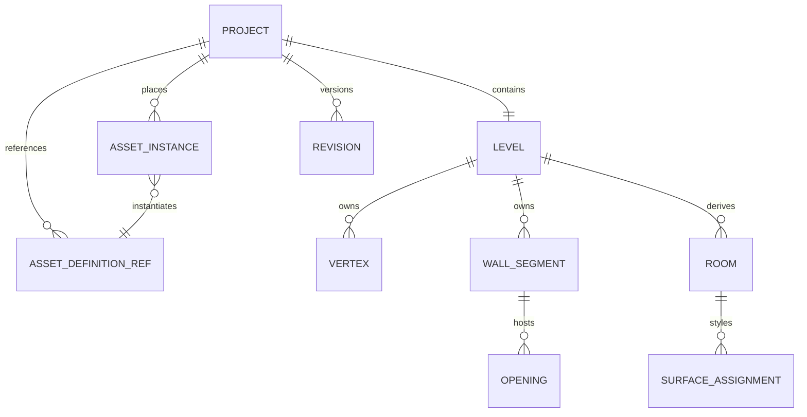
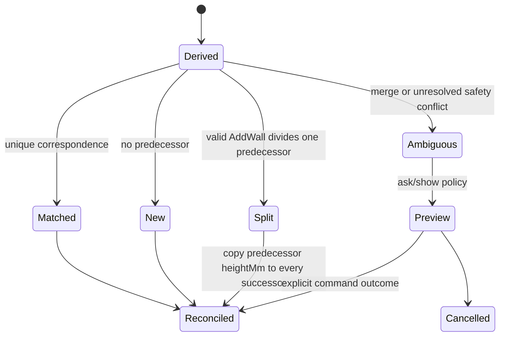

# Доменная модель

Статус: **draft**. Поля описывают смысл, не TypeScript API.

# 1. Aggregate boundaries

`Project` — единственный aggregate root альфы для пользовательской команды.
Asset binary и catalog manifest хранятся отдельно, но ссылки проверяются на
application boundary.



# 2. Entities

## Project

- `ProjectId`
- `schemaVersion`
- `name`
- `level`
- `assetInstances`
- `assetDefinitionRefs`
- `createdAt`, `updatedAt` через ClockPort
- `revisionMetadata`
- `lifecycle: Active`

Инварианты: один Level; уникальные IDs; все ссылки разрешимы или имеют явный
missing state; candidate проходит full-project validation затронутых границ.
Project не имеет recoverable delete state; отдельный confirmed deletion route
не входит в domain undo history и уничтожает Project metadata/owned Revisions.

## Level

- `LevelId`
- `vertices`
- `wallSegments`
- `rooms`
- `openings` могут храниться внутри wall collection в реализации
- default wall/room policies

`Level` не содержит renderer scene и camera.

## Vertex

- `VertexId`
- `xMm`, `zMm`

Identity не меняется при MoveVertex.

## WallSegment

- `WallSegmentId`
- `startVertexId`, `endVertexId`
- `thicknessMm`

Сегмент проходит по центральной reference line стены, толщина распределяется
поровну. Canonical orientation определяется для offset/opening операций
отдельно от порядка визуального обхода. Высота стены не редактируется
независимо: она выводится из соседних Room.

## Room

- `RoomId`
- `faceFingerprint`
- `name`
- `heightMm`

Centerline Face, usable interior polygon, площадь, периметр и adjacency —
производные. `heightMm` — единственный пользовательский источник высоты
помещения и производной высоты стен.

Derived RoomFace имеет ровно один simple outer boundary и ноль или несколько
simple, strictly-contained, non-touching void boundaries. Ring traversal,
usable interior polygon, area, perimeter и fingerprint всегда пересчитываются
из current planar graph; они не хранятся как альтернативный editable state.
Repeated bounded walk, touching/nested ring или non-simple component не даёт
Room/lineage mutation. Repeated exterior dart допускается только в unbounded
embedding и не становится Room face.

## Opening

- `OpeningId`
- `kind: Door | Window`
- `wallSegmentId`
- `offsetMm`, `widthMm`, `heightMm`, `sillMm`

`Door` не содержит `passable`, `locked`, access/key, lock/unlock или
open/close state. Swing/hinge остаётся отдельным невыбранным визуальным
решением Alpha; если оно появится в проекции, оно не может менять каноническую
геометрию или host semantics. Door и Window не создают navigation edge или
transition.

## AssetDefinitionRef

- `AssetDefinitionId`
- `source: CatalogVersion | CustomAssetId`
- semantic dimensions/footprint snapshot version
- content hash и pinned backup-ready resource references

Canonical Project JSON не сериализует весь каталог. Portable Backup отдельно
включает exact referenced catalog/custom resources по backup contract.

CatalogVersion и CustomAssetId проходят единый технический маршрут: проверка
размера, media type и content hash, точное pinning и BackupFeasibilityPolicy
до Durable use. В Alpha не существует состояния или proof route для лицензии,
provenance, AssetUsageGrant либо assetUsageDeclaration; владелец выбирает
бесплатные или созданные им модели за пределами приложения.

## AssetInstance

- `AssetInstanceId`
- `assetDefinitionId`
- `placement`
- `variantSelections`

Scale хранится только по явной resizable policy definition.

`placement` — discriminated union:

```text
FloorPlacement {
  roomId, xMm, zMm, elevationMm, yawStep
}
WallPlacement {
  wallSegmentId, adjacentRoomId | exteriorSide,
  offsetMm, elevationMm, normalOffsetMm, orientation
}
```

FloorPlacement всегда принадлежит конкретной `Room`; её `roomId` должен
разрешаться в совместимый host. Её `xMm`/`zMm` всегда заданы в
канонической integer-mm plan coordinate frame единственного `Level`, а не в
неопределённой локальной frame комнаты; `roomId` — host address, не origin.
Wall side определяется соседней Room, а не нестабильным `left/right`. Topology
Command переносит placement автоматически только по one-to-one compatible
same-root lineage. Для Floor такой transfer
сохраняет exact `xMm`/`zMm` и повторно проверяет placement/collision
compatibility, но никогда не пере-выражает точку в заново derived room frame.
Split/merge, cross-root transfer, incompatible/deleted host или иной ambiguous
rehost дают transient conflict preview с явным выбором rehome/delete/orphan и
fresh base/fence re-entry. Частичное «зависание в воздухе» или silent host move
не commit-ится.

Пол и стены имеют только нейтральную display-проекцию derived Room. У них нет
отдельной persistent сущности, resource reference или reconciliation route;
единственными пользовательскими floor/wall host-объектами остаются размещённые
предметы.

# 3. Value objects

- `LengthMm`, `CoordinateMm`, `AreaMm2`;
- `PlanPoint`;
- `ConstrainedDirection`;
- `WallThickness`;
- `RoomHeight`;
- `OpeningOffset`;
- `Dimensions3dMm`;
- `FootprintPolygon`;
- `RotationStep`;
- `MaterialPresetId`;
- `SurfaceAddress`: `Floor(RoomId) | WallSide(WallSegmentId,
  AdjacentRoomId|ExteriorSide)`;
- `SchemaVersion`;
- `ContentHash`;
- `RevisionId`;
- `ReasonCode`.

AD-21 additionally uses candidate-private `InitialWallLimits`,
`WriterFenceGeneration`, `CancellationGeneration` and `PermitNonce`; they are
immutable branded values and never Project/Revision/Command/Backup fields.

Value object создаётся только после локальной валидации и неизменяем.

# 4. Commands

## Project lifecycle

`CreateProject`, `RenameProject`, `DuplicateProject`, `ImportPortableBackup`,
`DeleteProject`.

Удаление Project является отдельной recoverability policy и не обязано входить
в его undo history.

## Geometry

`AddWallSegment`, `MoveVertex`, `MoveWallSegment`, `DeleteWallSegment`,
`SplitWallSegment`, `AddOpening`, `MoveOpening`, `ResizeOpening`,
`DeleteOpening`, `SetRoomProperties`.

MergeCollinearSegments является explicit topology Command с тем же
allocation/lineage, fence, inverse и corpus obligation, что add/move/delete
and split routes. Он не является silent library cleanup или renderer effect.

### Первый materialized kernel slice

`MaterializeInitialWallSegment` — internal domain route, а не новый public UI
tool и не сокращённый синоним общего `AddWallSegment`. Он принимает только
records below. They are canonical in the domain slice, deeply immutable and
observationally independent: no nested record or collection may alias a mutable
input, port value or returned result.

```text
InitialWallIntent {
  kind: "initial-wall-segment"
  levelId: LevelId
  projectLimits: InitialWallLimits
  projectLimitsPolicyHash: ContentHash
  start: PlanPoint
  end: PlanPoint
  thicknessMm: WallThickness
}

EmptyPlanGraph {
  levelId: LevelId
  projectLimitsPolicyHash: ContentHash
  verticesById: {}
  wallSegmentsById: {}
}

MaterializationPermit {
  projectId: ProjectId
  baseRevisionId: RevisionId
  baseRevisionChecksum: ContentHash
  baseGraphDigest: ContentHash, intentDigest: ContentHash,
  projectLimits: InitialWallLimits,
  projectLimitsPolicyHash: ContentHash,
  writerFenceGeneration: WriterFenceGeneration
  cancellationGeneration: CancellationGeneration
  permitNonce: PermitNonce
}

IdReservationPort.consumeIfCurrent(permit, ["startVertex", "endVertex", "wall"])
  -> Reserved { startVertexId, endVertexId, wallSegmentId, retireUnpublished() -> Retired }
   | Cancelled | StaleBase | LostFence | InitialRouteUnavailable

IdReservationPort may expose an opaque stable `authorityKey`; wrappers over the
same allocation authority carry the same key. A direct unwrapped port instance
is its own authority identity.

MaterializedInitialWall {
  nextPlanGraph: PlanGraph {
    levelId,
    verticesById: {
      startVertexId -> intent.start,
      endVertexId -> intent.end
    },
    wallSegmentsById: {
      wallSegmentId -> { startVertexId, endVertexId, thicknessMm }
    }
  }
  changeSet: InitialWallChangeSet {
    baseGraphDigest: ContentHash, postGraphDigest: ContentHash,
    projectLimitsPolicyHash: ContentHash,
    bindingDigest: ContentHash,
    addedVertexIds: [startVertexId, endVertexId],
    addedWallSegmentId: wallSegmentId,
    roomOpeningHostEffects: []
  }
  allocationIntent: InitialWallAllocationIntent {
    slots: [
      { label: "startVertex", vertexId: startVertexId },
      { label: "endVertex", vertexId: endVertexId },
      { label: "wall", wallSegmentId }
    ]
  }
  inverse: RemoveInitialWall {
    expectedPostGraphDigest: ContentHash,
    wallSegmentId, startVertexId, endVertexId,
    restoresGraphDigest: baseGraphDigest,
    bindingDigest: ContentHash
  }
}
```

`InitialWallLimits` — immutable projection only of the existing source-owned
`ProjectLimitsPolicy`: absolute coordinate hard limit, Vertex/WallSegment hard
counts, minimum/maximum wall length and minimum/maximum wall thickness. It does
not choose or duplicate numeric thresholds. `projectLimitsPolicyHash` is the
IWM-D1 digest of this complete projection, and must match the intent, empty
graph and permit before any permit consumption; missing, unknown or mismatched
snapshot returns private `InitialRouteUnavailable`. `intentDigest` and
`baseGraphDigest` are not caller fields: the materializer derives them from the
complete respective IWM-D1 records before comparing them with the permit.

### IWM-D1 candidate binding bytes

Candidate structural digests — `projectLimitsPolicyHash`, `intentDigest`,
base/post graph digest, ChangeSet and inverse binding — are lowercase SHA-256
over exactly one IWM-D1 UTF-8 ASCII preimage; a caller-supplied candidate digest
is rederived and compared, never trusted. `baseRevisionChecksum` is explicitly
not IWM-D1: it is the prevalidated opaque Durable Revision checksum governed by
AD-3. Each IWM-D1 record begins `IWM-D1|record=<name>|`; fields follow the
record order shown above, separated by `|`. Safe integers use canonical base-10
without `+`, leading zeroes or `-0`; opaque IDs use `<byteLength>:<ASCII-id>`;
and an absent collection is `[]`. `InitialWallIntent` writes level ID, limits
hash, then `start.xMm|start.zMm|end.xMm|end.zMm`, then thickness. `InitialWallLimits` writes
the seven source-owned limits in this exact order: `coordinateAbsHardMm`,
`vertexHardCount`, `wallSegmentHardCount`, `minWallLengthMm`,
`maxWallLengthMm`, `minWallThicknessMm`, `maxWallThicknessMm`. Empty graph
writes level ID, limits hash, then `vertices=[]|wallSegments=[]`; post graph
writes the fixed `startVertex`, `endVertex`, `wall` slots in that order, not map
insertion order. ChangeSet and inverse write their digest/hash fields and the
same fixed ID slots in declaration order. A returned `bindingDigest` is derived
from its complete ChangeSet or inverse preimage and is explicitly excluded from
that same preimage, preventing a self-referential hash. A valid `Reserved` tuple
also carries a port-owned `retireUnpublished()` terminal capability: every
post-reservation failure invokes it before returning no materialization. The
port returns `Retired` only after its authoritative allocation state permanently
rejects that tuple. If the callback rejects or returns anything other than
`Retired`, the materializer applies the bounded authority-level fence before a
later `consumeIfCurrent` call; no wrapper over that same authority can
materialize a later candidate. A confirmed `Retired` needs no
retained local tuple record. This encoding is candidate-only: it
does not replace PPJ-A1 Project serialization or Portable Backup hashing.

Raw lexemes never reach this route: the detached S2-01 ingress seam either
returns an existing stable geometry reject or creates this canonical intent.
The materializer revalidates canonical direction and complete empty-plan
invariants against the immutable `InitialWallLimits` projection whose IWM-D1
hash must match the intent, graph and permit. `MaterializationPermit` is one-shot
and is bound to every identity shown above. `consumeIfCurrent` is its only
linearization point: cancellation
wins, then base/checksum/graph/intent mismatch, then fence mismatch. Only the
remaining current state atomically consumes the permit and reserves all three
slots; refusal retains no slot and retry needs a freshly issued permit.

The reserved tuple must contain correct branded, pairwise distinct IDs. A port
must roll back before an invalid/partial/throwing reply escapes; the materializer
then emits no candidate and empty allocation intent. It validates the complete
next graph/ChangeSet after reservation. Candidate IDs are non-public but stay
exactly the same if a later AD-3 envelope publishes; discarded candidates leave
them unreachable and IDs are never reused. If build/revalidation/freeze/inverse
construction fails after a valid `Reserved` tuple, the tuple is likewise
irrevocably unreachable and the private no-materialization result exposes an
empty allocation intent; no retry through that reservation authority may reuse
it. `RemoveInitialWall` is a session-private, non-serializable capability for
this first route: the materializer issues and retains an opaque provenance
receipt; a deep copy, rehydrated record or reload cannot replay it. Its visible
canonical fields and `bindingDigest` establish integrity, not provenance. With
the issued capability it is pure and allocation-free, applies only to the
matching post-graph digest and exact three IDs, and never means `ResetToEmpty`.

Canonical topology reject, cancel, stale base and lost fence return a
no-materialize outcome с неизменным base и пустым allocation intent.
`EmptyPlanGraph` factory
is the only runtime entry guard: malformed or non-empty state returns private
`InitialRouteUnavailable` before permit consumption; a replayed permit or a
violated port contract is mapped to the same private no-materialization outcome
without any retained slot. It is not persisted and not a stable geometry/UI
reason. Contacts/T/X, face/Room/Opening/host
reconciliation intentionally не входят в его type boundary. Общий
`AddWallSegment` остаётся закрыт до соответствующих TCC-A1 corpus families;
V1/V2, React, storage, publication и renderer не могут стать обходным
implementation path.

## Interior

`PlaceAsset`, `MoveAsset`, `RotateAsset`, `DeleteAsset`,
`SetAssetVariant`, `AssignSurfaceMaterial`, `ClearSurfaceMaterial`.

## Alpha+

`RegisterCustomAssetDefinition` выполняется только после validation result;
`PlaceAsset` затем одинаков для catalog/custom.

# 5. Command envelope

```text
CommandEnvelope
├── commandId
├── projectId
├── baseRevisionId
├── kind + validated payload
├── issuedAt
└── optional gestureCorrelationId
```

Application отклоняет любую stale `baseRevisionId`; auto-rebase в Alpha
запрещён. Silent last-write-wins запрещён даже до появления cloud sync.

До CommandEnvelope существует только ephemeral preflight. PlanProjectionPort
может вернуть selection-unavailable/retry при non-finite или non-invertible
presentation transform; это не INVALID_DIMENSION и не Command result.
Allocation-free discovery может вернуть conflict preview for Room, Opening или
host with a transient choice request. Только confirm rechecks current base
Revision, checksum and writer fence, reruns discovery/validation and then
materializes one complete CommandEnvelope, ChangeSet and inverse. Cancel,
stale base, changed fence или worker cancellation materialize nothing.

Результат:

```text
CommandResult =
  | Validated { candidateRevision, changeSet, inverse, diagnostics }
  | Rejected { reasonCode, field/context, safeSuggestions }
```

`MaterializeInitialWallSegment` is deliberately below this public envelope:
его no-materialize transient не является `CommandResult`, а его accepted
semantic candidate не становится `CommandEnvelope` или `PendingDurability`
без application boundary AD-3.

`Validated` не означает `saved`. Application переводит candidate через
`PendingDurability → Durable | PersistFailed`; только Durable получает
HistoryEntry и становится base следующей mutating Command.

# 6. ChangeSet

Содержит семантические изменения, достаточные для incremental projections:

- added/updated/removed entity IDs;
- topology invalidation scope;
- room reconciliation;
- affected surfaces/assets;
- projection hints, не влияющие на correctness;
- inverse command или immutable previous values.

Renderer не интерпретирует исходный pointer event.

ChangeSet и inverse являются versioned semantic operations over declared
canonical Project records. Pure semantic replay validates addresses, target
uniqueness and forward/inverse determinism, but it receives no resource bytes,
pin roots или publication authority. RevisionCoordinator separately admits
resources/manifests and atomically publishes the replayed candidate. Neither
ChangeSet nor inverse is independently durable.

# 7. Revision и history

Revision — immutable snapshot или логически эквивалентная persistent structure.
History хранит entries текущей активной сессии:

```text
HistoryEntry { label, command, inverse, beforeRevisionId, afterRevisionId }
```

Группировка допустима по одному пользовательскому намерению: непрерывный drag
может иметь много previews, но один history entry. Переключение вида, camera
orbit и открытие sheet в history не входят. Reload/reopen, recovery, migration,
duplicate и backup import начинают новую видимую history boundary; portable
backup не переносит session History. Resource hashes, достижимые из Revision
обеих undo/redo-веток, являются GC roots до сброса boundary. Новая команда
после undo атомарно заменяет redo branch только после Durable publication;
`SessionRetentionPolicy` может отклонить новую команду до mutation, но не
может молча сделать существующий history entry невосстановимым.
Если integrity issue затрагивает только History, `DiscardSessionHistory`
является отдельным явно подтверждённым session action без Project Revision;
до него либо exact repair History остаётся недоступной, но не обрезанной.

Recovery state carries the source ResourceIssue variant and scope for
CurrentProject, SessionHistory or Both. RecoveryChangeSet runs under project
fence and either repairs all unresolved current references into one Durable
Revision or publishes nothing. DiscardSessionHistory first verifies healthy
current resources, atomically removes both session branches, creates a visible
new history boundary and never performs an automatic discard.

# 8. Domain events

Events применяются для наблюдения, не как второй mutation path:

- `ProjectCandidateValidated`;
- `ProjectRevisionBecameDurable` публикуется application layer;
- `PlanTopologyChanged`;
- `RoomsReconciled`;
- `OpeningChanged`;
- `AssetInstanceChanged`;
- `SurfaceMaterialChanged`;
- `ProjectMigrationCompleted`;
- `ProjectRecoveryRequired`;
- `ProjectResourceRecoveryCompleted`;
- `AssetResourceMissing`.

Event содержит IDs/revision и reason, но не GPU/DOM object.

# 9. Room identity state machine



Точный автоматический критерий matching определяется topology spike. Valid
`AddWall` split не имеет metadata recipient: все successor Rooms получают
точный `heightMm` predecessor, а `roomId`, name, type и history не выбираются
по стороне polygon. Нейтральная display-проекция не создаёт room metadata и
потому не зависит от порядка обхода polygon.

Merge, Opening and host reconciliation use the preview/re-entry boundary. A
preview is not Rejected and not a partial candidate: user choice is transient,
and confirm must re-check base/fence before a newly derived complete candidate
may enter validation. The automatic AddWall split itself does not enter that
state.

# 10. Policies

Отдельные pure policies:

- `SnapPolicy`;
- `IntersectionPolicy`;
- `RoomReconciliationPolicy`;
- `OpeningFitPolicy`;
- `DoorAdjacencyPolicy`;
- `PlacementPolicy`;
- `CollisionPolicy`;
- `MaterialApplicabilityPolicy`;
- `ProjectLimitsPolicy`;
- `HistoryGroupingPolicy`;
- `MigrationPolicy`;
- `WallOffsetJoinPolicy`;
- `AnchorRehostPolicy`.

Они конфигурируются versioned product rules, а не произвольными UI flags.

Ephemeral application policies also include PlanProjectionPolicy,
MeasurementRequestPolicy, AllocationLineagePolicy and ConflictReentryPolicy.
They bind request/result shape and evidence to one revision/fence but never add
serialized Project, Command, ChangeSet, History or Backup fields.

# 11. Негативные инварианты

- Project никогда не содержит `THREE.Object3D`, Blob URL или DOM element;
- Room не существует без derived Face;
- usable Room geometry всегда выводится из centerline Face и Wall thickness;
- Wall не содержит конкурирующую с Room пользовательскую высоту;
- Opening не живёт вне WallSegment;
- Door не сериализует и не принимает `passable`, `locked`, access/key,
  lock/unlock или open/close state;
- Door и Window не создают navigation edge или transition;
- Floor/Wall AssetInstance не существует без валидного compatible host
  surface;
- AssetInstance не меняет физические dimensions определению молча;
- unknown material/asset имеет явный missing state;
- новая referenced AssetDefinition не становится Durable без pinned exact
  bytes и успешного BackupFeasibilityPolicy;
- rejected Command не повышает revision;
- validated, но недолговечный candidate не называется committed/saved;
- autosave не сохраняет DraftCommand;
- backup import не меняет существующий Project до полной валидации;
- downgrade renderer quality не меняет сериализованные данные.

- transform/selection failure не использует INVALID_DIMENSION и не становится
  durable diagnostic;
- measurement request/result не является Project, Command, ChangeSet, Revision,
  History или Backup state;
- discovery/preview не аллоцирует durable identity, resource pin или inverse;
- AD-21 `MaterializationPermit` (including nonce/generations), reservation
  ledger, `InitialRouteUnavailable`, internal port-contract fault and
  `InitialWallAllocationIntent` never enter Project, Revision, CommandEnvelope,
  ChangeSet, History, Portable Backup, renderer/query model, logs or diagnostics;
- staging/pin root не является Project/History/Backup field и защищён от GC до
  source-defined terminal lifecycle.

# 12. Test model

Для каждой Command задаются:

- valid example;
- invalid boundary и stable reason code;
- inverse/undo;
- serialization round-trip;
- projection invalidation;
- property-based chain;
- migration fixture при изменении schema.

Модельные factories используют единицы в именах и не создают invalid state по
умолчанию. Golden plans покрывают прямоугольники, диагонали, T/X intersections,
holes, split/merge rooms, проёмы у границы и большое число предметов.
Отдельный schema/command corpus подтверждает отсутствие редактируемого Door
access state и navigation semantics.

Worker job envelope содержит `jobId`, `baseRevisionId`, `kind`, bounded payload
и cancellation token. Result с несовпадающей current Revision всегда
 discard-ится. Controllable scheduler воспроизводит out-of-order, cancel и crash.

D-022 corpus дополнительно покрывает screen/plan edge and inverse transforms,
selection continuity, all paired measurements, multi-component faces/holes,
repeated exterior and invalid bounded walks, conflict confirm/cancel/race,
all topology allocation/lineage routes, nested semantic replay, placement and
surface reconciliation, pin-stage crash/GC lifecycle, and recovery/history
discard root inventories. Каждый vector declares either one complete durable
post-state or no mutation.
