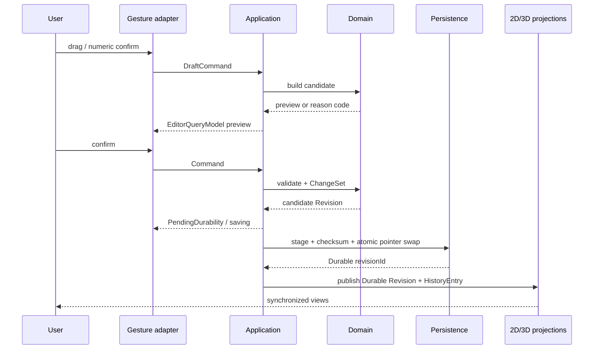

# Solution design

Статус: **draft / до implementation readiness gate**. Архитектурные границы
обязательны, а конкретные библиотеки, лимиты и устройство-floor подтверждаются
spikes.

# 1. Контекст решения

InteriorsEditor — вычислительно насыщенный локальный PWA: сенсорный ввод меняет
топологическую 2D-модель, из которой воспроизводятся 2D/3D, каталог и
навигация. Главные риски — не отрисовать красивый куб, а сохранить одну истину,
не потерять локальные данные и удержать интерактивность на мобильном GPU.

# 2. Контейнеры

| Контейнер | Ответственность | Данные |
|---|---|---|
| UI shell | навигация, режимы, sheets, accessibility | transient UI state |
| Gesture adapter | интерпретирует pointer/touch в DraftCommand/Command | gesture session |
| Application | use cases, CommandBus, RevisionCoordinator, query model | durable Project + pending candidate |
| Geometry domain | topology, rooms, openings, placement policies | integer-mm values |
| 2D projection | viewport, grid, hit-test, annotations | derived draw model |
| 3D projection | meshes, materials, picking, camera, disposal | derived scene |
| Persistence | transactions, migrations, recovery | revisions + metadata |
| Catalog | manifests, technical resource descriptors, asset cache policy | definitions + resources |
| Catalog Control Plane | versioned curated catalog publication only | metadata/resources and hashes; never User Project data |
| Platform/PWA | lifecycle, update, capabilities, file/share | platform state |
| Workers | bounded topology/import work | copied/transferable jobs |
| Diagnostics | timings, reason codes, consent-aware events | non-content telemetry |

# 3. Основной поток изменения



Mutating Commands сериализованы: пока candidate находится в
`PendingDurability`, следующий commit ожидает pointer swap, хотя camera,
просмотр свойств и Draft preview остаются отзывчивыми. Если persist отклонён,
current остаётся последней Durable Revision; candidate не называется
committed/saved, а пользователь получает retry или emergency recovery export.

## D-022 preflight and conflict re-entry

Этот уточнённый путь является authoritative для diagram above. Gesture adapter
asks a fakeable PlanProjectionPort for screen-to-plan conversion. Non-finite,
non-invertible or stale conversion retains the draft in a transient
selection-unavailable/retry state; it is not INVALID_DIMENSION, a rejected
dimension, Command, ChangeSet, Revision or History effect.

Preflight discovery has no identity allocation, inverse, pin or durable
candidate. It can produce a no-selection draft, an ordinary validation reject,
or a Room/Opening/host conflict preview. The conflict preview carries only
transient user choices. On confirm, Application rechecks current base Revision,
checksum and writer fence, reruns discovery and validation, then materializes
exactly one complete Command, ChangeSet and inverse. Cancel, stale base,
fence loss, changed discovery result or cancelled worker materialize nothing.
Semantic replay is pure after the application has supplied an authorized inverse
capability; the AD-21 initial-route `RemoveInitialWall` receipt is session-private
and cannot be reconstructed from copied canonical bytes. Resource admission,
staging and pointer publication belong only to RevisionCoordinator. A
ChangeSet/inverse is never independently durable.

# 4. Renderer decision

## Кандидат A: Three.js + React Three Fiber

Плюсы: широкий ecosystem, прямой контроль Three.js, удобная React-композиция,
богатые helpers, много примеров glTF. Риск: чрезмерная реактивность и
непреднамеренное смешение domain с scene component tree.

## Кандидат B: Babylon.js

Плюсы: интегрированный engine/tooling, loader и scene lifecycle. Риск:
больший framework surface и возможная цена bundle/control для узкого editor.

## Lifecycle boundary

Renderer получает только disposable projection canonical Revision. Unsupported
WebGL2, context loss, dispose/open и recreate не меняют Project, Draft,
PendingDurability, History, writer fence или recovery state. После одной
recreate attempt из current canonical projection повторная неудача переводит
renderer в low-quality tier, а следующая — в доступный 2D fallback. Diagnostics
содержат только backend/probe, lifecycle outcome, ordinal loss,
quality/fallback tier и stable reason code; они не содержат Project geometry,
asset bytes, file paths или user names.

Camera и cutaway transient: `Авто cutaway` меняет только camera-relative
visibility exterior Wall, `Показать все стены` её отменяет. Neither camera nor
cutaway state is persisted. Mutating touch, numeric и list alternative передают
одно semantic intent в общий preflight; camera/orbit/pinch/cutaway и
reduced-motion animation остаются transient UX-owned behavior.

## Spike protocol

Оба варианта строят RS-1 и RS-2 из одного JSON snapshot через одинаковый
`SceneProjectionPort`. Сравниваются:

- WebGL2 compatibility на floor devices;
- startup/bundle chunks;
- frame-time distribution при orbit, select, move;
- incremental rebuild walls/openings;
- picking и touch;
- texture/catalog lifecycle;
- init → forced context loss → dispose → recreate/open и repeated-loss fallback;
- on-demand rendering;
- camera-sector/cutaway fixtures;
- testability и отсутствие engine types в domain/persistence.

Forced-loss vector feature-detects `WEBGL_lose_context`. If it is unavailable,
controlled lifecycle injection is recorded as `injection-unavailable`, not as
loss/recovery evidence. Restore classification waits for asynchronous actual
`webglcontextrestored` and recreate/dispose health, separate from unsupported
WebGL2 and real-device observation. Every vector has bounded timeout/cancel;
absent loss/restored events close as a non-project `no-event` lifecycle outcome,
not recreate health or device evidence.

Renderer остаётся unselected до equivalent versioned corpus и independent
review. Playwright/simulation являются prerequisite browser evidence и не
заменяют physical NFR-15 или participant evidence. Популярность библиотеки не
является exit criterion.

# 5. Geometry decision

Domain-owned constrained PlanGraph kernel является единственным authority для
integer-mm ingress, 0°/45° directions, exact contacts, derived
faces/usable geometry, Room/Opening lineage, allocation intent/inverse и
application-facing stable reason outcomes. `BigInt`, rational predicates/
intersections и `2×mm` intermediates допустимы только ephemeral; они не входят
в Project, Revision, History, Command payload или Portable Backup. Geometry и
Project/Backup companions сохраняют ownership exact offset/join, raw grammar и
reason-union semantics.

Вычислительная библиотека, если понадобится, — immutable test-only
oracle/fixture adapter для differential corpus, а не canonical kernel. Ей
запрещены ID allocation, Command/publication path, reason-code authority и
canonical mutation. V1/V2 остаются characterization fixtures, не подлежат
silent reinterpretation или promotion. Нельзя делегировать библиотеке:

- продуктовые направления/snapping;
- смысл split/merge;
- identity комнаты;
- политику проёмов;
- правило вывода межкомнатного перехода из валидной Door;
- границу Command;
- единицы сериализации.

Spike исполняет versioned golden corpus до editor UI. Если test-only oracle
uses float, его input/output сравниваются с canonical domain result без
normalization, rounding или mutation canonical state; divergence остаётся
evidence finding, а не library default.

## AD-21 initial materialization boundary

Первый executable domain slice не подключает текущий editor к новой topology
модели. Its exact records live in the Domain Model: canonical `InitialWallIntent`
contains Level, source-owned `InitialWallLimits` snapshot/hash, endpoints and
thickness; `EmptyPlanGraph` is a matching empty topology whose digest is derived
under IWM-D1; and the permit carries the same immutable limits snapshot.
Missing/unknown/identity-mismatched snapshot returns private
`InitialRouteUnavailable` before permit consumption; otherwise the kernel applies that exact policy projection to input
wall and resulting counts without choosing numeric limits or stable reasons.
IWM-D1 fixes every candidate-only structural record's UTF-8 preimage and
SHA-256 `ContentHash`, so intent/limits/graph/ChangeSet/inverse hashes are
rederived, not caller authority; the prevalidated AD-3 Durable
`baseRevisionChecksum` remains outside IWM-D1. `MaterializedInitialWall` fixes the resulting graph,
ordered allocation intent, ChangeSet and digest-guarded inverse. Raw bytes and
lexemes never cross this boundary: the existing detached ingress seam either
rejects them with its source-owned reason or produces the canonical intent.

`MaterializationPermit` is immutable, one-shot and binds Project, base revision/
checksum/graph digest, intent digest, writer-fence and cancellation generations.
`IdReservationPort.consumeIfCurrent` is the single linearization point: cancel,
then stale base/checksum/graph/intent, then lost fence win; only otherwise it
atomically consumes the permit and reserves a valid pairwise-distinct
`startVertexId`, `endVertexId`, `wallSegmentId` tuple. A refusal, replayed permit
or invalid/throwing port reply returns no candidate and no retained reservation.
The kernel deep-freezes a revalidated next graph/ChangeSet and its fixed ordered
allocation intent, plus an inverse that may remove only that exact wall and pair
of vertices at its expected post digest.

The reservation itself has no Project, Revision, History, resource-root or
publication effect. A later AD-3 envelope retains exactly the same candidate
IDs; a post-reservation construction failure leaves them irrevocably unreachable
and its private no-materialization result exposes no allocation intent.
`EmptyPlanGraph` factory is the sole runtime guard; malformed/non-empty state reports private
`InitialRouteUnavailable` before permit use, not a public geometry reason.
Contacts/T/X, faces, Room/Opening/host reconciliation and durable publication
remain outside this route; the general `AddWallSegment` cannot be wired until
their named TCC-A1 corpus families prove it. The route has no V1/V2, React,
renderer, persistence or publication dependency.

## D-022 derived geometry, allocation and metrics

The domain derives each Room from one simple outer boundary plus zero or more
strictly-contained, non-touching void boundaries. Usable geometry, area,
perimeter and fingerprint are disposable outputs of that face; repeated
bounded walks, touching/nested rings and non-simple components do not publish
partial Room state. Repeated darts of the unbounded exterior remain embedding
data and not a Room identity shortcut.

An allocation/lineage intent is transient and carries project, base revision
and checksum, observed writer fence and cancellation identity. It covers every
topology-changing route: add/move/delete/split/merge, shared Vertex contacts,
Wall children, Room lineage, Openings, placements and their inverses. It is
consumed only after preflight re-entry. IdPort allocation, resource pin and
complete candidate materialization happen together after that check, never
during discovery.

MeasurementRequest is also transient and bound to one revision/checksum. It
expresses a named operation over typed one/two targets: plan point/Vertex,
Wall centerline, Room inner boundary or Item footprint boundary. Exact
boundary-locator, tie and nearest semantics remain source-owned, while stale
result means visible reselection/retry. A single MeasurementFormatPolicy owns
the same text in preview, 2D, 3D and export.

## Opening projection

После каждой кандидатной topology/opening команды путь один:

```text
validated Plan + Opening
→ derived Faces
→ reconciled Rooms
→ validated wall-hosted Door or Window projection
```

Door и Window не создают отдельный navigation graph или transition. В Alpha
нет `passable`, `locked`, access/key, lock/unlock или open/close field,
команды, API и UI; swing/hinge остаётся отдельным невыбранным визуальным
дизайном и не может влиять на каноническую геометрию или host semantics.

# 6. State model

State разделён:

- `DurableProjectState` — current сериализуемая canonical Revision;
- `PendingDurabilityState` — один проверенный candidate поверх current;
- `HistoryState` — session undo/redo envelopes;
- `DraftState` — текущий gesture candidate;
- `ProjectionState` — кэши 2D/3D, пересоздаваемые по revision;
- `EditorQueryModel` — единая semantic projection для canvas и DOM inspector;
- `UiState` — sheets, selection, onboarding, viewport;
- `PlatformState` — online, installability, storage, update, GPU.

Zustand допустим для UI/application orchestration, но не превращает store
setters в альтернативный mutation path.

History Alpha живёт в активной сессии. Обычный reload/reopen, recovery,
migration, duplicate и backup import начинают видимую новую границу history;
portable backup не содержит undo/redo. Последняя Durable Revision и отдельная
recovery revision хранятся независимо от session history. Пока History
активна, GC roots включают resource hashes обеих undo/redo-веток; их
объединение с current ограничивает `SessionRetentionPolicy`. Отброшенная
redo-ветка освобождается только после Durable publication заменившей её
команды.

D-022 adds only transient states beside this durable model:
SelectionUnavailable, PreflightDiscovery, ConflictPreview and
AwaitingUserOutcome. They retain intent/context for the current session but
cannot contain a durable Command, ChangeSet, inverse, allocation, resource pin
or history entry. PendingDurability exists only after refreshed complete
validation. ResourceRecoveryRequired carries source-owned ResourceIssue scope;
history-only repair or explicit DiscardSessionHistory is not ordinary command
undo/redo.

# 7. Persistence

Предлагаемая логическая схема:

```text
projects          projectId → metadata + currentRevisionId
revisions         revisionId → projectId + schemaVersion + canonical snapshot/checksum
recoveryJournal   projectId → pending transaction marker
writerLeases      projectId → fencingToken + contextId + expiry
assetDefinitions  assetId → semantic metadata + blob hash
assetBlobs        hash → locator + bytes metadata + lifecycle/tombstone
catalogManifests  version → verified manifest
settings          key → local preferences/consents
```

Every pointer, Revision, writer fence, root/lease and recovery record binds a
`projectId`. Fenced logical publication covers the verified candidate revision,
current-pointer swap, History-root transition, newly pinned/staging root and
its release eligibility. A stale/lost fence must leave no new Durable Revision,
pointer, History/root transition or publish-visible resource. If a future
physical substrate spans non-transactional stores, a recoverable journal/
reconciliation resolves startup to exactly `published` or `no-publish` before
GC or new writes.

`ProjectRepositoryPort` and `AssetBlobStorePort` stay substrate-neutral:
IndexedDB Blob, OPFS and a bounded hybrid are compared by physical
Safari/Home-Screen/Android lifecycle and quota corpus. Service-worker Cache
Storage stores deployable shell/catalog resources but is never the sole store
of a user Project.

Recovery protocol:

1. записать staging revision/checksum;
2. проверить deserialize + invariants;
3. атомарно сменить `currentRevisionId`;
4. очистить journal;
5. сохранить одну предыдущую recovery revision по versioned policy;
6. удалить только revisions, недостижимые из current/recovery/staging и обеих
   веток активной session History.

Одновременно пишет только context с актуальным fencing token. Второй browser
tab или standalone instance получает read-only state и может сделать явный
takeover; stale command отклоняется `PROJECT_WRITE_LOCK_LOST`. Web Locks может
быть оптимизацией, но correctness обеспечивается persisted lease/fencing.

Project deletion требует явного подтверждения и в fenced metadata transaction
удаляет Project pointer с owned Revisions; промежуточного lifecycle или
восстановления удаления нет. Blob GC
идемпотентен и удаляет
только resource, недостижимый из current/recovery/import staging,
custom AssetDefinition и обеих веток активной session History. Catalog
definitions без Project/custom/history reference не превращают browse cache в
пользовательский pin.

# 8. Web PWA deployment и Catalog Control Plane perimeter

Web PWA deployable как статический versioned build за HTTPS:

- immutable hashed JS/worker/assets;
- коротко кэшируемый manifest/entry;
- versioned ReleaseManifest и startup compatibility handshake;
- service worker с explicit reload UX, но без предположения, что waiting можно
  удержать после закрытия clients;
- CSP разрешает только declared web, asset и Catalog Control Plane origins;
- catalog publication несёт version/hash, а конкретные build/delivery
  steps остаются решением control-plane operations;
- local Project core не имеет required remote-service dependency: Catalog
  Control Plane AD-17 нужен только для browse/search или download ещё не
  pinned curated resource и не получает User Project, Revision, session
  History, Portable Backup или user-owned pinned bytes.

`CatalogGatewayPort` allows only versioned catalog identifiers,
descriptors/resource bytes, hashes and
typed availability, cancellation or failure outcomes. It does not carry
Project, Revision, History, Backup, account or user-pinned-blob data; local
adapter alone validates, pins, backs up and publishes. A catalog-only
contract/negative corpus must prove prohibited data cannot enter endpoint,
migration, PostgreSQL row, audit log or delivery cache. API/transport, physical
delivery, Kotlin build/test, PostgreSQL operations, publisher/operator auth and
Security/Operations assignments remain separate
`G-CP-ADR` decisions.

Offline boundary честная: app shell и уже materialized ресурсы работают;
никогда не загруженный предмет может показывать placeholder и просить сеть.
Недоступный Catalog Control Plane создаёт только
`control-plane-unavailable`/`unpinned-download-unavailable`; healthy Project
не становится read-only и не входит в `ResourceRecoveryRequired`.

Catalog Control Plane реализуется Kotlin/PostgreSQL по AD-17, но API/transport,
physical resource distribution, publisher/operator authentication, web
framework/build, hosting/topology, database operation/backup, SLA, telemetry и
retention не выбраны этим companion.

ReleaseManifest содержит `appBuildId`, service-worker/worker protocol,
readable Project schema range, writable schema, catalog/asset schema и minimum
capabilities. Promotion идёт `development → device-lab → invited-alpha`;
previous immutable build сохраняется на период rollback. Migration
copy-on-write и startup recovery должны работать даже при автоматической
activation worker после закрытия всех clients.

На iOS browser tab и Home Screen Web App рассматриваются как разные local-data
contexts. Install-help предлагается до первого Project. Если Project уже создан
в Safari, handoff выполняется portable backup/export → import; автоматическое
появление данных после Add to Home Screen не обещается.

# 9. Catalog pipeline

Источник → semantic metadata → geometry/texture
optimization → thumbnail → validation → versioned publication → distribution
(deferred) → local cache tier.

Build-time checks:

- физические размеры и units;
- bounding box/footprint/anchor;
- triangle/material/texture budgets;
- no external URI;
- naming/category/a11y label;
- complete self-contained resource set and technical media metadata;
- deterministic hash;
- renderer smoke test и disposal.

Количество предметов не заменяет покрытие задач. Alpha catalog matrix строится
от UJ-3: сидение, сон, хранение, стол, сантехника, кухня, крупная техника,
электроника, свет/декор, ковёр/зеркало/растение.

Runtime resource имеет состояния `metadata-ready`, `loading`,
`offline-ready/backup-ready`, `missing`, `stale`, `failed`. Metadata достаточно
для карточки и placement preview, но не для Durable AssetInstance: exact
binary/texture сначала pin-ятся в user-owned blob store, затем проходят
BackupFeasibilityPolicy. Backup не полагается на browse cache и включает exact
referenced resources по self-contained contract.

`control-plane-unavailable` и `unpinned-download-unavailable` — отдельные
неблокирующие catalog states, а не состояния самого Project. Они допускают
retry/cancel preview, но не создают Durable AssetInstance, не делают healthy
Project read-only и не заменяют integrity recovery.

Missing/corrupt referenced hash переводит весь Project из `Healthy` в
read-only `ResourceRecoveryRequired`. Blob можно восстановить из другого
локального hash-root, выбранного complete backup либо exact catalog version с
проверкой hash. Альтернатива — один staged `RecoveryChangeSet`, удаляющий или
заменяющий **все** unresolved references. Частичный repair не создаёт Durable
Revision; обычное редактирование и Portable Backup возвращаются только после
полной проверки manifest/envelope и новой видимой history boundary.
Если issue существует только в undo/redo resource manifest, current Project
не переписывается: пользователь восстанавливает exact bytes либо явно
подтверждает `DiscardSessionHistory`; cancel сохраняет обе ветки.

## D-022 pin staging and fenced recovery

When a candidate first references new bytes, Persistence atomically creates a
repository-local staging/pin-lease root with those exact bytes. The root is a
GC root until it is promoted to a published revision manifest or released by
reject, cancel, fence loss or deterministic crash recovery. It is neither
Project JSON nor History/Backup data. RevisionCoordinator verifies the same
base/fence before resource admission, after pinning and immediately before
pointer swap; any failed boundary leaves current Revision and both history
branches unchanged.

Resource recovery is a separately fenced route. A complete RecoveryChangeSet
repairs every unresolved current reference and publishes one Durable Revision,
or publishes none. Before DiscardSessionHistory, Persistence verifies that
current resources are healthy; after explicit confirmation it atomically drops
both history branches, releases only their roots and emits a visible new
history boundary without a Project Revision. Cancel preserves all roots and
history.

# 10. Security и privacy

Threat surface:

- malformed project backup;
- GLB decompression/decoded memory bomb;
- external URI и unexpected fetch;
- XSS через filenames/metadata;
- storage corruption/schema mismatch;
- telemetry leakage;
- stale service worker/runtime mismatch.

Controls: schema validation, stable allowlists, size/decode limits, worker
timeouts, CSP, text escaping, staging import, checksums, safe logging, consent,
resource disposal и recoverable update.

Portable Backup имеет отдельный обязательный contract: container bytes,
unpacked bytes, entry/entity counts, checksums, staging namespace, progress,
cancel и stable errors. «Backup» означает self-contained bundle с exact
referenced catalog/custom resources; неполный semantic export называется иначе.

GLB byte-level preflight выполняется до loader/decoder и запрещает любой
external/data URI. Resource resolver deny-all; decoder JS/WASM pinned и
локальный. Worker можно terminate для cancel, но он не даёт hard memory quota,
поэтому byte/declared/decode stages и hostile corpus являются обязательными.

# 11. Failure matrix

| Failure | Сохраняем | Пользовательский выход |
|---|---|---|
| Offline | Project/revision, cached assets | продолжить, missing assets placeholder |
| Quota exceeded | последняя readable revision | очистить cache, backup, retry |
| Failed migration | исходные bytes | read-only/export/rollback |
| WebGL context lost | canonical model | one recreate → low quality → 2D fallback on repeated failure |
| Catalog asset 404 | instance metadata | placeholder, retry |
| Invalid command | прежняя revision | reason + edit/cancel |
| Worker crash | прежняя revision | restart/cancel |
| Update mismatch | durable data + compatible artifact | startup handshake, migrate/read-only/rollback |
| Corrupt backup | существующие проекты | reject staging import |
| Second writer | durable project | read-only, explicit takeover/conflict copy |
| Browser → iOS Home Screen | оба local contexts раздельны | export/import handoff |
| Origin storage evicted | только внешняя backup | clean-context restore; гарантия не завышается |

# 12. Quality architecture

- pure domain tests и property testing;
- golden topology/import corpora;
- contract tests для каждого port/adaptor;
- migration fixtures от каждой schema version;
- Playwright browser matrix для gestures, PWA, offline и recovery;
- real-device performance sessions по RS-1/RS-2;
- accessibility automation + manual screen-reader/touch review;
- asset pipeline gates на каждый catalog manifest;
- production-like fault injection: context loss, quota, worker abort, update.
- architecture dependency test: forbidden import fixtures должны падать;
- deterministic worker scheduler tests: stale/cancel/out-of-order results;
- single-writer/multi-context browser tests;
- clean-profile self-contained backup restore without network.
- topology corpus: валидные Door/Window wall-host rules, отсутствие
  редактируемого Door access state и navigation semantics.

## D-022 owner and corpus register

| Package | Architecture artifact | Canonical source owner and workflow | Corpus / adoption exit |
| --- | --- | --- | --- |
| D22-01 projection/job | Spine AD-7/AD-12; solution sections 3 and 5 | Geometry Contract sections 4/11, PRD FR-7/FR-8/FR-12, Experience sections 5.1.1/5.1.2; bmad-spec, bmad-prd, bmad-ux | transform edges, ties, C1-C4, stale/cancel and DOM/canvas parity |
| D22-02 faces | Spine AD-1/AD-7; domain model sections 2/9/12 | Geometry Contract sections 2/3/7/12, PRD FR-14/FR-15, Experience section 14; bmad-spec, bmad-prd, bmad-ux | holes, exterior articulation, repeated bounded walk, offset/collapse |
| D22-03 measurement | Spine AD-7/AD-12; domain model sections 3/10/12 | Geometry Contract sections 1/7/12, PRD FR-13, Experience sections 5.1.1/5.1.2; bmad-spec, bmad-prd, bmad-ux | paired target, ties, stale result and common formatted output |
| D22-04 preview/re-entry | Spine AD-3/AD-7; domain model sections 5/9 | PRD FR-11/FR-15/FR-19/FR-28, Experience sections 5.1.2 and UXF-1/UXF-3; bmad-prd, bmad-ux | cancel/confirm/base and fence race, no partial inventory |
| D22-05 allocation/lineage | Spine AD-3/AD-7/AD-12; domain model sections 5/6/12 | Geometry Contract sections 5/6/10/12 and source command/inverse model; bmad-spec | all command kinds, shared vertex, retries, stale intent and inverse |
| D22-06 replay/publication | Spine AD-3/AD-4; domain model sections 5/6/7 | Project/Backup sections 1/7 and source persistence grammar; bmad-spec | nested addresses, duplicate target and stage/pointer fault injection |
| D22-07 placements/surfaces | Spine AD-8; domain model sections 2/3/10 | Geometry Contract sections 8/9, PRD FR-28/FR-34–FR-35, FR-37, Experience UXF-3/UXF-4; bmad-spec, bmad-prd, bmad-ux | floor/wall sides, cross-root compatible/incompatible rehost |
| D22-08 pin lifecycle | Spine AD-4/AD-14; solution persistence section | Project/Backup sections 1/6/7, Asset Import sections 6/8/9, PRD FR-28/FR-37; bmad-spec, bmad-prd | crash/GC and redo-root inventory |
| D22-09 recovery/history | Spine AD-4; domain model section 7 | Project/Backup sections 6/7 and Experience UXF-5; bmad-spec, bmad-ux | each ResourceIssue scope, repair/cancel and history discard |
| D22-10 ownership | Spine AD-19 and this register | exact rows above with the named source workflow | trace from capability/requirement/AD to corpus vector and independent re-review |

No architecture row substitutes for the named source owner. Canonical source
adoption and versioned corpus evidence precede implementation and a favorable
readiness re-review.

# 13. Архитектурные spikes до feature work

| Spike | Вопрос | Артефакт выхода | Разблокирует |
|---|---|---|---|
| S-1 Renderer | R3F/Three или Babylon проходит одинаковый lifecycle/comparator corpus? | versioned comparator corpus + independent review record; no device claim | CAP-5/6/11 |
| S-2 Topology | как domain-owned kernel детерминированно ведёт graph/rooms и Door adjacency? | versioned kernel corpus + test-only oracle report; no library promotion | CAP-2/3/4 |
| S-3 Storage/PWA | как fenced publication/recovery работает на local contexts? | fault/root corpus + physical lifecycle/quota/handoff traces | CAP-1/9/10 |
| S-4 Touch | какой gesture contract минимизирует ошибки? | tested interaction prototype | CAP-2/6 |
| S-5 GLB | безопасные limits и decoder path? | hostile corpus + measurements | CAP-12 |
| S-6 Asset pipeline | какой budget/cache tier нужен каталогу? | versioned sample manifest + device traces | CAP-6/7/9/11 |

Spikes time-boxed и не становятся скрытым production foundation без тестов,
решения и удаления исследовательских обходов.

# 14. Архитектурная граница альфы

Alpha включает S-1–S-4, S-6 и CAP-1–CAP-11. S-5/CAP-12 идёт параллельно только
если не отнимает evidence у базового планировщика. Remote Project service,
account identity и cloud sync не создаются «на будущее»: единственный running
service Alpha — AD-17 Catalog Control Plane для curated catalog. Он
не хранит User Project, Revision, session History, Portable Backup или
user-owned pinned resources. Между local contexts перенос остаётся через
Portable Backup; future user-data service потребует отдельного решения.
