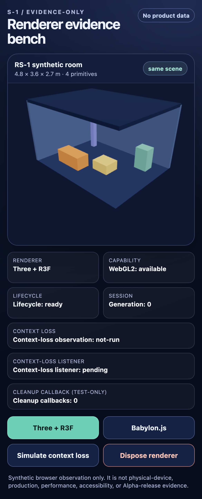
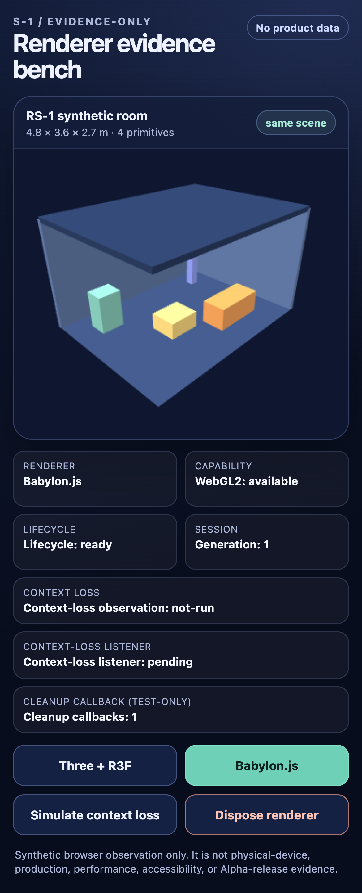
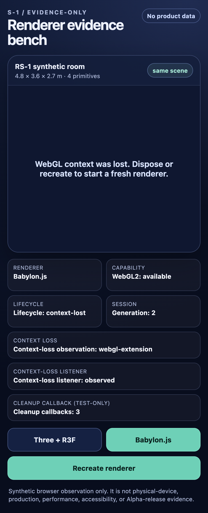

# S-1 — renderer and WebGL2 lifecycle evidence

## Terminal disposition

**Terminal disposition: `PAUSED`.** The amended independent review accepts the
three bounded remediations; its record is
[S-1-amended-independent-review-2026-08-05.md](S-1-amended-independent-review-2026-08-05.md).
The isolated prototype proves a narrowly controlled browser observation, not a
renderer choice or product capability. No ADR is proposed and no `V-*` slice is
opened.

The physical-device and NFR-15 conditions that would be needed for a stronger
conclusion remain absent. In particular, this report must not be read as
evidence of iPhone Safari, Android/Samsung Chrome, Home Screen PWA,
performance, thermals, memory behaviour, accessibility, or Alpha readiness.

## Question and strict boundary

Under waiver `W-SPK-2026-08-04`, the experiment compares **Three.js + React
Three Fiber** and **Babylon.js** on exactly one literal synthetic scene:
`RS-1`, a `4.8 × 3.6 × 2.7 m` room with four coloured primitive boxes. It
observes a WebGL2 probe, a controlled context-loss event, explicit disposal,
and recreation as a new renderer generation.

All implementation, manifests, lockfile, dependencies, tests and transient
artifacts remain under the permitted prototype root
`_bmad-output/implementation-artifacts/spikes/W-SPK-2026-08-04/S-1/`; retained
evidence is only in this matching `evidence/spikes/S-1/` root. The source uses
literal geometry and primitive meshes. A source scan found no `fetch`, XHR,
source-level WebSocket API, external HTTP URL, GLB/GLTF, texture loader or
user/catalog input. The trace does include the local Vite dev-server/HMR
loopback traffic required for this test; there is no remote endpoint or network
publication. No production source, root manifest/configuration, real Project
content, asset, telemetry, commit or deployment was created.

## TDD and final automated evidence

| Layer | Final result |
| --- | --- |
| Type check | `npm run typecheck` — **PASS** (`tsc --noEmit`). |
| RED → GREEN S1-R1/R2 remediation | The strengthened test first timed out waiting for non-existent `cleanup-callback-count`. The smallest matching implementation adds a monotonic **test-only** count that is incremented only by the renderer `onDisposed` callback; no manual action writes it. |
| Unit lifecycle contract | `npm run test:coverage` — **5/5 PASS**; `src/lifecycle.ts` has **100%** statements, branches, functions and lines. |
| Mutation | `npm run mutation` — **36/36 killed**, 0 survived, 0 timeout, 0 no coverage, 0 errors; **100%** score. Its intentional scope is only the pure `src/lifecycle.ts` reducer. |
| Mobile browser flow | `npm run test:e2e` — **1/1 PASS**. It waits for R3F and then the actual labelled Babylon canvas plus `Lifecycle: ready` / `WebGL2: available` before the retained Babylon capture; it separately proves ready → explicit Dispose callback delta + canvas removal, then recreate generation 2, then `WEBGL_lose_context` → listener + cleanup-callback delta + canvas removal, then direct recreate generation 3 + a new visible Babylon canvas. |
| Build | `npm run build` — **PASS**. |
| Production dependency audit | `npm audit --omit=dev --json` — **0 vulnerabilities**. |

The browser flow is deliberately an experiment, not production E2E coverage.
It uses a locally started loopback Vite server and records a Playwright trace.
The earlier broad `Fallow` zero-findings statement has been removed: it was
neither version-pinned nor restricted away from generated Playwright-report
files, so it is not retained as S-1 evidence and is not a replay condition.

## Post-review remediation

- **S1-R1 — remediated for amended review.** The browser test now waits for
  `canvas[aria-label="Babylon.js synthetic RS-1 scene"]`, `Lifecycle: ready`
  and `WebGL2: available` before creating the retained Babylon PNG. The
  replacement PNG and trace have new hashes below.
- **S1-R2 — remediated for amended review.** The former manual
  `disposeObserved` flag was removed. `Cleanup callbacks: N` is a test-only,
  monotonically increasing observable written only from `onDisposed`. The
  retained flow compares a baseline with the callback deltas for both
  ready-state explicit Dispose and context loss, asserting canvas absence after
  each, then direct recreation with a visible new canvas/generation.
- **S1-R3 — remediated for amended review.** The unpinned broad Fallow
  assertion and replay command were removed rather than treated as evidence.
  This makes no static-health conclusion for S-1.

## Browser/device context and observed result

The final trace used Playwright's `iPhone 13` device descriptor with a
`390 × 664` CSS-px visual viewport, DPR 3, mobile/touch emulation, but launched
the installed **Google Chrome Chromium binary** on the host with
`--use-angle=swiftshader`. It is therefore accurately described as **Chromium
iPhone-13 emulation**, not an iPhone, not iOS Safari, and not a physical GPU.
The iPhone-like user agent supplied by the device descriptor does not change
that fact.

In that context both candidates rendered RS-1 and reported `WebGL2: available`.
The retained Babylon capture is taken only after its real canvas with
`aria-label="Babylon.js synthetic RS-1 scene"` is visible and the status is
ready. The test-only `Cleanup callbacks: N` observable is incremented **only**
by a renderer cleanup callback. It first records a ready → explicit Dispose
callback increment and canvas removal, recreates generation 2, then calls
`WEBGL_lose_context`, observes the canvas `webglcontextlost` listener, records
another cleanup-callback increment and canvas removal, and directly recreates
generation 3 with a new visible Babylon canvas. This demonstrates only a
controlled event/listener/dispose path; it does **not** demonstrate browser
restoration, leak freedom, memory release, or real-device resilience.

The visible checkpoints are genuine Playwright captures of that synthetic
context:







## Build observation — not a performance verdict

The final Vite build dynamically split the two candidates. Its initial
application chunk was **201.65 kB** minified / **63.23 kB** gzip; the lazily
loaded R3F candidate was **894.73 kB** / **241.18 kB** gzip and Babylon was
**1,069.99 kB** / **256.40 kB** gzip. Vite emitted its expected warning for
candidate chunks over 500 kB.

This is a useful warning for a future renderer decision, not a transfer-size,
startup, FPS, frame-pacing, thermal or mobile budget result. Both candidates
must not become initial-load dependencies in a future product merely because
they render in this disposable experiment.

## Retained evidence and integrity

| Artifact | SHA-256 |
| --- | --- |
| `S-1-iphone13-chromium-r3f.png` | `8b64d40e2975e7a8d293af3fbec94421341368c9dbe7d2df7b240e94642e8f21` |
| `S-1-iphone13-chromium-babylon.png` | `14a18060ad399617ec0fda5dbadad272c26a053556a41f53163d3587c62d66c6` |
| `S-1-iphone13-chromium-context-lost.png` | `704e398edc9fe33b85505c599462c8952fabc33960e20545dbe5c8cdfad638a2` |
| `raw/S-1-iphone13-chromium-playwright-trace.zip` | `400e073ac9b0def6ab3d8c3203bac1b5ae52fbba70f40c9d9aae5f652c876efb` |
| `raw/S-1-mutation.json` | `aa0801c0bb01162647cedc04c26d53f3742e22cfc445f32264c328b14b4904f1` |
| `raw/S-1-coverage-summary.json` | `5935c9e2d792bf9e4fc8e7f2054d8b59e24f79417401c9cb91f35f1a19ffad82` |
| `raw/S-1-package-lock-2026-08-05.json` | `a67904c4b071f153fc1f979e86a0bef950dc96b1f494c16c50c77552383b630e` |

Runtime: Node `v22.8.0`, npm `10.8.2`, React `19.2.8`, Three `0.185.1`, R3F
`9.7.0`, Babylon `9.19.1`, Vite `6.2.0`, Vitest `3.2.4`, Playwright `1.62.1`,
Stryker `9.6.1`, TypeScript `5.9.3`. Inputs are the literal RS-1 values above;
there are no asset bytes or personal/project data to retain.

## Replay instructions for independent review

Run only from the permitted prototype root:

```sh
cd _bmad-output/implementation-artifacts/spikes/W-SPK-2026-08-04/S-1
npm ci
npm run typecheck
npm run build
npm run test:coverage
npm run mutation
npm run test:e2e
npm audit --omit=dev --json
```

The reviewer should inspect the source boundary, replay the post-remediation
browser trace, match the replacement SHA-256 values above, and verify that the
final run uses the same Chromium-with-iPhone-descriptor context. It must confirm
S1-R1's ready Babylon capture and S1-R2's callback-only deltas; the independent
reviewer must not edit this prototype while reviewing it.

## What remains unproven and blocks any `PASS`

- A comparative renderer decision or an architecture ADR.
- Direct recordings on physical recent iPhone Safari tab + Home Screen and
  recent Samsung/Android Chrome tab + installed PWA, including the required
  NFR-15 contexts.
- Measured cold/warm load, frame time/FPS, input latency, GPU memory, context
  restoration, long-session stability, thermal/battery impact, accessibility or
  fullscreen behaviour.
- Product geometry/domain integrity, persistence, local-first recovery,
  catalog asset policy, Kotlin/PostgreSQL backend or any product feature.
- `G-1`, `G-READY`, production delivery, or Alpha release readiness.

The amended independent reviewer accepted S1-R1/S1-R2/S1-R3. Physical NFR-15
evidence remains absent, so the terminal state is `PAUSED`, not `PASS`. Under
waiver §5 the disposable prototype root was removed from the workspace on
2026-08-05 and moved recoverably to the operating-system Trash at
`/Users/romanzheltov/.Trash/InteriorsEditor-W-SPK-2026-08-04-S-1-2026-08-05`.
No spike source was promoted into product code; this evidence root retains the
reports, raw traces, screenshots and resolved lock trace.
