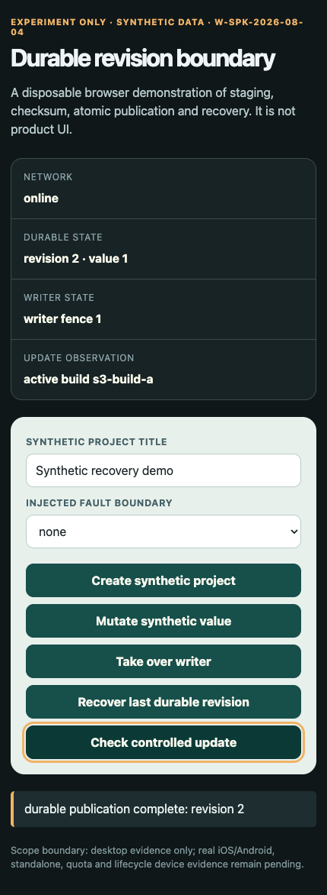

# S-3 — durability / local contexts / recovery / PWA lifecycle

> **Record navigation.** The sections through **Independent reviewer result**
> preserve the first-run handoff exactly as historical evidence. They do not
> identify the current source. The dated **Follow-up C–H — current-source
> addendum** at the end is the authoritative current-run record; in particular,
> its test counts, mutation report and raw-artifact availability supersede the
> first-run claims.

## Decision at handoff

**Recommended terminal status: `PAUSED`, not `PASS`.** The isolated prototype
provides desktop-browser evidence for a narrow subset of the question, but it
does not replace physical iOS/Android, Home Screen/standalone, kill/relaunch,
quota/eviction, migration or release-update evidence. `G-1` remains `PENDING`
and `G-READY` remains `NOT READY`; neither is changed by this report.

The independent reviewer must verify scope, command results and the `PAUSED`
conclusion before waiver cleanup. Until that review, the prototype source,
manifest, local dependencies and generated artifacts remain only in its
allowed S-3 root; nothing may be promoted or copied into product code.

## Question and boundary actually exercised

The disposable browser prototype represents one **synthetic** document with a
synthetic numeric field. It exercises this sequence:

```text
immutable candidate
  → staging record
  → SHA-256 checksum verification
  → one IndexedDB transaction: revision + pointer + history + staging delete
  → Durable Revision visible to restart/recovery
```

It is deliberately not an implementation of a Project, geometry, catalog,
backup, renderer or production PWA. It does not read real user data, contact an
external service or contain a non-synthetic asset.

## Green verification

Run from
`_bmad-output/implementation-artifacts/spikes/W-SPK-2026-08-04/S-3/`:

```sh
PLAYWRIGHT_BROWSERS_PATH=0 \
S3_CHROME_PATH='/Applications/Google Chrome.app/Contents/MacOS/Google Chrome' \
npm test
```

Result: **23/23 Vitest behavior tests passed; 4/4 Playwright browser tests
passed.**

| Evidence | What passed |
| --- | --- |
| Unit / durability | Immutable candidate; `staging → checksum → atomic pointer`; faults at before/after staging, after checksum, before/after pointer swap; last durable recovery; checksum/tamper detection; writer fencing; retention and redo roots; undo/redo; explicit history-only discard cancel/confirm. |
| Persistent-profile Playwright | Visible create → durable revision 1 → mutation → durable revision 2 → profile close/restart → recovery of revision 2/value 1. |
| Fault UI Playwright | Visible `before-pointer-swap` injected fault retains revision 1/value 0 after recovery. |
| Offline UI Playwright | App shell loaded online, gained service-worker control, browser context was made offline, and cached shell reloaded with visible `offline` state and usable controls. |
| Controlled local update Playwright | Local server changed synthetic build A→B; active client observed `registration.waiting` for B while its synthetic durable revision remained visible. |

The browser test uses the already installed desktop Google Chrome
`150.0.7871.187`, launched with a temporary persistent profile under the
allowed S-3 prototype root. `PLAYWRIGHT_BROWSERS_PATH=0` was used; the local
Playwright browser installation is contained under S-3 `node_modules` and no
new global `chromium-*` cache directory was created.

## Fault-boundary finding

| Injection point | Observed recoverable state |
| --- | --- |
| `before-staging` | Existing pointer remains; no candidate becomes durable. |
| `after-staging` | Existing pointer remains; recovery clears only that Project's dangling synthetic staging record. |
| `after-checksum` | Existing pointer remains. |
| `before-pointer-swap` | Existing pointer remains; UI reports fault and recovery shows prior revision. |
| `after-pointer-swap` | Pointer/revision/history transaction is already durable; restart recovers the new revision despite the later fault report. |

## Mutation-test evidence

Command:

```sh
npm run mutation
```

Stryker mutated only the isolated `src/durability.mjs` file. Final result:
**346 killed, 74 survived, 17 no-coverage, 0 timeout, 0 runtime error; total
mutation score 79.18%, covered score 82.38%.**

Survivors were retained as an explicit limitation rather than hidden by a
threshold. The remaining highest-level classes are error-message literals,
unreachable synthetic IndexedDB event-error plumbing, and internal details
whose public behavior is already proved by the durability flows. Mutation is a
quality signal for this disposable spike, not a product-quality claim and not a
release gate. The exact JSON/HTML output is retained in the allowed prototype
root and integrity-addressed in the trace manifest below.

## Real screenshot

The screenshot is from a real successful desktop Playwright demo, not a mock:



It shows synthetic revision 2/value 1 and a waiting controlled update while
the active synthetic session remains present. SHA-256:

```text
9f2b947f53fec22161bf8c66e8a925940371d7dd49ffc4e7821e7bd0c5d323b5
```

## RED evidence retained

The initial Playwright offline test was intentionally retained as evidence of
the RED→GREEN correction: the cached shell reloaded but a `navigator.onLine`
only label stayed `online`. The UI was corrected to probe `/health` and show
offline on failure; the final green run above proves that state.

See [red Playwright evidence](red-playwright-2026-08-04.md). Its original
failure screenshot and error context are still retained in the isolated
prototype test-results directory named in that document.

## Not demonstrated — blocking `PASS`

| Required evidence | Status | Why this experiment cannot claim it |
| --- | --- | --- |
| iPhone 13 mini Safari tab | Not tested | No physical device / airplane-mode trace. |
| iPhone 13 mini Home Screen standalone | Not tested | Desktop Chrome cannot substitute a separate iOS Home Screen storage context. |
| Current iPhone Safari + Home Screen | Not tested | No physical device. |
| Galaxy A53 Chrome tab + installed PWA | Not tested | No physical device / Android standalone context. |
| Current Galaxy Chrome tab + installed PWA | Not tested | No physical device. |
| Kill/relaunch and OS eviction | Not tested | Playwright profile close/reopen is not mobile process kill or eviction evidence. |
| Quota pressure / origin eviction | Not tested | No quota exhaustion or browser-data-loss experiment was run. |
| Migration | Not tested | No versioned previous-schema fixture or copy-on-write migration exists in this disposable prototype. |
| Service-worker activation after a safe boundary | Partial only | A controlled waiting update was observed; install prompt, standalone lifecycle, real activation/reload/migration behavior are not demonstrated. |
| iOS browser ↔ Home Screen handoff by complete backup | Not tested | Portable backup is explicitly out of this synthetic prototype. |
| Physical-device NFR-15 perf/thermal/WebGL traces | Not tested | Desktop browser tests cannot certify performance or mobile touch behavior. |

## Replay and integrity

1. Enter only the allowed prototype root above.
2. Use Node `22.8.0`, npm `10.8.2`, Chrome `150.0.7871.187` and the package
   lock checksum in `trace-manifest-2026-08-04.md`.
3. Run the green command under **Green verification**.
4. Run `npm run mutation` for the mutation report.
5. To regenerate the screenshot, start `node scripts/server.mjs`, then run:

   ```sh
   PLAYWRIGHT_BROWSERS_PATH=0 \
   S3_CHROME_PATH='/Applications/Google Chrome.app/Contents/MacOS/Google Chrome' \
   node scripts/capture-demo.mjs
   ```

6. Stop only the exact local S-3 server process when finished.

## Scope / security observations

- The local server binds only `127.0.0.1`; the controlled build endpoint
  accepts only synthetic `s3-build-*` values.
- Test input is fixed synthetic text and numeric values. No user Project,
  CatalogAsset, resource bytes, telemetry or external network request was used.
- `npm audit` reports two moderate transitive developer-tooling advisories
  (`typed-rest-client → qs`); no runtime production package exists in this
  isolated experiment. The result is recorded, not waived for a future product.
- No commit, tag, push, production source, root manifest/configuration, CI or
  deployment artifact was created.

## Reviewer decision required

`Codex /root` should record one of:

1. `PAUSED confirmed` — preserve only allowed evidence and proceed to waiver
   cleanup per its §5; or
2. `needs further S-3 evidence` — name the bounded missing experiment while
   the waiver remains active; or
3. `scope/test conclusion rejected` — do not clean up until corrected.

## Independent reviewer result — 2026-08-04

Reviewer: `Codex /root/review_s3_storage`, independent of the implementation
owner.

### Reproduced and observed

- The declared green command reproduced **23/23 Vitest** and **4/4 Playwright**
  passes on Node `22.8.0`, npm `10.8.2`, and desktop Chrome
  `150.0.7871.187`. `npm run mutation` also reproduced **346 killed / 74
  survived / 17 no coverage** (79.18% total, 82.38% covered); the screenshot
  and package-lock SHA-256 values match the trace manifest.
- The reviewed runtime source is synthetic-only and calls only the local
  `127.0.0.1` server. The observed source/config/test surface remains inside
  the waiver-approved S-3 root; no product-root `src`, `tests`, manifest, or
  Playwright configuration is present. This directory is not a Git worktree,
  so a historical no-root-change claim cannot be independently reconstructed.
- Static `fallow health --format json --quiet --explain` found one
  non-gating static-health warning: the disposable local `server` function is
  untested (estimated CRAP 210, cyclomatic 14). It does not change the
  terminal gate, but it should not be carried forward as a design-quality
  claim.

### High findings — positive durability claims not approved

1. **Fencing is not atomic with publication.**
   `assertCurrentLease` reads the lease before work
   (`src/durability.mjs:177-182`), but `publishStage` writes the revision and
   pointer without checking that lease in its transaction (`231-247`). In an
   isolated fake-IndexedDB reproduction, writer A started a mutation, writer
   B took over, and A still published in **40/40** attempts. In addition, the
   UI stores one owner ID in shared `localStorage` and silently requests
   `takeover: true` (`src/app.mjs:3-5,41-43`), so two same-profile contexts
   share a valid fence and a new context does not require explicit takeover.
   The existing tests cover only the sequential stale-lease case.

2. **Checksum verification does not bind a pointer to its Project.**
   `getCurrentRevision` verifies checksum bytes but never requires
   `revision.projectId === projectId` (`src/durability.mjs:276-293`). A
   valid checksum/pointer pair for synthetic Project B, written into Project
   A's pointer record, is accepted and returns B as A. This defeats the
   claimed per-Project pointer/recovery guarantee.

3. **Undo/redo can publish a known-corrupt historic revision.**
   `undo` and `redo` read a historic record and repoint without validating its
   checksum (`src/durability.mjs:379-413`). After corrupting revision 1,
   `undo` returned `status: durable`, made it current, and only the next read
   failed with `DURABLE_CHECKSUM_MISMATCH`. A corrupt history target must be
   blocked or explicitly resolved before it becomes the current Project.

4. **Two evidence claims are not presently verifiable.**
   The recorded RED failure screenshot and error context named in
   `red-playwright-2026-08-04.md` are absent from the reviewed
   `test-results/` tree after replay (only `.last-run.json` and an empty
   persistent-profile directory remain). Also, the manifest's Stryker JSON
   hash `87c327…64aff2` does not match the current replay output
   `7752270ef0f2f6bdac9357c0c5c8296ecb47f69514420e4a2ccdbe64ee65c352`,
   although the counts reproduce. Preserve immutable, run-addressed raw
   artifacts before claiming retained RED/integrity evidence.

5. **Offline coverage overstates what the browser test proves.**
   The final offline test checks an `offline` label and that the Create button
   is visible (`tests/e2e/durability.spec.mjs:61-70`); it does not exercise a
   create, mutation, or recovery after the offline reload. The phrase
   “usable controls” therefore needs a real offline operation assertion.

### Decision

**`needs further S-3 evidence`; waiver cleanup is not approved.** The bounded
follow-up must correct and test atomic fencing (including two contexts and an
in-flight takeover), Project-bound pointer/checksum validation, and
corrupt-history undo/redo; it must retain replayable RED/raw artifacts and
exercise an actual offline operation in a persistent browser profile.

The only permissible terminal conclusion remains **`PAUSED`, never `PASS`**:
physical iOS Safari tab and Home Screen, physical Android tab and installed
PWA, kill/relaunch, quota/eviction, installed-PWA lifecycle, and device traces
are still required. No S-3 source may be promoted or cleaned up on this
reviewer's sign-off.

## Follow-up C–H — current-source addendum — 2026-08-04

**Current decision: `needs-further-evidence`.** The narrow
`W-SPK-2026-08-04` waiver remains active. This isolated prototype must not be
cleaned up, promoted, copied into the product, or treated as a product
implementation.

### Scope and environment

- The subject remains a **synthetic** S-3 durability prototype; it is not the
  Interiors Editor, does not contain a production PWA, and is not evidence from
  a physical mobile device.
- Current verification used desktop Google Chrome `150.0.7871.187`, Node
  `v22.8.0`, and npm `10.8.2`.
- Stryker's mutation target is only `src/durability.mjs`. Its result says
  nothing about the completeness of the surrounding synthetic UI, PWA shell,
  or any future product source.

The current source adds synthetic coverage for transaction-bound writer fencing
and pointer/history checks, Project-bound pointer validation, corrupt-history
handling, controlled recovery states, an in-flight local staging guard, and
the corresponding browser recovery/fencing flows. These are evidence-harness
behaviours only.

### Current test replay and mutation record

The root reviewer independently replayed `npm test` from the allowed S-3 root
and observed **63/63 Vitest** tests and **10/10 Playwright** tests passing. The
browser cases include persistent-profile recovery, before/after publication
fault boundaries, malformed-pointer read-only recovery, offline
create/reload/takeover/recovery, initial-create staging recovery, two-context
fencing, popup fencing, and a controlled local service-worker update.

The implementation owner reported a complete `npm run mutation` run with no
errors or timeouts. The root review regenerated and verified the current
`mutation.json`, but its command wrapper did not retain a direct terminal exit
status; this addendum therefore records the JSON result rather than asserting
an independently captured mutation-process exit code:

| Mutation status | Count |
| --- | ---: |
| Total | 915 |
| Killed | 761 |
| Survived | 129 |
| No coverage | 25 |
| Total mutation score | 83.17% |
| Covered-code mutation score | 85.51% |

### Current artifact integrity

All listed paths are beneath the waiver-approved S-3 evidence boundary unless
their path starts with `_bmad-output/planning-artifacts/evidence/`.

| Artifact | SHA-256 |
| --- | --- |
| `src/durability.mjs` | `a6575440c81c22e65c92e79ce704b6a642e3af00ee4295c43d108eb9a28de93c` |
| `src/app.mjs` | `393b2cd59a73f34f1f5d9b32ac51394d5edac91ede9775ed48228468b50bf02c` |
| `tests/unit/durability.test.mjs` | `1e061891d1f472119630fb5dfc3d2d871f2d5bcc80facf70777c9bb71ffd1c1a` |
| `tests/e2e/durability.spec.mjs` | `e768b0e884ca4947ddecbfca4a3b6c2739730874d43c0f07b9b7850dcf14b362` |
| `package-lock.json` | `4a1a29b511b33153c07cb2e26cf0c4c586ae3c5ddd626c74114a2923afd15d79` |
| `artifacts/mutation/mutation.json` | `c46aebf9925cc62d4a01470a541a296685539b03fbb591f1f194d7a3c3775d47` |
| Current planning-evidence screenshot `screenshots/s3-durability-green-demo.png` | `803b3bf1b9aaa3e333778ee92a295fa9c3ccc985d44f3399c790d3a3bff5150d` |

The mobile-sized visual checkpoints are desktop captures only, not device
evidence: `followup-e-durability-mobile.png`
(`956c06d67a8d6ed2249960c29425694404c640df1acb8a0a6606575fe1ca7ad1`),
`followup-e-safe-recovery-mobile.png`
(`133d6134fc3c3d62000d31690df0f7c36fdd3d736c4f2dd4f5562c4d81f68562`),
`followup-f-initial-recovery-mobile.png`
(`df2b6668e025e009613687af1d9c7224aa8a3f9b012c664f3a305055ad5a577c`),
and `followup-g-post-swap-durable-mobile.png`
(`ca39e03d626f2a62bbe8cf94c90f2c5ac648703262bb4884a1064bff8e24534e`).

### Historical-record correction

The earlier **23/23 + 4/4** test result, **346 / 74 / 17** mutation result,
and their associated hashes describe an older source state. They remain above
for provenance but are stale and must not be used to identify the current
source. The originally referenced RED screenshot and error-context paths are
absent in the current audit, so they are not retained or replayable evidence;
the dedicated RED record below now says so explicitly.

### Evidence still required

This addendum does not close the following gaps:

1. Eight physical NFR-15 contexts: iPhone 13 mini Safari tab and Home Screen;
   iPhone 17 Safari tab and Home Screen; Galaxy A53 Chrome tab and installed
   PWA; Galaxy S26 Chrome tab and installed PWA.
2. Real mobile process kill/relaunch, operating-system/origin eviction, and
   quota-pressure/origin-eviction traces.
3. Previous-version fixtures, migrations, and rollback evidence.
4. Actual safe update activation and reload rather than a controlled waiting
   update.
5. Complete portable-backup transfer between browser and iOS Home Screen
   contexts.
6. Physical-device WebGL, performance, touch, and thermal traces.

## Evidence-integrity closeout replay — 2026-08-05

**Owner status: `awaiting-amended-independent-terminal-review`.** This is a
fresh, reproducible replay of the C–H current source within the existing
waiver boundary. It is not a new implementation result and does not change the
recommended terminal status: **`PAUSED`, not `PASS`**. The independent reviewer
must make an amended terminal decision before any cleanup; no cleanup was
performed for this replay.

### Captured command results

All commands ran from the waiver-approved S-3 prototype root. The command
runner captured exit status `0` for each command; their unedited terminal
output is retained under `replay-2026-08-05/raw/`.

| Command | Exit | Result | Retained raw output (SHA-256) |
| --- | ---: | --- | --- |
| `npm run test:unit` | 0 | 63/63 Vitest passed | `raw/unit.raw.txt` — `f4d8e805490ce5f0d862d2fed5a8e8e6fab317bad3c7322c92d959ea5be62bbe` |
| `PLAYWRIGHT_BROWSERS_PATH=0 S3_CHROME_PATH='/Applications/Google Chrome.app/Contents/MacOS/Google Chrome' npx playwright test --trace on --output ../../../../planning-artifacts/evidence/spikes/S-3/replay-2026-08-05/playwright-results` | 0 | 10/10 Playwright passed | `raw/e2e.raw.txt` — `ff6db73cc03d49edd83cfa92a5cf97d478ad8ba0da42d741584fd20360d06184` |
| `npm run mutation` | 0 | 915 total; 761 killed; 129 survived; 25 no coverage; 83.17% total / 85.51% covered | `raw/mutation.raw.txt` — `c56728379f9e380205c2d0072115c6dcf8fa0c6ee8c80e17669807a4928a31af` |

The Playwright invocation explicitly used `--trace on`, so it produced traces
on this first green run rather than relying on retry-only trace capture. The
result set contains ten `trace.zip` files, one per passed browser scenario;
their paths and individual SHA-256 values are retained in
`raw/playwright-trace-sha256.txt`
(`5f1c6661a0fdb20130fc841235f34cb2c136c607594dafa6f39a0a7b17f9d94e`).

### Artifact and source reconciliation

- The source/test/lockfile checks before and after the replay are byte-for-byte
  identical. Each checksum-list file has SHA-256
  `8f434b2d353a44e4ba9dd8a5994a2d6e207bc33118871d6265d1491b6192765d`;
  the checked source hashes remain the C–H values recorded above.
- No new source defect surfaced during this replay. Accordingly, this closeout
  made **no source or test change**.
- The mutation report copies retained in this evidence directory are
  `mutation.json` (`3e33860bcbc6afa261b24736c7ca67b1f77530a57fafa8bbd6e0b210d3fe4dc0`)
  and `mutation.html` (`632153aafe5610bafebf3ceaea7514888a7c13801f0c1005de107e35a6679ac6`).
  Their pairwise checksum record is
  `raw/mutation-artifact-sha256.txt`
  (`ca0c389c99587b14a099192abe888c82597fb60da78c241b053b0453941acf01`).

The replay remains desktop-only synthetic evidence. It provides no physical
iOS/Android, Home Screen/PWA standalone, process-kill/relaunch,
quota/eviction, migration/rollback, browser-to-Home-Screen transfer, WebGL,
performance, touch, or thermal conclusion. Those gaps remain the blockers to
any broader readiness assertion.

## Terminal decision and authorized cleanup — 2026-08-05

The independent terminal review
[`S-3-terminal-independent-review-2026-08-05.md`](S-3-terminal-independent-review-2026-08-05.md)
accepted the evidence-integrity closeout and set terminal S-3 status to
**`PAUSED`**. It authorizes the owner to perform the separate waiver §5 cleanup
action without moving any prototype content into the product.

`PAUSED` is explicitly **not `PASS`**. The evidence remains limited to a
synthetic desktop browser harness; the physical NFR-15 device contexts,
standalone/Home Screen lifecycle, real process kill/relaunch, eviction and
quota pressure, migration/rollback, actual update activation, backup transfer,
and physical WebGL/touch/performance/thermal traces remain unproven. They must
not be inferred from this record.

## Terminal cleanup execution — 2026-08-05

After the accepted independent review, the owner moved **only** the exact
prototype root
`_bmad-output/implementation-artifacts/spikes/W-SPK-2026-08-04/S-3/` to the
recoverable Trash path
`/Users/romanzheltov/.Trash/InteriorsEditor-W-SPK-2026-08-04-S-3-2026-08-05`.
The source root is absent from the repository after the move. Its verified size
was 663M (679100 KiB) before and after the move. No `rm` operation was used,
and no prototype file was copied into product code.

The separate evidence root
`_bmad-output/planning-artifacts/evidence/spikes/S-3/` was retained in place.
Post-move verification found the root present with 27 files and size 5.7M,
including this owner report, the accepted independent review, raw command
outputs, ten Playwright traces, and mutation report copies. This preservation
does not broaden the result beyond `PAUSED` or close any NFR-15 gap.
