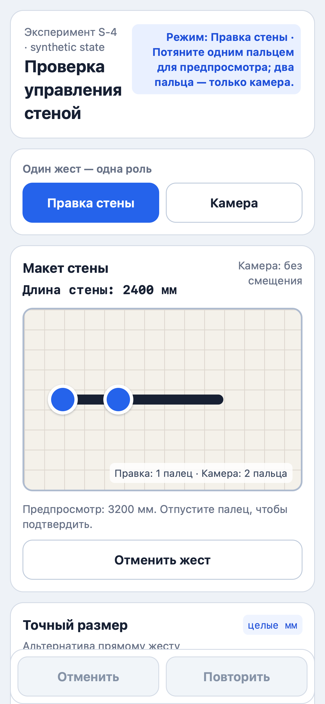
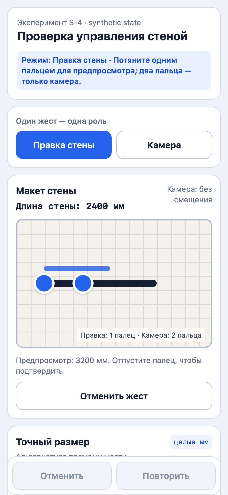
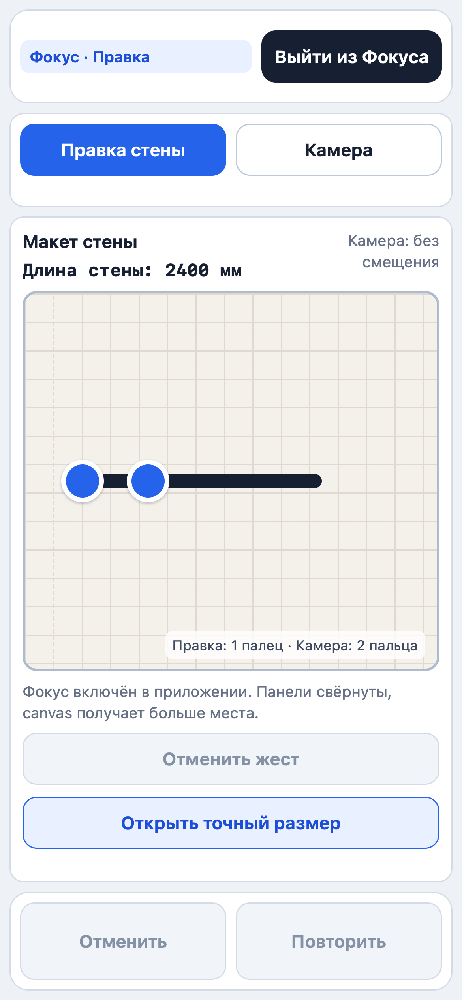
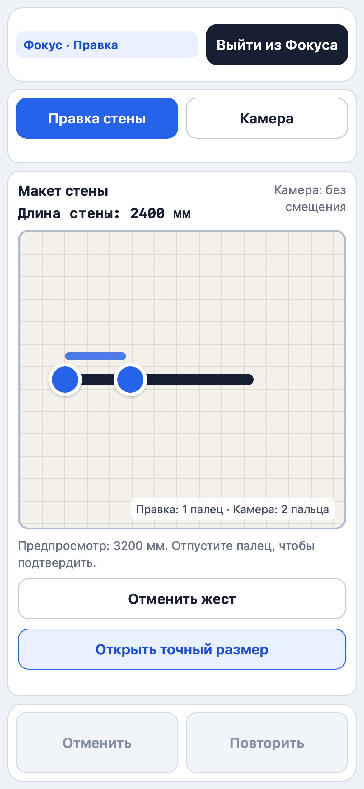

# S-4 — touch / numeric interaction evidence

## Decision at handoff

**Terminal status: `PAUSED`, never `PASS`.** The independent Amendment B review
is recorded in
[`S-4-post-amendment-b-independent-review-2026-08-05.md`](S-4-post-amendment-b-independent-review-2026-08-05.md).
Browser-emulated mobile interaction regression is green. The historical
baseline mutation score was 60.16%; Amendment A's post-change run was 62.42%,
and Amendment B's full-file run is 64.05%, but none substitutes for
participant, physical-device or `G-1` evidence. This terminal disposition
authorizes only the completed recoverable waiver-prototype cleanup; it does
not authorize product promotion, `READY`, a PWA/mobile performance claim or
native/fullscreen compatibility claim. Amendment B closes only the previously
recorded bounded synthetic browser assertion gap.

## Question and boundary exercised

The disposable prototype exercises three synthetic paths for changing one
synthetic wall length: one-pointer preview/confirm, numeric millimetre input,
and cancellation of an active preview. It also checks that a second pointer
transfers the synthetic interaction to camera navigation without committing a
wall edit.

It is not an implementation of Project, geometry, persistence, PWA, renderer,
Focus mode, native fullscreen, safe-area support on a real device, or a user
research result. No real Project, catalog asset, resource byte, telemetry or
external request was used.

## Reproduced browser evidence

Run from the waiver-approved prototype root
`_bmad-output/implementation-artifacts/spikes/W-SPK-2026-08-04/S-4/`:

```sh
npm test
```

Result: **6/6 Playwright tests passed** in 2.7 seconds on Node `v22.8.0` and
Playwright `1.62.1`.

The one configured context is Playwright **WebKit** with the `iPhone 13`
device descriptor, explicit `390×844` CSS-px viewport, device scale factor
`3`, `isMobile: true` and `hasTouch: true`. This is browser emulation, not an
iPhone, not Safari on iOS, not a Home Screen PWA and not a Samsung/Android
trace.

| Browser assertion | Result |
| --- | --- |
| Visible named controls, no hover prerequisite, 44×44 CSS-px targets and CSS safe-area fallback | PASS in emulation |
| One touch previews/confirms; a second touch prevents wall commit and enters camera path | PASS in emulation |
| One-finger camera mode does not edit the wall | PASS in emulation |
| Integer millimetre input and invalid-value preservation | PASS in emulation |
| Cancel affects only preview; undo/redo affect confirmed synthetic command | PASS in emulation |
| Reduced-motion visual transition removal with retained numeric/status path | PASS in emulation |

## Full mutation result — negative quality evidence retained

The unfiltered, full-file run was completed after the ordinary green test run:

```sh
npm run mutation
```

Stryker mutated exactly `app.js` (not a narrowed line range): **256 mutants**;
**153 killed**, **102 survived**, **1 timeout**, **0 no-coverage**, **0
runtime errors**. Total and covered mutation score are both **60.16%**. It
completed in 52 minutes 33 seconds; a subsequent ordinary `npm test` again
passed 6/6.

This is deliberately recorded as a failure to provide strong behavior proof,
not averaged away. The surviving classes include render-only state, status and
accessibility labels, preview geometry, disabled state, gesture branches and
numeric validation branches. A future bounded experiment may add tests only
after reviewer disposition; it cannot translate this disposable source into
product code.

Raw outputs retained only in the allowed prototype root:

| Artifact | SHA-256 |
| --- | --- |
| `artifacts/stryker-report/mutation.json` | `d49327aaf5886960fd369b2066e311ee0c23d462874b9f6b171b1d942dc1ddf6` |
| `artifacts/stryker-report/mutation.html` | `d3e4dc7000909fbf61eff052038a58c831c9e9f43b89c1655712f64a7e6839e2` |

## Visual observation retained

The following screenshots are real Playwright captures of the synthetic
iPhone-like WebKit viewport, not product mockups or physical-device evidence.





The refined capture exposes a P2 layout concern: the sticky undo/redo rail can
visually overlap the numeric card at this viewport. The current six tests do
not assert non-overlap, so the image is negative evidence, not proof that the
layout is ready. A later scoped S-4 amendment must repair and test it before a
new visual claim is made.

| Screenshot | SHA-256 |
| --- | --- |
| `s4-iphone-like-touch-preview-2026-08-04.png` | `f9209baddae7ac47d4ccdffc15704175ca561ae5a33880a92f5a4e6f6c06fa8d` |
| `s4-iphone-like-touch-preview-refined-2026-08-04.png` | `8816ec2d75034047d3370a40ba005ad9f49269e4da85016d908968fc1118d3f8` |

## Amendment A result — in-app Focus layout / non-overlap

The bounded amendment was implemented only below the waiver-approved S-4
prototype root. It adds a named **in-app** Focus layout; it deliberately does
not call the Native Fullscreen API or claim control over browser/system chrome.

### TDD and visual trace

1. The new semantic Playwright test was first red because `Войти в Фокус` did
   not exist.
2. The smallest matching Focus state/control implementation made the test
   green.
3. A real emulated viewport capture exposed excessive status height and a
   history-rail visibility problem. The test was strengthened, the synthetic
   layout compacted, and the final full suite became green without widening
   scope.

The seventh test enters and exits Focus directly, observes `data-focus-layout`
as `in-app`, exit/status/mode/cancel/undo/redo and the labelled numeric return
path, checks the unchanged synthetic wall in an empty-history/idle-gesture
baseline, checks 44 px touch targets inside the emulated `390×844` visual
viewport, and proves that the returned numeric input/apply control rectangles
do not intersect `.history-bar`. It does not yet browser-prove preservation of
a non-empty undo/redo history or an active preview; that bounded gap is recorded
in the post-amendment independent review.

### Reproduced regression result

After the full mutation run, ordinary `npm test` passed **7/7** Playwright
tests in **3.4 s**. The context remains Playwright WebKit using the `iPhone 13`
device descriptor (`390×844` CSS px, DPR 3, `isMobile: true`, `hasTouch: true`).
It is browser emulation only—not iPhone hardware, iOS Safari, a Home Screen
PWA, Android/Samsung, actual safe-area/keyboard behavior, or a native
fullscreen result.



| New artifact | SHA-256 |
| --- | --- |
| `s4-focus-in-app-iphone-like-2026-08-04.png` | `b743a79091da2c7f6c6799c280adc9e7b8de128278fa79aded937ac2b86a89e5` |

### Full post-amendment mutation result

The unfiltered full-file `npm run mutation` again mutated only `app.js`:
**306 mutants**, **190 killed**, **115 survived**, **1 timeout**, **0
no-coverage**, **0 runtime errors**. Total and covered mutation score are both
**62.42%**; the run completed in **61 minutes 53 seconds**. This is a modest
improvement over the historical 60.16% run, but it remains negative quality
evidence rather than a promotion threshold.

| Post-amendment raw artifact | SHA-256 |
| --- | --- |
| `artifacts/stryker-report/mutation.json` | `6b7294aacd5cbb95cabe3105b9b717b72a7533b808a044f3cac9a2fe90a777b1` |
| `artifacts/stryker-report/mutation.html` | `773f08ceee1af03614ae924644f0de933378c15a8cbac975bb824a5513495781` |

**Disposition remains `PAUSED — needs further S-4 evidence`.** This amended
browser evidence resolves the synthetic non-overlap observation only. It does
not authorize cleanup, promotion, production implementation, a mobile
performance claim, native fullscreen support, or closure of
participant/physical-device/`G-1` gates.

## Amendment B result — Focus state preservation

This bounded follow-up is authorized by the `Amendment B` section of
[`work-package.md`](work-package.md). Its owner is
`Codex /root/gcp_decision_research`; its appointed independent reviewer is
`Codex /root/ownership_readiness_review`.

### Test-first browser evidence

Two new semantic Playwright scenarios were added below the existing S-4
prototype root only:

1. A confirmed non-default `3050 мм` wall value enters and exits in-app Focus,
   then undo restores exactly `2400 мм`; it re-enters/exits Focus while redo is
   non-empty and redo restores exactly `3050 мм`.
2. A one-pointer `3200 мм` active preview enters/exits Focus without changing
   the confirmed `2400 мм` value; the visible Cancel control then discards that
   preview without creating an undo entry.

The test-first focused check passed **2/2** in **2.1 s** on the existing
synthetic handler. Therefore no change to `app.js`, HTML or CSS was needed or
made: the existing Focus handler already preserved the state under these
observable flows. A contrived source regression was not introduced merely to
manufacture a RED phase. This is browser-emulated synthetic evidence, not an
iPhone, iOS Safari, Samsung/Android, PWA, keyboard/safe-area or native
fullscreen result.

The full ordinary regression passed **9/9** both before the mutation command
and again after it; the post-mutation run completed in **4.2 s**. It uses the
same configured WebKit `iPhone 13` descriptor (`390×844` CSS px, DPR 3,
`isMobile: true`, `hasTouch: true`) and synthetic dispatched pointer events.



The screenshot and raw Playwright trace intentionally show the stronger
non-idle state: Focus is active, `2400 мм` remains confirmed, `3200 мм` is a
visible preview and Cancel is available. They are not physical-device evidence.

| Amendment B browser artifact | SHA-256 |
| --- | --- |
| `raw/s4-amendment-b-playwright-last-run-2026-08-05.json` | `91d1c43004802cd49950d78eb11c8fa7d05da8ffffe219a8b13b2f561bc00903` |
| `screenshots/s4-amendment-b-focus-active-preview-iphone-like-2026-08-05.png` | `6f80433d17ca9c1190b919aece419359c944a0c0dad28d7c46000140dc971082` |
| `traces/s4-amendment-b-focus-active-preview-iphone-like-2026-08-05-trace.zip` | `622bdbb47874ddb67a851331a17a793d0959b8335c889727c1d2582d7f624084` |

### Full Amendment B mutation result

The unchanged full-file command was run after the new tests:

```sh
npm run mutation
```

Stryker mutated exactly `app.js`, with no narrowed target or changed threshold.
It produced **306 mutants: 188 killed, 110 survived, 8 timeouts, 0
no-coverage, 0 runtime errors**. Total and covered mutation score are both
**64.05%**. The run completed in **96 minutes 7 seconds** and reran the full
browser suite for each mutant (0.97 tests per mutant on average).

This modest improvement over Amendment A's 62.42% does **not** turn the result
into a quality or promotion claim: 110 survivors and 8 timeouts remain negative
evidence. They must be independently assessed rather than hidden or averaged
away.

| Amendment B full-run raw artifact | SHA-256 |
| --- | --- |
| `raw/s4-amendment-b-mutation-2026-08-05.json` | `b73bf37fc09b8702ce5985e000ab529a3b480cd2daa813f4c475b9c454a1fdd2` |
| `raw/s4-amendment-b-mutation-2026-08-05.html` | `a5811318deddd56938eb82fa15731cc0c212d1ef23d59cbf9f6857664e0b67db` |

### Independent Amendment B terminal review

The appointed reviewer independently replayed the ordinary suite, checked the
raw hashes and reviewed the bounded scenarios. Its terminal disposition is
[`PAUSED`](S-4-post-amendment-b-independent-review-2026-08-05.md), not
`PASS`. The review closes only `S4-FOCUS-POST-01` within the synthetic scope;
it prohibits product promotion, `READY`, PWA/mobile performance and native
fullscreen claims.

## Limits blocking `PASS`

| Required evidence | Status | Why not demonstrated |
| --- | --- | --- |
| Direct physical iPhone Safari tab and Home Screen task recordings | Not tested | Playwright WebKit does not provide iOS device, Safari or separate Home Screen storage evidence. |
| Direct physical Galaxy Android Chrome tab and installed PWA recordings | Not tested | No physical Android device/standalone context was used. |
| `G-1` independent participant research | PENDING | Automation cannot measure whether people distinguish gesture roles. |
| Native fullscreen capability/request/exit | Not tested | S-4 now has synthetic in-app Focus but deliberately does not call the Fullscreen API. |
| Real safe inset, virtual keyboard and browser/system chrome behavior | Not tested | `env()` falls back to 12px in emulation; it is not a physical safe-area trace. |
| Actual touch hardware event behavior | Not tested | Tests dispatch synthetic `PointerEvent` payloads; they do not establish hardware touch behavior. |
| Non-overlap of history and numeric controls | PASS only in emulation | Amendment A has a `390×844` browser rectangle/clickability assertion; this is not physical safe-area or keyboard evidence. |
| Preservation of non-empty history and active preview across Focus | PASS only within synthetic emulation | Amendment B’s independent review confirms the two browser scenarios; this is not physical-device, PWA or native-fullscreen evidence. |
| `NFR-15` device acceptance matrix | Not tested | The required eight named physical contexts and their performance/focus traces are absent; Playwright WebKit emulation is not an `NFR-15 PASS`. |
| Strong mutation confidence | Not met | 64.05% / 110 survived / 8 timeouts remains negative quality evidence. |

## Scope and security observation

- Before terminal cleanup, source, local package manifest, dependencies, test
  runner and generated artifacts existed only below the waiver-approved S-4
  prototype root; none was copied into a product root.
- The local test web server binds to loopback; no network publication,
  repository commit, root manifest/configuration, production source, PWA/CI
  configuration or real user data was created.
- A valid DOM control in browser emulation must not be treated as a claim that
  current iPhone or Samsung devices perform or support native fullscreen.

## Terminal cleanup record — 2026-08-05

After the terminal independent review, the exact former prototype root
`/Users/romanzheltov/Desktop/frontentd-projects/InteriorsEditor/_bmad-output/implementation-artifacts/spikes/W-SPK-2026-08-04/S-4`
was recoverably moved with `mv` to
`/Users/romanzheltov/.Trash/InteriorsEditor-W-SPK-2026-08-04-S-4-2026-08-05`.
The explicit Trash target was verified absent immediately before the move.

The source path is now absent; the Trash target is present and retains exactly
**389456 KiB**, **15979 files** and **986 directories**. No `rm`, permanent
deletion, source promotion, commit or alteration of source/test/HTML/CSS was
performed. The evidence root, including this report, the terminal independent
review, raw mutation reports, trace and screenshot, remains retained in the
repository.

## Required independent-review disposition

The independent reviewer must record one of:

1. `PAUSED confirmed` — retain all artifacts in the waiver root and do not
   promote/clean up;
2. `needs further S-4 evidence` — state a bounded experiment, including the
   layout overlap and mutation gaps if accepted; or
3. `scope/test conclusion rejected` — correct the report before any further
   work package amendment.

## Independent reviewer result — 2026-08-04

Reviewer: `Codex /root/review_s4`, independent of the implementation owner.

**Decision: `PAUSED confirmed`.** The reviewer independently reran ordinary
`npm test` (**6/6 pass**, 2.9 seconds) and inspected the raw full-file Stryker
JSON. It confirmed exactly **256** mutants — **153 killed**, **102 survived**,
**1 timeout** — and confirmed that Stryker's 60.16% score counts the timeout.
The JSON, HTML and both screenshot SHA-256 values match this report.

The reviewer confirmed that this report does not overclaim physical mobile,
PWA or fullscreen behavior. It also confirmed the sticky history/numeric-card
overlap and required a bounded follow-up, if any: remove stickiness or reserve
scroll/safe-area space, then add a `390×844` Playwright non-overlap and
clickability assertion. The physical-device/participant/`G-1` gate remains
unmet, so cleanup and promotion remain prohibited.

## Post-Amendment A independent review — 2026-08-04

Reviewer: `Codex /root/architecture_door_semantics`, independent of the S-4
implementation owner. Full report:
[`S-4-post-amendment-a-independent-review-2026-08-04.md`](S-4-post-amendment-a-independent-review-2026-08-04.md).

**Decision: `PAUSED — needs further S-4 evidence`.** The reviewer independently
reran `npm test` (**7/7 PASS**, 3.5 seconds), verified the emulated WebKit
iPhone-13 descriptor, the post-amendment `306 / 190 killed / 115 survived / 1
timeout` mutation data and all three reported SHA-256 values. It also confirmed
that the prototype calls no Native Fullscreen API and makes no physical/native
claim.

Finding `S4-FOCUS-POST-01` is Medium, bounded to synthetic evidence: the Focus
test begins with empty history and an idle gesture, so it does not
browser-observe preservation of a non-empty undo/redo history or active preview.
Any follow-up requires separate S-4 authorization, must be test-first, rerun
the complete regression and full mutation command, and still cannot promote the
prototype beyond `PAUSED`.
