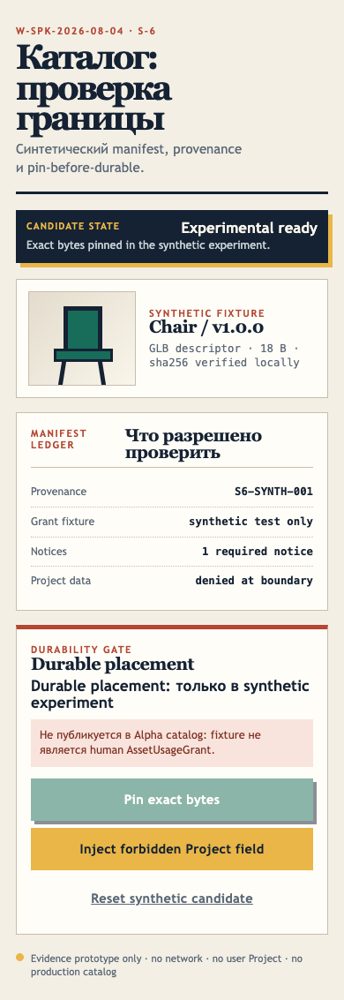

# S-6 — synthetic catalog manifest, provenance and pin boundary

## Bounded result

The isolated S-6 prototype demonstrates only a **synthetic policy boundary**.
An unpinned descriptor is preview-only; a pinned descriptor requires verified
bytes, a well-formed non-zero SHA-256 resource descriptor, a strict synthetic
manifest schema, complete synthetic-right fields and valid notice objects.
Every result remains `BLOCKED_SYNTHETIC_FIXTURE`; no result is an Alpha catalog
right or a durable product mutation.

The owner remediation is complete. The amended independent review records
**terminal `PAUSED`**: residual H-1R/H-2R/H-3R seams remain reproducible and
the human grant, representative corpus and physical evidence gates remain
absent. It cannot become `PASS` under the active waiver.

## First independent review and owner remediation

The initial independent review is recorded in
[S-6-independent-review-2026-08-05.md](S-6-independent-review-2026-08-05.md).
It correctly paused the spike after finding H-1 control-plane payload bypasses,
H-2 weak descriptor/verifier checks, H-3 shape-only grant/provenance/notice
checks and M-1 unstable evidence references. The reviewer did not edit owner
source or tests.

The owner then made the following scoped corrections inside the exact S-6
prototype root only:

1. Strictly allow-listed the synthetic descriptor, resource, provenance, grant
   and notice shapes; recursively rejected Project/Revision/History/Backup
   field names, including nested `projectId` and `projectData`.
2. Required a 64-hex SHA-256, a positive safe byte length, a pin verifier for
   every experiment-ready result, and byte-array verification in addition to a
   string fixture.
3. Modelled all seven declared synthetic rights: in-app render/thumbnails,
   model/subresources, optimisation/transcoding, `.interiors` backup packaging,
   private 3D transfer, rendered PNG download/share and notice placement. A
   required notice must have non-blank text and at least one non-blank placement.
4. Copied the screenshot, resolved lock trace and mutation JSON into this
   evidence root with the hashes below.

These are synthetic schema checks only. They do **not** manufacture a human
`AssetUsageGrant`, rights evidence, a real notice ledger or a real catalog
asset.

The amended independent review is
[S-6-amended-independent-review-2026-08-05.md](S-6-amended-independent-review-2026-08-05.md).
It confirms the replay and M-1 evidence fix, but records residual inherited or
non-enumerable field handling (H-1R), a browser byte-verifier seam (H-2R) and
sparse notice-array handling (H-3R). Those defects are deliberately not
silently patched after terminal disposition: a new written waiver is required
for another executable S-6 iteration.

## TDD and automated evidence

| Layer | Command / result |
| --- | --- |
| RED, original boundary gaps | Added nested/unlisted Project payload, malformed SHA-256, invalid byte-length and verifier tests; the old harness failed them. |
| RED, hardening | Added zero-byte, coercible/anchored digest, partial verifier, synthetic-right, malformed notice/provenance and per-level strict-schema tests; the pre-hardening harness failed the applicable cases. |
| GREEN, unit | `npm run test:unit`: **28/28** Vitest tests pass. |
| GREEN, browser | `S6_CHROME_PATH=… npm run test:e2e`: **2/2** mobile-sized Playwright tests pass. |
| Full replay | `S6_CHROME_PATH=… npm test`: **28 unit + 2 Playwright** pass. |
| Coverage | `npm run test:coverage`: **100% statements, branches, functions and lines** for `src/catalog-policy-core.mjs`. |
| Mutation | `npm run mutation`: **295 killed, 1 timeout, 0 survived, 0 no coverage, 0 errors; 100% mutation score**. The one timeout is the intentional cycle-safety mutant that removes the `WeakSet` return guard. |
| Audit | `npm audit` and `npm audit --omit=dev`: **0 vulnerabilities**. |

The browser tests use a `390×844`, touch-enabled desktop Chromium context.
They assert visible named controls, a ≥44×44 px `Pin exact bytes` target,
preview-only before pinning, experiment readiness after verified pinning and
rejection of injected Project data. They are browser regression observations,
not iOS/Android physical-device, PWA-install, renderer or performance proof.

## Observed UI checkpoint

The captured state is post-pin (`EXPERIMENTAL_READY`), while the warning keeps
the production boundary explicit:

## Provenance and integrity

| Evidence artifact | SHA-256 |
| --- | --- |
| [Resolved lock trace](raw/package-lock-2026-08-05.json) | `d998924a7ab280a155019ff405b323ad2042d916aa5ed6e50870d30031bb4aa7` |
| [Mutation JSON snapshot](raw/mutation-2026-08-05.json) | `822aa8d201bfad76f3f202c93589714240ec8edb4aafd0b7c8d18aba05e8fde9` |
| [Mobile screenshot](screenshots/s6-catalog-synthetic-mobile.png) | `e2f05308231e28d6d3ecc53610593d8f9728f405240ef5a3165424f9f7134d69` |
| Runtime | Node `v22.8.0`, npm `10.8.2`, Vitest `4.1.10`, Playwright `1.57.0`, Stryker `9.6.1` |
| Synthetic input | Literal `synthetic-chair-v1`, SHA-256 `04adb784bcea5db82e265cfb7065b80cd04e883e9a276bb96b9a219a0cd9e40e`, 18 bytes |

Stryker regenerates its JSON on each replay, so the dated evidence-root copy
above—not a transient prototype path—is the hash-stable snapshot for this
remediation. The local server binds to `127.0.0.1`; source inspection found no
`fetch`, XHR, WebSocket or external HTTP request. The prototype contains no
real 3D bytes.

## What this does not prove

- A human-approved `AssetUsageGrant` for any catalog resource or subresource,
  optimisation, backup, private transfer, rendered PNG or notice placement.
- A representative permitted catalog corpus or human provenance/notice ledger.
- Kotlin/PostgreSQL service/API/schema/deployment behaviour or `G-CP-ADR`.
- Resource delivery, network outage, CDN/object-store integrity or browser
  storage persistence outside this static synthetic page.
- Any NFR-15 physical iPhone/Samsung browser/PWA, WebGL2, thermal, PWA or
  performance conclusion.
- Product delivery, production catalog readiness or `G-READY`.

## Terminal disposition and cleanup

The amended independent review's terminal verdict is **`PAUSED`**. In
accordance with waiver §5, the 97 MiB disposable S-6 prototype root was removed
from the workspace on 2026-08-05 and moved recoverably to the operating-system
Trash at `/Users/romanzheltov/.Trash/InteriorsEditor-W-SPK-2026-08-04-S-6-2026-08-05`.
It contains source, manifests, dependencies, caches, coverage, mutation and
Playwright output; nothing was promoted into product source. The evidence-root
reports, raw lock/mutation traces and screenshot above remain in the project.
