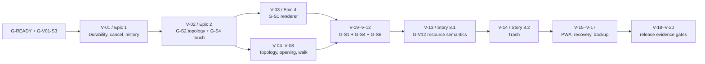

# Sprint Change Proposal — repair of delivery backlog and implementation gates

## 1. Trigger and evidence

The prior implementation-readiness review remained `NOT READY`. Its backlog
findings were concrete rather than a request to re-derive requirements: V-01
had no user-facing durable-command/history/cancel substrate before V-02;
topology/touch prerequisites were not represented as entry gates; duplicate and
Trash preceded real resource semantics; 3D item selection was promised before
an ItemInstance could exist; and release-wide performance/accessibility/rehearsal
cards were incorrectly represented as feature Stories.

An independent audit also required the following acceptance detail to be
explicit rather than implied: canonical measurement targets, shared-wall versus
opening-height fixtures, a no-silent-pruning history limit, a formal device
matrix handoff, and a uniform Playwright obligation for every user-facing BDD
flow.

This is a **Direct Adjustment**. It changes backlog sequence, story boundaries,
acceptance criteria and evidence gates only. It does not alter PRD-owned
requirements, SPEC-owned CAPs, Architecture-owned ADs, UX design, source code,
or any implementation decision.

## 2. Applied corrections

| Finding | Applied correction in `epics.md` | Resulting delivery rule |
| --- | --- | --- |
| V-01 lacked a usable durability/history baseline | Epic 1 now owns Stories 1.1–1.4; Story 1.4 gives confirm/cancel/undo/redo/reject and `SessionRetentionPolicy` behaviour | V-02 cannot be the first slice to invent durable command, history or cancel semantics |
| Storage prerequisite was merely trace text | Added `G-READY` and `G-V01-S3`; Epic 1 explicitly requires both | No application implementation begins before official readiness and S-3 PASS |
| V-02 could begin without proven topology/touch policy | Added `G-S2-topology` and `G-S4-touch`, and made them explicit Epic 2/V-02 gates | Integer-mm topology and touch/numeric alternatives are proven before plan authoring |
| Exact measurement was under-specified | Story 2.1 now covers point–point, point–boundary and boundary–boundary Wall/usable-Room targets; Story 5.4 extends the same canonical contract to ItemInstance footprints | Closest-point/rounding uses canonical mm geometry, never screen pixels, meshes or visual boxes |
| Height semantics could be implemented incorrectly | Stories 3.2–3.4 add `shared-wall-height-opening-min`: adjacent Rooms `2400/2700 mm` derive shared wall height `2700 mm`, while a `2401 mm` sill-plus-opening-height candidate rejects as `OPENING_OUT_OF_BOUNDS` against the `2400 mm` minimum | Wall projection height and Opening fit remain distinct, testable rules |
| FR-23 promised ItemInstance selection before an item existed | Story 4.2 is restricted to Room-surface selection; Story 5.4 owns durable ItemInstance selection through 2D/3D/list/numeric UI | No pre-item 3D scope claims an impossible selection interaction |
| FR-3/FR-4 came before resource-root semantics | Added Story 8.1 (independent variant) only after V-12 and Story 8.2 (Trash/restore/permanent delete) only after V-13 | Duplicate/Trash/GC operate on real pinned resource roots |
| Session history could silently prune redo | Story 1.4 and cross-journey hardening Story 7.1 reject prospective over-limit commands as `PROJECT_HISTORY_RESOURCE_LIMIT` **before** mutation/publication | Current durable revision, undo/redo, revision records, manifests and GC roots stay unchanged; redo disappears only after a successful atomic branch replacement |
| V-18–V-20 were feature Stories | Replaced the former release-wide cards with non-story Gates V-18, V-19 and V-20 | Release evidence has no fictional feature owner and cannot pass on a screenshot |
| Real-device requirement was not a formal test matrix | Added `H-DEV-01`, a required future `bmad-prd` NFR-15 handoff | PRD, not an implicit backlog choice, must name the supported iPhone/Samsung floor/typical profiles and test protocol |
| Screenshot and E2E expectations were inconsistent | Added one central `SC-V01`–`SC-V20`/`SC-P01`–`SC-P03` checkpoint protocol and a mandatory inherited Playwright clause | Every user-facing BDD flow needs linked Playwright E2E; physical iOS Home Screen, eviction/quota and thermal checks remain separate evidence |

## 3. Story and gate topology after the correction

The diagram is a delivery/evidence dependency graph, not a source-code design.
The authoritative detailed acceptance criteria remain in `epics.md`.

## 4. Verification standards now inherited by every user-facing Story

1. Every user-facing `Given/When/Then` has a linked Playwright E2E scenario,
   test identifier and green regression run. Mobile touch/canvas flows require
   a mobile viewport/touch configuration; a desktop browser pass is not a
   substitute.
2. PWA, offline, update, recovery, backup, import, writer-lock and capability
   fallback flows have Playwright end-to-end coverage wherever browser/service
   worker context permits controlled automation.
3. Playwright does not replace domain/unit/property/golden tests for geometry,
   exact millimetres, durability, migrations, resource roots, fault injection
   or stable reason codes.
4. Browser-tab and installed-PWA results remain distinct. Actual iOS Home
   Screen behaviour, OS eviction, quota pressure and thermal behaviour require
   the separately approved physical-device evidence.
5. At each material user-visible milestone the team sends a small screenshot
   of the *running app* under the `SC-*` protocol without blocking safe
   follow-on work. It is owner feedback only, not functional, device,
   accessibility, privacy, offline or performance evidence.

No test or application code was created by this change-control workflow.

## 5. Required follow-up handoffs

| Handoff | Owner/Workflow | Required output | Effect if absent |
| --- | --- | --- | --- |
| `H-DEV-01` | Product Owner + QA/Performance via a fresh `bmad-prd` update | NFR-15 names floor/typical iPhone and Samsung model/SKU, OS/browser/PWA context, vendor-declared RAM/SoC/GPU information, WebGL2 probe and repeatable battery/network/thermal protocol | S-1/S-3/S-4/S-6 real-device acceptance and V-15–V-20 remain `PAUSED` |
| Official readiness recheck | Independent fresh `bmad-check-implementation-readiness` workflow | Current verdict based on all authoritative planning artifacts and this repaired backlog | `G-READY` remains closed; no application code is authorized |
| Evidence spikes S-1, S-2, S-3, S-4 and S-6 | Respective architecture/engineering evidence owners after readiness authorization | PASS/PAUSED decisions and required corpora/ADRs/matrices | Each dependent slice remains closed by its explicit gate |
| Catalog/legal evidence | Catalog and legal owner | Human-approved `AssetUsageGrant`, notices and backup/rendered-output scope | Catalog-dependent placement, finishes, backup and PNG paths cannot claim Alpha readiness |

## 6. Artifact impact and scope control

Applied:

- `_bmad-output/planning-artifacts/epics.md` — corrected coverage, sequencing,
  acceptance criteria, story boundaries, gates, E2E inheritance and screenshot
  protocol.
- This proposal — durable decision record for the correction.

Deliberately not changed:

- PRD, SPEC, Architecture Spine, UX artifacts and project context. In
  particular, this document records `H-DEV-01`; it does **not** select devices
  or edit PRD NFR-15 on behalf of its owner.
- Any application code, package manifest, build configuration, tests, assets,
  generated artifacts or deployment configuration.

The project has no implicit waiver from this approved correction. The existing
rule that application implementation starts only after `READY` (or a narrowly
written waiver) remains intact.

## 7. Readiness verdict after this change

**Verdict: `NOT READY`.**

This correction removes the identified backlog-structure defects; it does not
and cannot satisfy the independent implementation-readiness gate. At minimum,
the official recheck, `H-DEV-01`, relevant S-1/S-2/S-3/S-4/S-6 evidence, named
physical-device matrix and catalog/legal evidence are still required. Any
unresolved documentation-integrity finding, including the referenced missing
`_bmad-output/plans/alpha-implementation-plan.md`, must also be evaluated by
that independent recheck.

The next authorized action is therefore the independent readiness recheck and
the bounded prerequisite workflows above, not application implementation.
