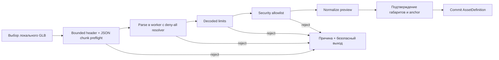

# Контракт импорта пользовательского 3D-ассета

Статус: **Alpha+ draft**. Контракт намеренно уже общего «импорта 3D». Альфа не
принимает произвольные форматы; capability может быть повышена в Alpha только
явным решением владельца после spike.

# 1. Формат и trust boundary

Принимается только самодостаточный бинарный `GLB` (glTF 2.0). `gltf` с внешними
файлами, OBJ, FBX, DAE, 3DS, USD/USDZ и архивы не входят в контракт.

Пользовательский файл считается недоверенным. Он не попадает в Project и не
получает постоянный URL до успешного завершения всех стадий проверки.
Расширение `.glb` не доказывает self-contained: external и data URI запрещены
явной проверкой JSON chunk.

# 2. Pipeline



До loader/decoder preflight проверяет magic/version/chunk bounds, JSON depth,
URI, extensions и declared counts. Стадии имеют прогресс, отмену и общий
deadline. Отмена освобождает ArrayBuffer, ImageBitmap, worker и GPU preview.
Worker можно terminate, но он не является hard memory sandbox.

# 3. Предварительные лимиты

Значения ниже — hypothesis, не обещание. GLB spike должен измерить их на
минимальном целевом устройстве и заменить подтверждёнными:

| Ресурс | Provisional limit |
|---|---:|
| Размер файла | 20 MiB warning, 25 MiB hard |
| Triangle count | 150k warning, 250k hard |
| Vertices | 300k hard |
| Mesh primitives | 128 hard |
| Nodes | 256 hard |
| Materials | 32 hard |
| Textures | 16 hard |
| Одна текстура | 2048×2048 preferred, 4096×4096 hard |
| Суммарные decoded texture pixels | 48 megapixels hard |
| Morph targets | запрещены в Alpha+ v1 |
| Skins | запрещены |
| Animations | игнорировать нельзя; файл отклоняется |
| Lights/cameras | файл отклоняется по FR-51 |
| Embedded audio/scripts | не поддерживаются |

Hard limit применяется к декодированному ресурсу, а не только к zip/file size.
Проверяется ожидаемый CPU/GPU memory footprint до создания полной сцены.
Эта таблица — единственный нормативный владелец provisional GLB limits;
research snapshots не используются validator-ом.

Эти limits защищают parse/decode и не дают право на Durable definition сами по
себе. Original и необходимые normalized runtime resources дополнительно
проходят более строгие per-entry/total/complete-archive limits из
`project-and-backup-contract.md`; при расхождении действует меньший предел.

## 3.1 Portable transfer и exact repair

Hard 25 MiB для custom GLB сохраняется для новой custom definition/reference,
включая создание нового Project из недоверенного backup; размер проверяется
до GLB/JSON parse и прочих preflight проверок. Default/public preflight,
browser/PWA smoke, custom import/placement/library и catalog media сохраняют
существующий 25 MiB hard и свои reason codes. File label или hash сами по себе
не доказывают ранее принятую reference. Envelope limit 50 MiB — не admission.

Для будущего Telegram V1 portable route архитектура допускает отдельно и явно
выбранный доверенной composition read-only structural/security seam с envelope
cap не выше 50 MiB для существующих referenced bytes, с прежними format, URI,
decoded-resource и security проверками. Прежде чем он запускается, проверяются
все применимые byte guards; при неясной применимости используется более строгий
25 MiB предел. Его успех не разрешает новый custom admission или Durable
publication и не изменяет Alpha+ scope.

Exact-byte repair уже ожидаемого hash без новой Project reference — отдельная
recovery операция, не новый asset admission; hash-only восстановление нельзя
приравнивать к допустимости последующего GLB parse/decode/render. Если в этом
пути требуется parse/decode, default/public guard до него остаётся 25 MiB при
неподтверждённой применимости иной policy. Возможность repair и безопасного
reopen для конкретного существующего custom resource 25–50 MiB требует решения
asset-policy owner и доказательства полного security/recovery пути; один
50-MiB structural smoke не закрывает вопрос. Source bytes, current Project и
read-only recovery сохраняются до безопасного исхода; ошибку размера не следует
называть доказательством corruption. Legal/grant policy не меняется.

# 4. Allowlist

Разрешаются только нужные статическому предмету glTF core-компоненты и
проверенные extensions. Первоначальный кандидат:

- `KHR_materials_unlit` — allow;
- `KHR_texture_transform` — allow;
- `KHR_mesh_quantization` — allow после renderer test;
- `KHR_draco_mesh_compression` — allow только при локальном decoder и decoded
  limits;
- `EXT_meshopt_compression` — allow только при локальном decoder;
- любые external URI, network fetch и data URI — reject;
- неизвестное required extension — reject;
- optional неизвестное extension — strip только если glTF validator и renderer
  подтверждают безопасную эквивалентность, иначе reject.

Финальный allowlist фиксируется ADR после spike.

# 5. Семантическая нормализация

GLB не диктует физические размеры проекта автоматически. Перед Durable
publication
пользователь подтверждает:

- канонические ширину, глубину и высоту в мм;
- ось `up` после преобразования к `+Y`;
- точку опоры на полу;
- forward direction;
- категорию;
- footprint;
- допустимость вращения и изменения размера;
- нейтральное preview.

Исходный transform bake-ится в производный runtime asset, но original bytes и
metadata policy определяются storage spike. Нельзя дважды применять scale.

# 6. Результат

Успех создаёт:

```text
CustomAssetDefinition
├── id + schemaVersion
├── sourceHash
├── originalMetadata
├── normalizedDimensionsMm
├── anchor + footprint
├── runtimeBlobRef
├── validationReport
└── createdAt
```

CustomAssetDefinition становится Durable только после local preflight,
pin original/runtime bytes и успешного `BackupFeasibilityPolicy`. Pin проходит через repository `PinStagingLease`:
crash/cancel/fence-loss не может дать GC удалить candidate bytes до явного
no-publication cleanup или atomic publication. Licensing/declaration не
является custom-admission route. AssetInstance создаётся отдельной командой
после Durable definition. Один бинарный blob не дублируется для
каждого экземпляра.

# 7. Отказ и UX

Стабильные категории ошибок:

- `UNSUPPORTED_CONTAINER`;
- `MALFORMED_GLTF`;
- `EXTERNAL_RESOURCE`;
- `UNSUPPORTED_REQUIRED_EXTENSION`;
- `FILE_BYTES_LIMIT`;
- `DECODED_GEOMETRY_LIMIT`;
- `TEXTURE_LIMIT`;
- `ANIMATION_OR_SKIN_UNSUPPORTED`;
- `MEMORY_BUDGET_RISK`;
- `VALIDATION_TIMEOUT`;
- `STORAGE_QUOTA`;
- `CANCELLED`.

Сообщение показывает нарушенный лимит и фактическое значение, когда это
безопасно. Приложение не обещает автоматически «оптимизировать» файл в Alpha+;
может предложить внешний способ уменьшения без отправки файла.

# 8. Privacy и безопасность

- проверка по умолчанию локальная;
- файл не загружается на сервер без отдельной capability и consent;
- владелец продукта выбирает бесплатные/self-authored модели вне приложения;
  Alpha не хранит и не проверяет legal/usage declaration, attribution или
  notice;
- каталог и custom assets визуально различимы;
- имена файлов очищаются перед логированием/экспортом;
- telemetry не содержит бинарный файл, texture, полный путь или персональное
  имя;
- content-type и magic bytes проверяются независимо от расширения;
- parser/decoder работает в worker с deadline/terminate, но не обещает hard
  memory isolation; container/declared bounds проверяются до тяжёлого decode;
- resource resolver deny-all, а decoder JS/WASM локально pinned по hash;
- object URLs отзываются; GPU resources dispose-ятся;
- preview не может инициировать network request.

# 9. Хранилище и переносимость

Storage spike сравнивает IndexedDB Blob и OPFS на поддерживаемых платформах.
Портативный backup должен:

- включать pinned original и все невоспроизводимые normalized runtime
  resources custom asset; неполный результат не называется Portable Backup;
- для PPJ-A1 materialize semantic `dimensionsMm`, local floor `footprintMm`, allowed
  discrete placement/orientation sets и closed resize policy каждого referenced
  AssetDefinition inside PPJ-A1 `assetDefinitionRefs[].semanticSnapshot`, plus
  exact current `AssetInstance.instanceDimensionsMm`; their raw-number grammar,
  exact-footprint admission, pointer traversal и backup reasons принадлежат
  [Portable Backup ingress registry](portable-backup-ingress-registry.md), а
  binary resource entry не является hidden geometry schema; V1-wire вместо
  этого сохраняет все точные V1 definition/item fields и referenced bytes по
  отдельной зарегистрированной grammar, не изобретая PPJ semanticSnapshot;
- дедуплицировать blobs по hash;
- иметь manifest, schema version и checksums;
- проверять общий unpacked budget до записи;
- импортироваться в staging namespace;
- атомарно публиковаться только после полной валидации.

# 10. Verification gate

До включения CAP-12 нужны:

1. corpus корректных и враждебных GLB;
2. fuzz/validator tests malformed chunks и metadata;
3. memory/thermal measurements на минимальном устройстве;
4. byte-level preflight и доказательство отсутствия network fetch до и во
   время loader/decoder;
5. cancel/dispose tests на каждой стадии;
6. quota and backup round-trip tests;
7. визуальная проверка осей, scale, normals, textures и footprint;
8. решение по Draco/Meshopt/KTX2;
9. подтверждённые hard limits;
10. UX-test: пользователь понимает, почему файл отклонён.
