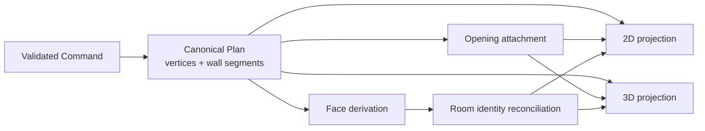

# Контракт геометрии

Статус: **draft**. Domain-owned constrained `PlanGraph` kernel уже выбран;
external computational geometry engine допускается только как test-only
oracle/fixture adapter. Его version и versioned corpus, а также provisional
численные пороги, требуют отдельного подтверждения golden corpus и topology
spike.

# 1. Координаты и точность

- правосторонняя система координат;
- `x,z` лежат на плане пола, `y` направлена вверх;
- доменная длина — `SafeIntegerMm`, то есть signed safe integer в мм;
- координаты Vertex — целые мм;
- renderer получает метры только через `GeometryProjectionPort`;
- raw UI text и raw geometry JSON lexeme допускают только
  `^-?(?:0|[1-9][0-9]*)$`: без whitespace, `+`, decimal или exponent form;
- schema-aware decoder сохраняет raw lexeme каждого persisted geometry field,
  перечисленного в [Portable Backup ingress registry](portable-backup-ingress-registry.md),
  и валидирует его **до** host IEEE `Number` coercion; обычный
  `JSON.parse`/reviver после coercion не является acceptance boundary. Current
  PPJ-A1 snapshot intentionally has no serialized geometry Command pointer:
  Command container/payload schema-unreadable rather than implicitly covered;
- `Number.isSafeInteger(...)` остаётся final runtime guard, но не заменяет
  lexical validation; для командной геометрии и PPJ raw `-0` нормализуется в
  canonical `0` до классификации length/delta и перед PPJ serialization.
  Зарегистрированный V1-wire отдельно сохраняет исходный IEEE-754 sign `-0`
  в переносимом snapshot и structured-clone Project; математическая геометрия
  считает оба нуля равными. Это не изменяет command geometry или PPJ grammar;
- `BigInt`, rational predicates/intersections и `2×mm` intermediates допустимы
  только как ephemeral exact-geometry arithmetic и никогда не входят в
  Project, Revision, History, Command payload или Portable Backup;
- визуальное округление никогда не записывается обратно без Command.

Для направлений, кратных 45°, доменная модель хранит целые конечные точки.
Корень из двух не сериализуется. Авторитетны равные integer-mm delta:
`abs(ΔxMm) = abs(ΔzMm) = n`. Length-only request обязан назвать quadrant
`NE|NW|SE|SW`; supplied exact endpoint/delta сохраняет свои signs и не
переинтерпретируется как length request. Для положительного integer `L`
candidate выбирает ближайший `n` к `L / √2` exact-integer predicate-ом
`(2n − 1)² < 2L² < (2n + 1)²`, а затем строит
`start + n × selectedDirection`. Equality невозможна, поэтому hidden
half-way tie нет. Preview до подтверждения показывает selected signed
`ΔxMm × ΔzMm` и actual quantized length; только resolved endpoints входят в
Command. Например, `1000 мм` в `SE` даёт `+707 × -707 мм` и `≈999,85 мм`.
Измерение хранит exact squared length `2n²`, а Preview, 2D, 3D и export получают
text только через общий `MeasurementFormatPolicy`; его formatted output никогда
не становится geometry input.

`MeasurementRequest` существует только ephemeral и bound to
`projectId/baseRevisionId/baseRevisionChecksum`. Его operation —
`WallCenterlineLength | RoomInnerDimensions | RoomArea | RoomPerimeter |
Distance`; target — `VertexPoint`, exact `PlanPoint`, `WallCenterline`,
`RoomInnerBoundary` или `ItemFootprintBoundary`. `Distance` принимает два
target; остальные operation имеют предписанное число target. Boundary locator
несёт source ID и параметр/точку, а nearest/tie comparison использует exact
distance и stable candidateSortKey, не traversal ordinal. Stale checksum или
удалённый target discard-ит result в transient reselection/retry, а не
переносит measurement на новую Revision.

`MeasurementFormatPolicy V1` использует `ru-RU`: длина — nearest integer mm
с half-up rule и suffix `мм`; площадь — nearest `0,01 м²` с half-up rule и
suffix `м²`; exact internal result сохраняется до formatting. Эта policy
одинакова в Preview, Plan 2D, 3D и export и не является canonical input.

# 2. Planar graph



Минимальные структуры:

```text
Vertex { id, xMm, zMm }
WallSegment { id, startVertexId, endVertexId, thicknessMm }
Face { outerCenterlineRing[], voidCenterlineRings[] }
Room { id, faceFingerprint, name, heightMm }
Opening { id, wallSegmentId, offsetMm, widthMm, heightMm, sillMm, kind }
```

WallSegment проходит по центру толщины. Ограниченная Room Face имеет одну
simple outer ring и ноль или больше simple void rings, которые строго лежат
внутри outer ring и не касаются ни её, ни друг друга. Topological Face описывает
centerline boundaries, а usable interior polygon выводится inward offset-ом
outer и void boundaries на половину толщины. ID не выводится из координат.
Координаты меняются, identity — по правилам команды и reconciliation.

Domain-owned constrained `PlanGraph` kernel единолично применяет этот
контракт к `SafeIntegerMm` ingress, permitted directions, exact contacts,
derived Face/usable geometry, Room/Opening lineage, allocation intent/inverse
и application-facing stable reason outcomes. Этот companion и
Project/Backup contract сохраняют ownership exact offset/join, raw grammar и
reason-union semantics; kernel не создаёт альтернативный contract. External
geometry engine допустим только как immutable test-only oracle/fixture adapter:
без ID allocation, Command/publication path, reason-code authority или
canonical mutation.

# 3. Инварианты valid plan

1. Vertex имеют уникальные ID и координаты в проектном диапазоне.
2. WallSegment ссылается на существующие разные Vertex.
3. Длина сегмента не меньше согласованного минимального значения.
4. Направление входит в текущий набор constraint directions.
5. Коллинеарные перекрывающиеся сегменты не существуют как независимые стены.
6. Пересечение сегментов допустимо только в общей Vertex; команда обязана
   детерминированно split-нуть пересечение либо отклониться.
7. Дубликаты не зависят от ориентации `A→B` / `B→A`.
8. Производная ограниченная Room Face имеет одну simple outer ring; её void
   rings simple, strictly contained и pairwise non-touching. Non-simple
   bounded walk получает `SELF_INTERSECTION`, а touching/nested/неоднозначный
   ring получает `AMBIGUOUS_INTERSECTION`; оба исхода не меняют Revision.
9. Толщина и высота стен положительны и находятся в product limits.
10. Opening целиком находится на usable interval стены.
11. Openings на одной стороне не перекрываются сверх разрешённого порога.
12. Любое изменение либо сохраняет весь набор инвариантов, либо не меняет
    Revision.
13. Usable interior polygon существует, не самопересекается и не схлопывается
    после offset/join.
14. Room.heightMm — единственная редактируемая высота помещения; Wall height
    является projection.
15. `FloorPlacement` и `WallPlacement` имеют устойчивый compatible host либо
    команда атомарно разрешает orphan/rehost до commit. Нейтральная
    визуализация пола и стен не является доменным host или durable assignment.
16. Proposed `AddWallSegment` не пересекает closed swept wall body ни одного
    retained rotated `FloorPlacement` footprint или его required clearance.
    `WALL_ITEM_COLLISION` отклоняет всю candidate до allocation; item не
    перемещается, не удаляется, не обрезается и не меняет host.

# 4. Grid, snap и exact numeric input

«Гридфинити» означает бесконечную editor grid, а не Gridfinity storage.
Обычный gesture работает по видимой `100 mm` minor lattice; zoom меняет только
контраст и плотность major lines. Для orthogonal `100 mm` Wall presentation
phase выравнивает minor-cell edges с внешними краями стены. Это presentation:
изменение zoom/phase/visible cell не валидирует, не округляет, не persist-ит,
не переписывает и не re-normalizes endpoint.

`SnapPolicy` — construction-only state. Gesture base candidate строится от
active gesture origin, а не от durable global-coordinate lattice: после выбора
permitted unit direction `d` он равен `origin + (100 × k) × d`, где `k` —
positive integer, а `d` — одна из восьми cardinal/45° unit directions.
Off-grid origin поэтому всё ещё образует exact 45° candidate. Candidate-class
order: eligible exact existing Vertex, eligible exact intersection/end,
constrained-direction candidate, затем origin-relative 100-mm candidate.
Диагональ показывает exact centerline и construction-step guide, но никогда не
притворяется полностью занятой square cell.

Exact numeric input bypasses только gesture/visual selection. Он принимает
off-grid integer-mm endpoint или delta, если non-zero delta имеет ровно одну
нулевую component либо `abs(dxMm) = abs(dzMm)`; otherwise он получает
`UNSUPPORTED_DIRECTION`, а не nearest-angle correction. Numeric path проходит
те же exact-contact normalization и полный Plan/Room/Opening/host validation,
что и gesture path. `SnapPolicy` configuration/identity и live `DraftCommand`
не входят в Project, Revision, History, persisted Command или Portable Backup;
later policy не может re-normalize Durable Revision.

`PlanProjectionPort` — единственный ephemeral и fakeable seam screen↔plan
selection. Он принимает один immutable Project snapshot/revision checksum,
forward/inverse transform и pointer in CSS px; возвращает только finite result
либо `SelectionUnavailable`. Его значения никогда не serialise в Project,
Command, ChangeSet, History, Revision или Portable Backup.

Для C1/C2 projected target eligible, только если он внутри closed square с
half-side `12 CSS px` вокруг pointer. При нескольких target одного класса
побеждает минимальный squared screen distance; exact tie выбирает стабильный
`candidateSortKey = kind + opaque source ID + canonical contact coordinate`.
Во время одного DraftCommand выбранный target удерживается до выхода за
half-side `18 CSS px`; после этого selection вычисляется заново. C3 допустим
только если inverse transform даёт safe-integer-mm endpoint и permitted
non-zero direction. Иначе C4 берёт nearest permitted direction (direction tie:
`E, NE, N, NW, W, SW, S, SE`) и
`k = max(1, floor((projectedDirectedMm + 50) / 100))`. T/X continuity всегда
перечисляет все exact contacts выбранной coordinate в одном candidate, а не
выбирает один WallSegment library default-ом. Non-finite/non-invertible/stale
projection остаётся transient `SelectionUnavailable` с retry/numeric path и
сохраняет DraftCommand; это не `INVALID_DIMENSION` и не durable outcome.

Fixtures передают PlanProjectionPort explicitly: hit-square edges/corners,
tie, hysteresis, C3/C4 boundary, T/X continuity, stale/cancel и non-invertible
path. Canvas и DOM/numeric alternative обязаны наблюдать тот же result.

# 5. Команды топологии

Минимальный словарь:

- `AddWallSegment`;
- `MoveVertex`;
- `MoveWallSegment`;
- `DeleteWallSegment`;
- `SplitWallSegment`;
- `MergeCollinearSegments`;
- `AddOpening`;
- `MoveOpening`;
- `ResizeOpening`;
- `DeleteOpening`;
- `SetRoomProperties`.

Каждая mutating path проходит:

```text
lossless input normalization
→ allocation-free detached preflight discovery (project/baseRevision/checksum/fence/cancellation bound)
→ total exact-contact normalization + topology operations
→ full Plan/Room/Opening/host invariant validation
→ room identity/height reconciliation
→ hosted-surface/material/asset reconciliation
→ ConflictPreview / AwaitingUserOutcome when a source-owned choice is required
→ confirmed choice: recheck current base Revision and writer fence, then rerun discovery/validation
→ deterministic opaque-ID allocation and materialize one complete candidate
→ Validated complete ChangeSet
→ PendingDurability
→ staging write + checksum + atomic current-pointer swap
→ Durable Revision + HistoryEntry
→ derive projections
```

Pointer move создаёт current-session-only `DraftCommand`. Для Wall gesture
только non-zero endpoint после explicit pointer-down/drag (либо complete exact
numeric intent) может создать preflight: tap, cancelled long press или draft
без non-zero endpoint завершается без candidate, allocation или Project effect.
Parse,
normalization, topology или invariant reject сохраняет current Durable Revision
без `PendingDurability`, History entry, autosave или canonical projection
publication. `SelectionUnavailable` и `ConflictPreview/AwaitingUserOutcome`
также не materialize Command/ChangeSet/inverse. Cancel, stale base или lost
writer fence завершают такой preflight без durable effect. Только Validated
complete ChangeSet входит в `PendingDurability`; ChangeSet/inverse — semantic
candidate inputs, не independently durable records. Candidate не называется
saved и не становится основой следующей mutating Command до Durable
publication. Post-validation persistence failure не является reject: Durable
Revision/History остаются current, pending candidate/journal доступен только
для retry/recovery export, а следующий mutating commit fenced.

# 6. Пересечения и нормализация

Touch и numeric path используют одно total exact-contact rule до full
validation. Каждая exact coordinate group охватывает:

1. candidate endpoint → existing Vertex;
2. candidate endpoint → existing WallSegment interior;
3. candidate interior → existing Vertex, включая multi-Wall junction;
4. candidate interior → existing WallSegment interior.

Group reuse-ит единственную existing Vertex или создаёт ровно одну shared
Vertex. Каждый proposed/existing WallSegment, чьё interior содержит group
coordinate, атомарно partition-ится по всем distinct ordered contacts в
non-zero consecutive pieces. Поэтому endpoint/interior contact создаёт T,
candidate interior через existing junction split-ит proposed segment, а один
otherwise valid exact X создаёт одну Vertex и четыре canonical WallSegment.

Non-integer или out-of-limit contact, collinear overlap, self-intersection,
duplicate/coincident Vertex, zero/too-short partition либо любой иной failed
invariant reject-ит весь detached candidate до Command или Revision mutation.
Near-contact не создаёт approximate topology contact: если C1/C2 hit predicate
не выполнен, PlanProjectionPort продолжает C3/C4 route. T/X continuity
перечисляет все exact contacts одной coordinate; merge/host consequences идут
через ConflictPreview/re-entry. UX visual feedback observes this transient
result, а library не может подменить exact rule своим default.

# 7. Вывод комнат

Room строится из ограниченной Face, а внешняя бесконечная face отбрасывается.
Её normalized fingerprint включает outer ring и sorted normalized void rings,
но не зависит от начальной точки обхода. Repeated vertex/dart допустим только
на unbounded exterior embedding; repeated bounded walk не создаёт Room.

## 7.1 Внутренняя геометрия

- Wall reference line — centerline.
- Толщина распределяется симметрично.
- Для outer boundary Room usable line смещается внутрь Face на
  `thicknessMm / 2`, а для void boundary — от void, сохраняя usable region.
- Соседние usable lines пересекаются miter join; miter ограничен четырьмя
  половинами большей толщины, после чего применяется детерминированный bevel.
- Площадь и периметр вычисляются по usable interior polygon.
- Dimension стены без уточнения показывает centerline length; dimension Room
  и rectangular starter используют расстояние между finished inner surfaces.
- Rectangular starter с внутренними `W×D` строит centerlines наружу на
  половину соответствующей толщины, поэтому usable polygon равен `W×D`.

Для нечётной толщины half-offset требует rational intermediate. Kernel может
считать в half-millimetre fixed point (`2×mm`) как производной точности, но
persisted Vertex и пользовательские dimensions остаются integer mm. Miter cap,
затем deterministic bevel и `MeasurementFormatPolicy V1` — единственные
канонические formatting/join routes; library default не выбирает их.

Reconciliation свойств:

- unchanged normalized face сохраняет Room ID;
- изменённая face сохраняет ID только при complete one-to-one lineage: один
  previous Room и один derived Room с documented command lineage и valid
  normalized outer/void correspondence;
- valid `AddWall` split каждого predecessor Room materializes immediately: все
  его successor Rooms получают exact predecessor `heightMm`. Новый `roomId` и
  не-height Room metadata выводятся детерминированно, не наследуются по
  left/right user choice и не открывают отдельный preview;
- merge, several eligible predecessors, а также Opening, asset или surface-host
  последствия, для которых нельзя сохранить данные однозначно, требуют
  `ConflictPreview`. Пользователь выбирает только разрешённый safety outcome;
- такой confirm повторно проверяет base/fence, целиком reruns derivation и лишь
  затем materializes один complete ChangeSet. Обычный wall-induced Room split
  этой второй стадии не имеет.

# 8. Стены, проёмы и 3D

Стена экструзится из параметрического сегмента, толщины и производной высоты.
Room.heightMm задаёт производную высоту стен; shared wall имеет высоту `max` соседних Room,
наружная/незамкнутая стена использует default Room height. Junction mesh —
проекция и не может менять Plan. Проём хранит offset вдоль канонической
ориентации сегмента; при reverse ориентации адаптер преобразует offset
детерминированно. Shared opening обязан помещаться в `min` высот соседних Room.

После Wall topology edit Opening сохраняется автоматически только если его
previous host имеет ровно одного lineage successor и прежний
`offsetMm/widthMm/heightMm/sillMm` остаётся valid interval/height. Resize,
relocation, delete, several successor или missing host создают
`ConflictPreview`: пользователь выбирает valid rehome с shown parameters,
delete Opening либо cancel. Cross-root transfer требует compatible host и
явного confirm. Confirm повторно проверяет base/fence и reruns full validation;
никакой offset/host не переносится silently и stale candidate не materialize.

Door и Window не создают navigation graph или transition. В Alpha в domain, UI
и API нет `passable`, `locked`, access control, key, lock/unlock либо
open/close state/interaction Door.

# 9. Предметы и collision

AssetInstance хранит одну из placement-форм:

```text
FloorPlacement { roomId, xMm, zMm, elevationMm, yawStep }
WallPlacement { wallSegmentId, adjacentRoomId|exteriorSide,
  offsetMm, elevationMm, normalOffsetMm, orientation }
```

Каталоговый предмет имеет физические `width/depth/height`, footprint и anchor.
В альфе произвольный non-uniform scale запрещён: изменение размеров возможно
только для ассетов, явно объявленных resizable.

PPJ-A1 materializes exact current `instanceDimensionsMm`, а не свободный
renderer scale. AssetDefinition declares closed `fixed`, `uniform` или
`perAxis` resize policy with integer-mm bounds: fixed instance equals base
dimensions, uniform preserves exact base ratio, and independent axes are
permitted only by `perAxis`. Its current local footprint is rederived without
rounding from base footprint and current width/depth by exact integer division;
non-integral result is schema-unreadable before collision/host construction.
`yawStep`/`orientation` use RotationStep V1 `0..7`: each step is a positive
right-hand `45°` turn about `+Y` from asset-local `+Z` to plan `+Z`, and must
belong to the asset-declared allowed set. The complete raw field registry and
reason mapping remain in [Portable Backup ingress registry](portable-backup-ingress-registry.md).
The same exact-divisibility predicate is checked by resize candidate preflight
and `BackupFeasibilityPolicy` before Durable publication, so a current-policy
Project cannot gain a size that its mandatory self-contained backup cannot
round-trip.

Collision tiers:

1. outside-room, item placement through wall, либо proposed Wall swept body
   through retained rotated floor-item footprint — blocking;
2. предмет–предмет — warning по умолчанию;
3. clearance zone двери/техники — warning с семантическим объяснением;
4. декоративное пересечение — допустимо.

Точная collision policy остаётся продуктовым решением. Любой warning
сохраняется в диагностируемом состоянии, но не меняет физический размер
объекта.

AssetPlacement reconciliation сохраняет semantic host. Wall side адресуется парой
`(WallSegmentId, AdjacentRoomId|ExteriorSide)`, а не направлением сегмента;
Floor всегда принадлежит конкретному Room. При reverse сторона не
меняет смысл. Automatic transfer допустим только при one-to-one compatible
same-root lineage; split/merge/cross-root/delete/incompatible host показывает
`ConflictPreview` с rehome/delete/orphan route. Подтверждённый route проходит
fresh base/fence validation. Удаление host не оставляет скрытый world-space
asset.

# 10. Сериализация и миграции

- schema ID и positive schema version обязательны; current portable selector —
  manifest/root pair `interiors.project/alpha-1` / `1` из
  [Portable Backup ingress registry](portable-backup-ingress-registry.md), а не
  bare legacy version number;
- Portable Backup canonical Project JSON — mandatory `project/project.json`
  member внутри `.interiors` bundle; внутреннее non-JSON repository encoding
  не переопределяет этот portable canonical format и не становится его alias
  без отдельного source-owned решения;
- производные Face, mesh и spatial index не являются авторитетными и могут
  пересчитываться;
- ID стабильны в пределах Project;
- порядок unordered collections нормализуется для snapshot/golden tests;
- миграция выполняется copy-on-write;
- исходная revision остаётся доступной до успешной валидации результата;
- unregistered более новая schema не открывается как current Project и не
  reserializes; original-byte inspect/read-only handoff возможен только если
  будущая source-owned registry row явно пометит свой safe inspector.
- Legacy topology/Project V1/V2 fixtures (не `MeasurementFormatPolicy V1`)
  классифицируются только [TCC-A1](topology-corpus-contract.md): readable,
  unmappable и unreadable fixture остаётся non-current diagnostic/export
  handoff, не PlanGraph input. Portable matrix сохраняет ordinary
  `BACKUP_SCHEMA_UNREADABLE` только внутри valid checksum-valid,
  AST-R1-admitted current envelope (иначе выигрывает ранний
  container/path/manifest/checksum/AST-capacity reason). Ни automatic
  reinterpretation, discard, migration, promotion, production handoff, ни
  Durable publication не разрешены. Future exception требует новой registry
  row, closed grammar/reason map, corpus и explicit copy-on-write action.

# 11. Ошибки

Минимальные reason codes:

`ZERO_LENGTH`, `DUPLICATE_SEGMENT`, `UNSUPPORTED_DIRECTION`,
`SELF_INTERSECTION`, `AMBIGUOUS_INTERSECTION`, `OPENING_OUT_OF_BOUNDS`,
`OPENING_OVERLAP`, `ROOM_IDENTITY_AMBIGUOUS`, `PROJECT_BOUNDS_EXCEEDED`,
`INVALID_DIMENSION`, `DIAGONAL_LENGTH_QUANTIZED`, `USABLE_POLYGON_COLLAPSED`,
`HOST_SURFACE_REMOVED`, `ANCHOR_REHOST_AMBIGUOUS`, `WALL_ITEM_COLLISION`.

UI локализует reason code, но код остаётся стабильным для тестов и диагностики.
Interactive malformed/fractional/nonfinite/unsafe value и negative length
используют `INVALID_DIMENSION`; zero length использует `ZERO_LENGTH`, а valid
integer value за Project bounds — `PROJECT_BOUNDS_EXCEEDED`. Persisted raw
geometry token, который не проходит lossless schema boundary в canonical
`project/project.json`, не превращается в runtime conversion exception: import
contract применяет [Portable Backup ingress registry](portable-backup-ingress-registry.md)
— unsafe normalized path прежде JSON decode есть `BACKUP_PATH_UNSAFE`,
10 MiB canonical Project JSON guard после safe path/container-entry checks есть
bounded pre-checksum `BACKUP_PROJECT_LIMIT`; checksum-post AST-R1 allocation cap
из registry также есть `BACKUP_PROJECT_LIMIT` до closed shape. Schema/raw-field
failure в admitted AST-R1 до coercion есть `BACKUP_SCHEMA_UNREADABLE`, а только
затем schema-valid value/count beyond remaining `ProjectLimitsPolicy` есть
`BACKUP_PROJECT_LIMIT`. Later domain failure сохраняет собственный stable reason;
после read-only valid-Plan binding FP-A1/SurfaceAddress/resizable-footprint mismatch остаётся
`BACKUP_SCHEMA_UNREADABLE`. Private V1/V2 reason и hidden normalisation не
выделяются.

# 12. Verification

Обязательные уровни:

- example tests на каждую команду и reason code;
- property tests: undo(command(state)) = state, сериализация round-trip,
  инварианты после случайной допустимой цепочки;
- golden corpus сложных пересечений, split/merge, диагоналей и проёмов;
- differential projection tests: 2D/3D используют одну canonical revision;
- fuzz tests импортируемого project backup;
- raw-byte fixtures для `project/project.json` внутри `.interiors` покрывают
  каждый pointer/placement branch registry: decimal, exponent,
  malformed/nonfinite/unsafe, negative-zero и bounds values доказывают
  validation before host-number coercion; duplicate key, unknown field и
  forbidden serialized Command container доказывают closed snapshot, а nested
  `.interiors/project/project.json` path rejects;
- corpus для каждого signed diagonal quadrant, exact nearest-`n` predicate,
  selected signed preview delta и общего `MeasurementFormatPolicy` в Preview,
  2D, 3D и export;
- PlanProjectionPort vectors для closed hit-square edge/corner, class order,
  exact tie/candidateSortKey, hold hysteresis, C3/C4/k boundary,
  non-invertible and stale/cancel path, а также DOM/canvas parity;
- all-contact fixtures для endpoint/Vertex, T, candidate-interior/junction,
  one/multi-X и whole-candidate reject без partial Command/Revision mutation;
- face corpus для exterior articulation, multiple Rooms, simple hole,
  hole-offset/collapse, repeated bounded walk и touching/nested ring с exact
  Room/usable post-state или stable no-mutation outcome;
- paired MeasurementRequest vectors для Wall, Room inner dimensions/area/
  perimeter, point/boundary and footprint/boundary distance, tie and stale
  result; text must match Preview/2D/3D/export;
- conflict/re-entry vectors для Room split/merge, Opening post-Wall edit and
  asset/surface host change: cancel, base/fence loss and confirm rerun create
  no partial identity, ChangeSet, Revision, History or GC-root state;
- total allocation/lineage vectors for every topology command, shared Vertex,
  retry/stale intent, split/merge and inverse replay;
- fixtures для валидной межкомнатной Door, exterior/invalid Door, topology или
  Opening edit/remove и отсутствия независимого Door-state;
- differential fixtures для immutable external oracle/fixture adapter: он
  сравнивает результат с canonical domain kernel без normalisation, rounding,
  ID allocation или mutation; divergence остаётся evidence finding;
- TCC-A1 versioned V1/V2 corpus доказывает readable/unmappable/unreadable
  classification, original-byte handoff, `BACKUP_SCHEMA_UNREADABLE` только в
  checksum-valid, AST-R1-admitted current envelope, earlier boundary reason
  otherwise, и отсутствие migration/pin/ID/Revision/Project publication;
  `MeasurementFormatPolicy V1` не является частью этого legacy scope;
- AST-R1 vectors доказывают caps depth/node/member/array/pointer/string/numeric
  token, retained-metadata formula и byte-order precedence против
  malformed/duplicate-key input;
- browser tests для touch-to-command mapping;
- visual snapshots только как дополнение к доменным assertions.

До начала feature implementation topology slice должен доказать adopted
domain-owned kernel against уже принятой policy и relevant TCC-A1 fixture
family, включая PlanProjectionPort,
multi-component faces, paired measurement, conflict re-entry, total
allocation/lineage, replay/inverse и corpus выше. Optional external engine
может быть только immutable test-only oracle/fixture; он не вправе заменить
policy library default-ом или стать canonical implementation. Unregistered legacy topology V1/V2 fixtures
могут получить supported migration/handoff лишь после future source-owned
registry row, closed grammar, stable-reason mapping, explicit user action и
versioned corpus.
