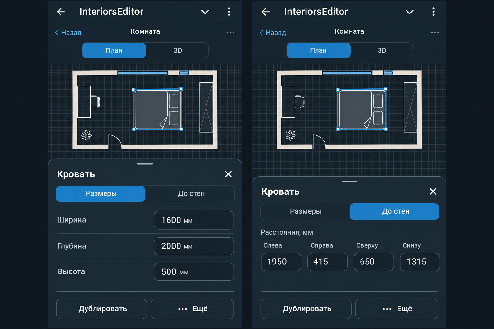
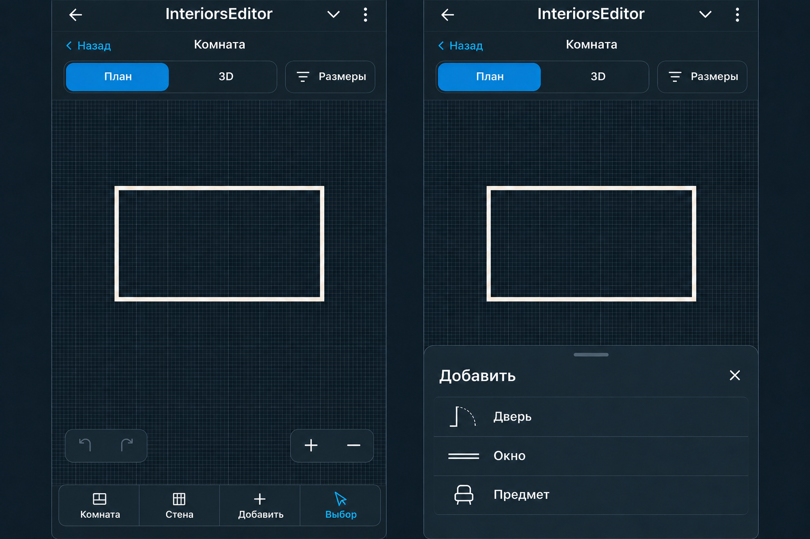
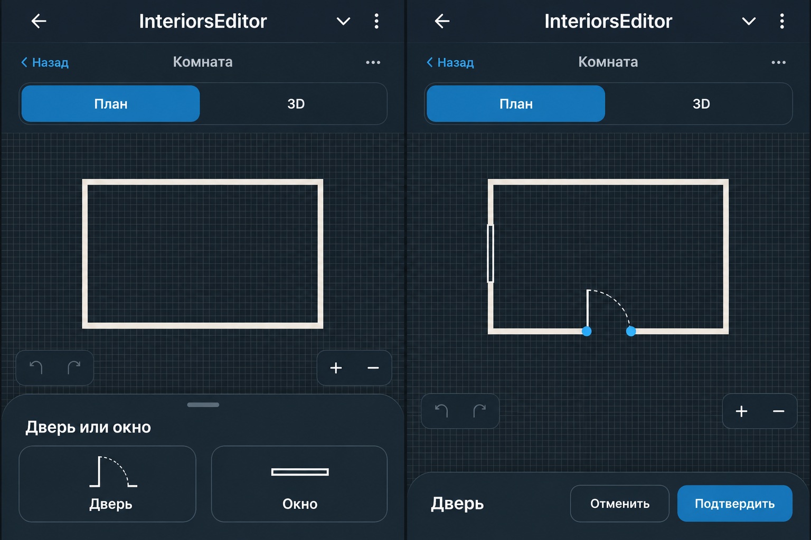

# Параметры мебели и постановка проёмов

**Предложение для мобильной TMA · 23 ноября 2026.** Другой пользователь прислал снимок Android со шторкой «Кровать» и попросил её переработать. Владелец поддержал запрос. Этот отзыв учитывается отдельно от шести анкет и замечаний участника № 7. [Исходный снимок](evidence/05-bed-inspector-android.png)

## Почему сложно выбрать поле

На снимке «Слева 1950» задаёт положение кровати в комнате, а «Ширина 1600» меняет саму кровать. Поля выглядят одинаково и идут подряд. Четыре отступа выстроены в ряд, ширина и глубина — в два столбца, высота остаётся одна на следующей строке. Затем столько же внимания получают блокировка, копирование и большая красная кнопка удаления. На плане почти не видно предмета, к которому относятся числа. Красные пометки выделяют места затруднения. Предлагаемая компоновка ниже — решение для проверки с пользователями.

## Что подсказали конкуренты

| Продукт | Что подтверждает первоисточник | Решение для InteriorsEditor |
| --- | --- | --- |
| Planner 5D | На iOS выбранный предмет получает быстрые действия, в том числе копирование. Точный ввод габаритов открывается через редактирование. На Android у выбранного окна перемещение вдоль стены и числовые параметры доступны разными действиями. [Предмет](https://support.planner5d.com/en/articles/16944106-how-to-edit-an-object) · [Окно](https://support.planner5d.com/en/articles/12906280-how-to-add-windows-android) | Оставить «Дублировать» рядом с выбором. Для проёма дать отдельный вход в подробные параметры и короткое подтверждение переноса. |
| Home Planner | В руководстве размер предмета отделён от его положения. Например, для настенной полки отступы и расстояние от стены находятся в Position. Доступные поля зависят от привязки предмета. [Руководство по положению предмета](https://share.homeplannerapp.com/help/wall-panel-visualizer) | Дать двум задачам буквальные названия «Размеры» и «До стен». В нашей TMA у напольного предмета стороны относятся к осям плана и внутренним стенам текущей комнаты. |
| KitPlan | В мобильном просмотре импортированной мебели касание предмета показывает габариты. Общее руководство описывает числовые ширину, глубину и высоту, а у проёмов — собственные размеры и отступы. [Мобильный просмотр](https://kitplan.app/ru/pro100/na-telefone/) · [Редактор комнаты](https://kitplan.app/ru/proekt-komnaty-onlayn/) | Сделать габариты легко читаемыми при выборе и оставить у двери и окна только относящиеся к ним поля. Раскладку на телефоне проверяем на своей TMA. |
| Floorplanner | Руководство описывает точные настройки выбранных элементов. Конкретная компоновка инспектора на телефоне в этом источнике не показана. [Руководство редактора](https://cdn.floorplanner.com/static/brochures/FloorplannerManualEN.pdf) | Использовать как справку о составе свойств. Расположение вкладок и кнопок оценивать по мобильным сценариям выше. |

## Шторка выбранной кровати

**Верхняя строка** использует одобренную общую оболочку TMA: название предмета, доступное закрытие и небольшая полоска сверху по центру для изменения высоты. [Контракт компонента](shared-bottom-sheet.md) Статус черновика или сохранения остаётся в штатном месте редактора. Под названием две вкладки. В обеих вкладках название остаётся в заголовке, а быстрые действия — в нижней строке шторки.

| Состояние | Что видит и меняет человек |
| --- | --- |
| **Размеры** | По умолчанию при открытии параметров уже размещённого напольного предмета. Три строки одинаковой структуры: «Ширина — 1600 мм», «Глубина — 2000 мм», «Высота — 500 мм». Подписи слева, числа выровнены справа. У фиксированной модели те же строки доступны для чтения, без активного поля ввода. |
| **До стен** | Четыре поля под общей единицей «мм». Для кровати на снимке это слева **1950**, справа **415**, сверху **650**, снизу **1315**. Подписи относятся к осям плана, включая повёрнутый предмет. В фокусе поля на плане выделяется соответствующая направляющая. При отсутствии достоверного измерения показывается прочерк с пояснением, при известном касании — 0. |
| **Действия** | «Дублировать» доступно после выбора одним нажатием, в том числе из шторки. «Ещё» открывает «Заблокировать» или «Разблокировать» и отдельное «Удалить предмет» с действующим подтверждением. Блокировка защищает исходный предмет от перемещения, изменения размеров и удаления. В доступном для записи проекте разрешено поставить независимую копию заблокированного напольного предмета. |

При обычном тексте четыре поля «До стен» сохраняют одну строку на 320, 360 и 390 CSS px. На 200% поля переносятся с сохранением подписей и единиц. Переключение вкладки само по себе не сохраняет проект. Допустимый ввод применяется штатно по Enter или выходу из поля. Неполный или недопустимый ввод не изменяет последнюю допустимую позу, причина видна рядом с полем. Закрытие или смена вкладки сохраняют действующую защиту незавершённого ввода. Для поля с неизменённым значением запись в истории не появляется.

При постановке или перемещении напольного предмета доступ к четырём зазорам и их направляющим остаётся в черновике. Для нового экземпляра публикация происходит только после подтверждения постановки. Поворот остаётся под рукой на холсте, изменение цвета — в 3D. Вкладка «До стен» в этом предложении относится к 2D-плану. Межпредметный зазор из отдельного среза явно подписывается выбранной парой. [Действующее поведение точного ввода](../../planning-artifacts/sprint-change-proposal-2026-11-22-mobile-editor-finish.md) · [Проверки межпредметного замера](acceptance-scenarios.md)

## Двери и окна

На обычном плане без выделения третья кнопка показывает плюс над подписью «Добавить». Нажатие открывает общую шторку, в которой сразу видны «Дверь», «Окно» и «Предмет». Первые два действия включают постановку конкретного типа. Пользователь указывает подходящее место на стене. При входе с уже выбранной подходящей стены используется текущая стена. Полотно и дуга показывают сторону открывания двери, окно обозначается линиями остекления. В форме создания доступны ширина и высота, у окна — высота подоконника, у двери — предусмотренные настройки открывания.

При перемещении видны оба края проёма. После отпускания остаётся только короткое подтверждение с «Отменить» и «Подтвердить». Детали снова доступны по запросу. В портрете и горизонтальном положении телефона используется общая нижняя оболочка. Во время движения она занимает компактную высоту. [Сценарии выбора, перемещения и отмены](mobile-editor-ux.md) · [Контракт перемещения FUP-06](../../../contracts/alpha-release-ux-followup-2026-11-01.md)

## Макеты для сравнения

Макеты в тёмной теме Telegram показывают параметры мебели и полный вход в проёмы. На последнем изображении справа подтверждается только дверь. Окно на боковой стене показывает, как выглядит уже поставленный оконный проём. Числа и правила приёмки заданы в этом документе. [Промпты и исходные референсы ImageGen](mockups/prompts.md)

**Вход в проёмы.** Слева четыре кнопки с иконками над подписями. Плюс над «Добавить» занимает третье место, стрелка над «Выбор» — четвёртое. Справа показана шторка после нажатия «Добавить».

**Подтверждение положения.** На раннем эскизе ниже действующим ориентиром служит правый кадр с дверью на стене. Актуальный выбор типа показан в шторке «Добавить» выше.

## Приёмка

1. На контрольном плане с прямыми стенами и без препятствий взять изменяемую кровать с параметрами со снимка. В «До стен» изменить левый отступ с 1950 до 1850 мм. После применения справа **515 мм**, сверху и снизу **650 и 1315 мм**. Во вкладке «Размеры» по-прежнему **1600 × 2000 × 500 мм**. Проверить, что экранный диктор произносит сторону, значение и единицу.
2. В отдельной пробе изменить ширину кровати с 1600 до 1700 мм, затем проверить ширину после повторного открытия. У модели с фиксированными габаритами все три значения читаются. Для заблокированной кровати проверить разблокировку и прямое копирование. Неполное число, попытка закрытия, потеря записи и отмена не должны выдать ложный статус «Сохранено».
3. Попросить человека без подсказки сначала узнать глубину кровати, затем придвинуть её на 100 мм к левой стене и создать копию. Записать, какое поле он выбрал первым для каждой задачи и сохранился ли исходный размер. Отдельно попросить без выделения найти дверь и окно, разместить окно, затем подвинуть дверь на её стене и отменить. Сверить исходные положения.
4. При открытии клавиатуры остаются видны активное поле, единица и ошибка. В обеих темах, при увеличении текста и в горизонтальном положении элементы достижимы без перекрытий и ложных касаний. Кнопки и поля сохраняют мобильные размеры целей; VoiceOver и TalkBack сообщают активную вкладку, имя и доступность поля. Закрытие «Ещё» возвращает фокус на вызвавшее действие. Проверить в Telegram на iOS и Android.

Связи с каноническим контрактом — CAP-2/4/5/6/8/13, FR-13/17–19/29–31/38/39/55/59, NFR-1/17–19/26/28, AD-3/6/8/25/27/32. Требование применять `design-taste-frontend` для дальнейшей UX-проработки действует для всех показанных состояний.
