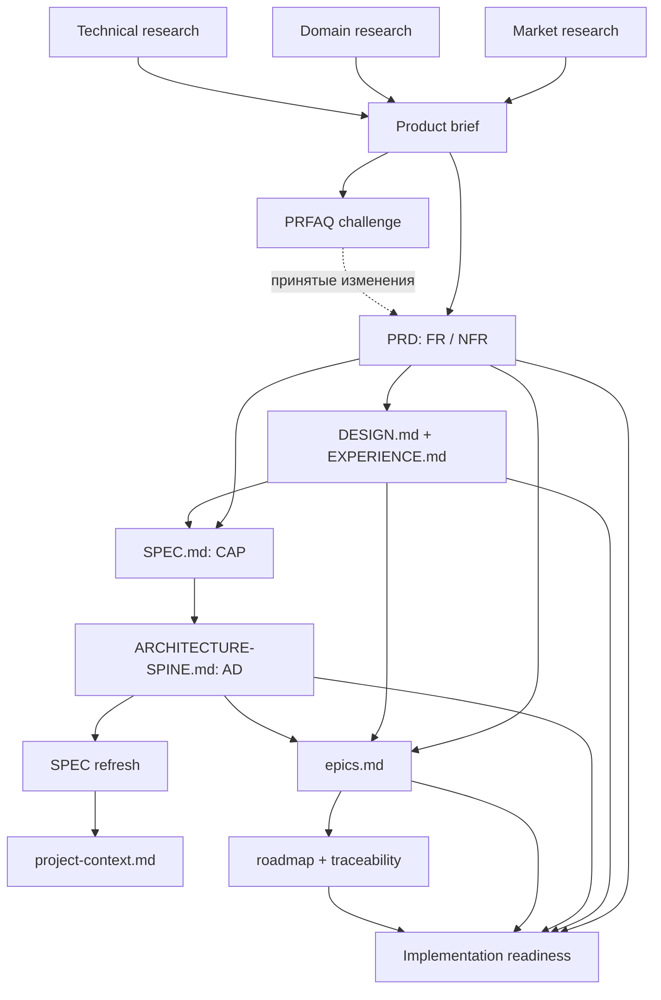

# Интеграция BMad Method в InteriorsEditor

## Назначение документа

Этот документ определяет, как BMad Method используется в InteriorsEditor для
spec-driven development: от исследования продуктовой идеи до проверки
готовности к реализации.

Состояние на 4 ноября 2026: существующий Web/PWA Alpha реализован в `apps/web`,
каталог — в `apps/catalog-control-plane`. Итоговый исторический
[readiness 30 августа](../_bmad-output/planning-artifacts/implementation-readiness-report-2026-08-30.md#final-verdict--2026-08-30)
имеет `READY`. Для Telegram выполнена отдельная цепочка S0; локальные срезы,
включая AD-31, получили применимые planning `READY`. Реализация и проверки
продолжаются по [актуальному состоянию](progress/telegram-extension-2026-11-04/current-status.md).
Epic 10/release остаётся `NEEDS_WORK`: незавершённые локальные gates,
физическая приёмка и внешние условия не заменяются planning readiness.
Новый scope требует согласованного пакета и свежего применимого `READY` либо
явного written waiver. Старый Alpha READY не разрешает Telegram-код.

[Задание Telegram](../plans/telegram-mini-app-extension-spec-2026-11-04.md)
сохраняет Web/PWA, данные и проверки в S0–S7; последующий Telegram-only
retirement выполняется после проверки владельцем и отдельного допуска.
4 ноября владелец разрешил создать и вести шесть отдельных workflow-чатов:
PRD → UX → Architecture → SPEC → Epics/Stories → Readiness.

Упоминания ниже о не начатом root production и `NOT_READY` описывают
первоначальный planning checkpoint. Они не отменяют финальный исторический
verdict; ограничения нового Telegram implementation действуют по актуальному
gate выше. Ownership, fresh-chat, memlog и запрет неразрешённых коммитов
сохраняются. Исторические отчёты и bounded waivers не переписываются и не
расширяются до нового scope.

## Статус интеграции

**Техническая интеграция BMad Method завершена.** В проект установлена и
настроена официальная стабильная версия 6.10.0. Первый полный draft
исследований, Product Brief, PRD, UX, SPEC, Architecture, roadmap, quality,
risk, traceability и official epics/stories создан. Владелец подтвердил
направление реализации; ранние отрицательные recheck завершились финальным
`READY` 30 августа для прежнего Alpha scope. Telegram readiness оценивается
заново по [пакету S0](../plans/telegram-mini-app-s0-preflight-2026-11-04.md).

Состояние подтверждается
`_bmad/_config/manifest.yaml` и установленным каталогом skills:

| Компонент | Состояние |
| --- | --- |
| BMad Core | 6.10.0, установлен |
| BMad Method Module (`bmm`) | 6.10.0, установлен |
| AI-инструмент | Codex |
| Project-scoped skills | 46 skills в `.agents/skills/` |
| Язык общения | Russian |
| Язык документов | Russian |
| Уровень объяснений | intermediate |
| Каталог результатов | `_bmad-output` |
| Каталог planning artifacts | `_bmad-output/planning-artifacts` |
| Каталог implementation artifacts | `_bmad-output/implementation-artifacts` |
| Project knowledge | `docs` |
| Имя проекта | `InteriorsEditor` |

Параметр `core.project_name = "InteriorsEditor"` уже исправлен официальным
`quick-update`. Последнее обновление manifest после исправления:
`2026-07-26T19:18:39.863Z`.

Официальный stable release:
[BMad Method v6.10.0](https://github.com/bmad-code-org/BMAD-METHOD/releases/tag/v6.10.0).

## Что означает «полная интеграция»

В рамках InteriorsEditor полная интеграция состоит из двух уровней.

### Уровень 1. Framework integration — завершён

- Core и BMM установлены в проект.
- Codex видит project-scoped skills.
- Конфигурация языка, путей и имени проекта разрешается корректно.
- Служебные manifest и help-каталоги созданы.
- Каталоги для planning и implementation artifacts созданы.
- Доступна безопасная поверхность кастомизации `_bmad/custom/`.

### Уровень 2. Product lifecycle integration — создан, readiness не закрыт

Созданы и связаны:

1. исследований;
2. product brief;
3. PRD;
4. UX-контракта;
5. SPEC;
6. architecture spine;
7. roadmap до alpha и vertical implementation plan;
8. traceability, quality strategy и risk register;
9. epics/stories, readiness precheck и final recheck-отчётов;
10. ограниченных synthetic evidence-spikes по отдельному waiver.

Уровень будет завершён после закрытия owner-решений, remaining evidence и
штатного implementation-readiness workflow со статусом `READY`.

До прохождения readiness gate продукт не переходит к реализации.

## Почему выбран BMM

InteriorsEditor — сложный greenfield software-продукт: mobile-first PWA с
интерактивной 3D-сценой, геометрией помещений, импортом пользовательских
3D-моделей и существенными ограничениями мобильных устройств. Для такого
проекта нужен полный BMad Method track:

```text
Analysis → Planning → Solutioning → Implementation Readiness
```

Официальная логика фаз описана в
[Workflow Map](https://docs.bmad-method.org/reference/workflow-map/).

### Почему не Game Dev Studio

Наличие 3D-сцены не делает продукт игрой. Game Dev Studio (`gds`) ориентирован
на GDD, игровые механики, баланс, progression, narrative design и типичные
Unity/Unreal/Godot-процессы. Эти артефакты создали бы второй, конкурирующий
центр требований рядом с PRD.

Для InteriorsEditor нужные вопросы — WebGL/WebGPU, геометрическая модель,
touch-взаимодействие, PWA, asset pipeline и мобильные performance budgets —
покрываются BMM через technical research, PRD, UX и architecture.

Пересмотреть решение о GDS следует только если продукт станет игровой
симуляцией с механиками, progression или GDD как самостоятельным источником
требований. Официальное назначение модуля:
[BMad Game Dev Studio](https://game-dev-studio-docs.bmad-method.org/).

### Почему не Quick Flow

Quick Flow предназначен для небольших и хорошо понятных изменений. Он
объединяет уточнение, планирование и реализацию и не создаёт необходимую для
InteriorsEditor цепочку Product Brief → PRD → UX → Architecture → Epics.

Для текущего этапа запрещены:

- `bmad-quick-dev`;
- `bmad-dev-auto`;
- `bmad-dev-story`;
- `bmad-create-story`;
- `bmad-sprint-planning`;
- любые другие Phase 4 workflows.

## Источники истины

BMad развивается быстро, поэтому источники имеют строгий приоритет.

1. Зафиксированный release
   [v6.10.0](https://github.com/bmad-code-org/BMAD-METHOD/tree/v6.10.0).
2. `_bmad/_config/manifest.yaml` — что фактически установлено.
3. `_bmad/_config/skill-manifest.csv` — какие skills доступны.
4. Установленные `.agents/skills/bmad-*/SKILL.md` — реальный протокол
   выполнения для Codex.
5. [Живая документация](https://docs.bmad-method.org/) — концепции и
   справочная информация, если они не противоречат stable release.
6. `main` и npm `@next` — только исследовательские источники, не руководство
   для текущего проекта.

Живая документация может опережать stable package. Например, она уже
упоминает `bmad-deep-recon`, но в stable 6.10.0 этот skill отсутствует.
В текущем проекте используются:

- `bmad-market-research`;
- `bmad-domain-research`;
- `bmad-technical-research`.

Нельзя подменять ими команды из `main`, пока проект остаётся на 6.10.0.

## Рабочая модель: document-only

Каждый workflow выполняется в **новой отдельной задаче/чате**. Это снижает
загрязнение контекста и является официальной рекомендацией BMad:
[Getting Started](https://docs.bmad-method.org/tutorials/getting-started/).

Research workflows разрешено запускать параллельно. Артефакты, которые
образуют цепочку решений, создаются последовательно.



## Последовательность workflows

### 0. Проверить маршрут

В отдельной задаче вызвать `bmad-help`. Он проверяет существующие артефакты и
предлагает следующий допустимый workflow.

### 1. Исследование рынка

Skill: `bmad-market-research`.

Исследовать:

- прямые и косвенные аналоги;
- целевые сегменты и Jobs to Be Done;
- неудовлетворённые сценарии mobile-first планирования;
- ограничения и pricing конкурентов;
- способы монетизации;
- причины отказа от существующих решений;
- доказательства спроса и риски продукта.

Результат:
`_bmad-output/planning-artifacts/research/market-*-research-YYYY-MM-DD.md`.

### 2. Исследование предметной области

Skill: `bmad-domain-research`.

Исследовать:

- терминологию планировок и интерьеров;
- модель помещений, стен, проёмов и дверей;
- измерения и допуски;
- каталоги мебели, материалов, сантехники и техники;
- права на 3D-модели и текстуры;
- ожидания пользователей от импорта;
- accessibility и privacy аспекты.

Результат:
`_bmad-output/planning-artifacts/research/domain-*-research-YYYY-MM-DD.md`.

### 3. Техническое исследование

Skill: `bmad-technical-research`.

Исследование фиксирует альтернативы и доказательства, но ещё не принимает
архитектурные решения. В фокусе:

- Three.js, Babylon.js и другие web-3D варианты;
- WebGL/WebGPU и browser fallback;
- PWA, offline-first и cache strategy;
- touch/gesture input;
- scene graph и параметрическая геометрия;
- spatial indexing, snapping и undo/redo;
- glTF/GLB и asset validation pipeline;
- мобильные CPU/GPU/RAM ограничения;
- compatibility и performance budgets;
- тестирование геометрии и 3D-взаимодействий.

Результат:
`_bmad-output/planning-artifacts/research/technical-*-research-YYYY-MM-DD.md`.

### 4. Product brief

Skill: `bmad-product-brief`.

Brief владеет стратегическим продуктовым нарративом: проблема, аудитория,
ценность, differentiation, alpha hypothesis, границы продукта и ключевые
неизвестные.

Результат:

```text
_bmad-output/planning-artifacts/briefs/
  brief-InteriorsEditor-YYYY-MM-DD/
    brief.md
    addendum.md
    .memlog.md
```

### 5. PRFAQ challenge — рекомендован, но не является вторым PRD

Skill: `bmad-prfaq`.

PRFAQ используется для customer-first pressure test. Его выводы не должны
оставаться отдельными конфликтующими требованиями: принятые изменения
возвращаются в Product Brief или PRD.

Результат:
`_bmad-output/planning-artifacts/prfaq-InteriorsEditor.md`.

### 6. PRD

Skill: `bmad-prd`, intent `create`.

PRD определяет продуктовые требования и alpha scope. Он должен содержать:

- пользовательские journeys;
- функциональные требования `FR-N`;
- нефункциональные требования `NFR-N`;
- измеримые критерии успеха;
- alpha in-scope и out-of-scope;
- ограничения PWA и мобильных устройств;
- требования к импорту, безопасности и privacy;
- error, empty, loading, recovery и offline states;
- допущения и открытые вопросы.

Результат:

```text
_bmad-output/planning-artifacts/prds/
  prd-InteriorsEditor-YYYY-MM-DD/
    prd.md
    addendum.md
    .memlog.md
```

### 7. UX contract

Skill: `bmad-ux`.

Для текущего этапа создаются только Markdown-контракты:

- `DESIGN.md` — визуальная система, design tokens, компоненты;
- `EXPERIENCE.md` — information architecture, journeys, состояния,
  взаимодействия, touch-жесты и accessibility;
- `.memlog.md` — журнал решений workflow.

HTML mockups, Excalidraw и внешние design handoffs на этом этапе отклоняются.

Результат:

```text
_bmad-output/planning-artifacts/ux-designs/
  ux-InteriorsEditor-YYYY-MM-DD/
    DESIGN.md
    EXPERIENCE.md
    .memlog.md
```

### 8. Первый SDD-контракт

Skill: `bmad-spec`.

Он создаёт компактный машинный контракт из PRD и UX. Центральный файл
содержит Why, Capabilities, Constraints, Non-goals и Success signal.

Для InteriorsEditor вероятны companion-документы:

- `domain-model.md`;
- `geometry-contract.md`;
- `asset-import-contract.md`;
- `performance-budgets.md`;
- `compatibility-matrix.md`;
- `state-machines.md`.

Конкретные companions определяются содержанием, а не этим списком.

Результат:

```text
_bmad-output/specs/spec-interiors-editor/
  SPEC.md
  <companions>.md
  .memlog.md
```

Стабильный протокол:
[bmad-spec в v6.10.0](https://github.com/bmad-code-org/BMAD-METHOD/blob/v6.10.0/src/core-skills/bmad-spec/SKILL.md).

### 9. Architecture spine

Skill: `bmad-architecture`, intent `create`.

Architecture принимает технические решения после PRD, UX и первого SPEC.
Каждое решение получает стабильный идентификатор `AD-N` и формулирует:

- что оно связывает;
- какую несовместимость предотвращает;
- обязательное правило для нижележащих единиц работы.

Результат:

```text
_bmad-output/planning-artifacts/architecture/
  architecture-InteriorsEditor-YYYY-MM-DD/
    ARCHITECTURE-SPINE.md
    .memlog.md
    <optional-fuller-rendering>.md
```

### 10. Обновить SPEC

Повторно вызвать `bmad-spec` и принять `ARCHITECTURE-SPINE.md` как adopted
companion. Это связывает продуктовые capabilities с принятыми архитектурными
инвариантами без копирования архитектуры в SPEC.

### 11. Project context

Skill: `bmad-generate-project-context`.

Результат: `_bmad-output/project-context.md`.

Документ содержит только подтверждённые правила, которые будущие агенты
обязаны учитывать при реализации. Он не должен раньше Architecture
фиксировать неподтверждённый стек.

### 12. Epics и stories

Skill: `bmad-create-epics-and-stories`.

Workflow получает точные пути к PRD, UX и Architecture. Не следует полагаться
только на auto-discovery: некоторые glob-шаблоны stable 6.10.0 старше новых
вложенных output-папок.

Результат: `_bmad-output/planning-artifacts/epics.md`.

Epics группируются по пользовательской ценности, а не по техническим слоям.
Каждая story:

- реализуема одним dev-agent;
- не зависит от будущей story;
- содержит testable acceptance criteria;
- ссылается на покрываемые требования;
- приносит законченное вертикальное приращение.

### 13. Roadmap и traceability

Это project-specific документы, а не отдельные штатные BMM workflows:

- `_bmad-output/planning-artifacts/roadmap-to-alpha.md`;
- `_bmad-output/planning-artifacts/traceability-matrix.md`.

Roadmap задаёт порядок, зависимости и exit gates. Он не дублирует требования.
Traceability связывает `CAP-N`, `FR-N`, `NFR-N`, `AD-N`, epics, stories и
acceptance criteria.

### 14. Implementation readiness

Skill: `bmad-check-implementation-readiness`.

Результат:
`_bmad-output/planning-artifacts/implementation-readiness-report-YYYY-MM-DD.md`.

Gate проверяет согласованность PRD, UX, Architecture и Epics. Для stable
6.10.0 итоговые статусы:

- `READY`;
- `NEEDS WORK`;
- `NOT READY`.

При любом результате кроме `READY` сначала исправляются владеющие артефакты,
затем обновляются SPEC и downstream-документы, после чего gate запускается
повторно.

### 15. Индекс

В конце вызвать `bmad-index-docs` для создания навигации по итоговому набору
документов. Индекс содержит ссылки и статусы, но не копирует содержание.

## Целевое дерево

```text
InteriorsEditor/
├── .agents/
│   └── skills/
│       └── bmad-*/
├── _bmad/
│   ├── _config/
│   │   ├── manifest.yaml
│   │   ├── skill-manifest.csv
│   │   ├── files-manifest.csv
│   │   └── bmad-help.csv
│   ├── core/
│   ├── bmm/
│   ├── custom/
│   ├── scripts/
│   ├── config.toml
│   └── config.user.toml
├── _bmad-output/
│   ├── INDEX.md
│   ├── project-context.md
│   ├── specs/
│   │   └── spec-interiors-editor-alpha/
│   │       ├── SPEC.md
│   │       ├── glossary.md
│   │       ├── geometry-contract.md
│   │       ├── asset-import-contract.md
│   │       ├── performance-budgets.md
│   │       ├── project-and-backup-contract.md
│   │       └── .memlog.md
│   ├── planning-artifacts/
│   │   ├── research/
│   │   ├── briefs/
│   │   ├── prds/
│   │   ├── ux-designs/
│   │   ├── architecture/
│   │   ├── decision-register.md
│   │   ├── roadmap-to-alpha.md
│   │   ├── traceability-matrix.md
│   │   ├── quality-strategy.md
│   │   ├── risk-register.md
│   │   └── implementation-readiness-precheck-2026-07-26.md
│   └── implementation-artifacts/
│       └── spikes/W-SPK-2026-08-04/  # isolated evidence only; not product code
├── plans/
│   └── alpha-implementation-plan.md
└── docs/
    ├── index.md                      # curated human-facing entry point
    ├── BMAD-INTEGRATION.md
    └── GIT-GOVERNANCE.md
```

## Ownership и идентификаторы

| Артефакт | Чем владеет | Идентификаторы |
| --- | --- | --- |
| Product Brief | Видение и ценность | Не вводит delivery IDs |
| PRD | Требования | `FR-N`, `NFR-N` |
| UX contract | Визуальный и поведенческий контракт | Имена flows/components |
| SPEC | Машинный контракт продукта | `CAP-N` |
| Architecture Spine | Технические инварианты | `AD-N` |
| Epics | Декомпозиция и coverage map | Epic/Story IDs |
| Roadmap | Порядок поставки и gates | Ссылки на принятые IDs |
| Readiness report | Доказательства согласованности | Ссылки на принятые IDs |

Право записи закреплено за соответствующим workflow:

- Product Brief — `bmad-product-brief`;
- PRD — `bmad-prd`;
- UX contract — `bmad-ux`;
- SPEC — только `bmad-spec`;
- Architecture Spine — только `bmad-architecture`;
- Epics — `bmad-create-epics-and-stories`;
- Roadmap — PM/Technical Writer без создания новых требований;
- Readiness report — `bmad-check-implementation-readiness`.

При декомпозиции UX-требования получают `UX-DR-N`, но исходным владельцем
визуального и поведенческого контракта остаётся `bmad-ux`.

### Правила `.memlog.md`

- Это append-only журнал решений конкретного workflow.
- Он хранит решения, изменения, overrides, допущения и открытые вопросы.
- Записи добавляются только через `_bmad/scripts/memlog.py`.
- Нельзя редактировать, переупорядочивать или переписывать его вручную.
- При update workflow сначала загружает memlog, а не реконструирует историю из
  финального документа.
- Для SPEC memlog является decision-of-record, из которого заново выводятся
  `SPEC.md` и authored companions.

### Правила `SPEC.md`

- `bmad-spec` — единственный writer.
- Ручные правки unsupported и будут потеряны при следующей derivation.
- Существующие `CAP-N` сохраняются.
- Новая capability получает следующий свободный номер.
- Удалённый номер не переиспользуется.
- `companions:` перечисляет load-bearing документы, обязательные downstream.
- `sources:` хранит поглощённые источники для аудита, но downstream их не
  перечитывает.

### Правила Architecture

- `AD-N` не перенумеровываются.
- Новое решение получает следующий номер.
- Изменение правила оформляется через memlog и update workflow.
- Конфликт с inherited AD нельзя скрыто переопределить локальным решением.

## Change control

Изменение начинается в документе, который владеет затронутой истиной.


Порядок:

1. Классифицировать изменение:
   - стратегия → Product Brief;
   - поведение или quality attribute → PRD;
   - visual/interaction contract → UX;
   - capability contract → SPEC через его source;
   - технический инвариант → Architecture;
   - порядок поставки → Epics/Roadmap.
2. Запустить соответствующий workflow с intent `update`.
3. Зафиксировать решение и причину в memlog.
4. Повторно вывести SPEC через `bmad-spec`.
5. Обновить затронутые downstream-артефакты.
6. Проверить traceability.
7. Повторно пройти implementation readiness.

Readiness report не исправляется вручную для получения `READY`: исправляются
источники обнаруженных проблем.

## Multi-agent operating rule

Используется гибридная модель:

- **один accountable writer на один артефакт**;
- параллельные subagents — для независимого research, extraction и review;
- один parent-agent синтезирует результаты и вносит изменения;
- два агента не редактируют один canonical artifact одновременно;
- каждый следующий workflow получает только утверждённые upstream-файлы.

Для Codex:

- `session` — быстрый brainstorming одним контекстом;
- `auto` — основной экономичный режим;
- `subagent` — независимые исследования, adversarial review и focus group;
- `agent-team` не является рабочим выбором: нативный persistent team mode
  предназначен для Claude Code и в других harnesses деградирует.

Для сложных решений полезен:

```text
bmad-party-mode --party anti-consensus-club --mode subagent
```

Party Mode помогает найти возражения, но не становится владельцем документа и
не заменяет решение человека. Официальное описание режимов:
[Party Mode](https://docs.bmad-method.org/explanation/party-mode/).

## Markdown-only policy

### Продуктовые результаты

На текущем этапе production root не содержит application code. Основной набор
product-planning artifacts состоит из Markdown-файлов, включая `.memlog.md` и
Mermaid-диаграммы внутри Markdown. Отдельный waiver может разрешить
изолированный synthetic evidence-prototype только в названном
`_bmad-output/implementation-artifacts/spikes/` root.

Не создавать:

- исходный код приложения в root delivery;
- `sprint-status.yaml`;
- HTML validation reports;
- HTML mockups;
- Excalidraw-файлы;
- изображения и design assets;
- Party Mode HTML keepsake;
- story implementation files Phase 4 в root delivery.

Standalone validate-intents PRD, UX и Architecture могут создавать HTML.
В document-only фазе вместо них используются встроенные finalize reviewers,
adversarial review и Markdown readiness report.

### Служебные файлы framework

Полная установка BMad не может физически состоять только из `.md`. Она
неизбежно добавляет служебные:

- TOML — конфигурация;
- YAML — manifest и module config;
- CSV — skill/help/file catalogs;
- Python — resolver и memlog scripts;
- Markdown `SKILL.md` — исполняемые протоколы skills.

Это инфраструктура SDD-процесса, а не реализация InteriorsEditor. Ограничение
на root production delivery не запрещает runtime BMad или специально waiver-
approved synthetic evidence artifacts.

## Кастомизация

Не изменять вручную:

- `.agents/skills/bmad-*/SKILL.md`;
- `.agents/skills/bmad-*/customize.toml`;
- `_bmad/config.toml`;
- `_bmad/config.user.toml`;
- сгенерированные module config.

Installer-owned файлы перезаписываются при update.

Использовать:

- `_bmad/custom/config.toml` — team overrides, сохраняются в version control;
- `_bmad/custom/config.user.toml` — персональные overrides, gitignored;
- `_bmad/custom/<skill-name>.toml` — team customization workflow/agent;
- `_bmad/custom/<skill-name>.user.toml` — персональная customization.

Override должен быть sparse: в него добавляются только изменяемые поля.
Копировать целиком штатный `customize.toml` нельзя. Подробности:
[How to Customize BMad](https://docs.bmad-method.org/how-to/customize-bmad/).

## Deprecated aliases

В stable 6.10.0 присутствуют compatibility aliases, которые будут удалены в
v7:

| Не использовать | Использовать |
| --- | --- |
| `bmad-create-prd` | `bmad-prd`, intent `create` |
| `bmad-edit-prd` | `bmad-prd`, intent `update` |
| `bmad-validate-prd` | `bmad-prd`, intent `validate` |
| `bmad-create-architecture` | `bmad-architecture`, intent `create` |

Также нельзя использовать команды и пути старых поколений:

- `.bmad-method`;
- v4/v5 slash-command paths;
- старые `workflow-init` инструкции;
- архивные V1–V5 репозитории вместо официального v6 release.

## Проверка установки

### Проверить manifest

```bash
sed -n '1,120p' _bmad/_config/manifest.yaml
```

Ожидается:

```yaml
installation:
  version: 6.10.0
modules:
  - name: core
    version: 6.10.0
  - name: bmm
    version: 6.10.0
ides:
  - codex
```

### Проверить центральный config

```bash
sed -n '1,80p' _bmad/config.toml
```

Критические значения:

```toml
[core]
project_name = "InteriorsEditor"
document_output_language = "Russian"
output_folder = "_bmad-output"

[modules.bmm]
planning_artifacts = "{project-root}/_bmad-output/planning-artifacts"
implementation_artifacts = "{project-root}/_bmad-output/implementation-artifacts"
project_knowledge = "docs"
```

### Проверить skills

```bash
find .agents/skills -mindepth 1 -maxdepth 1 -type d -name 'bmad-*' | wc -l
sed -n '1,80p' _bmad/_config/skill-manifest.csv
```

Ожидаемое количество: 46.

### Проверить разрешённый config

```bash
python3 _bmad/scripts/resolve_config.py \
  --project-root . \
  --key core.project_name \
  --key core.document_output_language \
  --key modules.bmm.planning_artifacts
```

Если локальный Python старше версии с `tomllib`, использовать `uv run`.

### Проверить официально поддерживаемые tools

```bash
npx -y bmad-method@6.10.0 install --list-tools
```

В списке должен присутствовать `codex` с target directory `.agents/skills`.

## Воспроизводимая установка

Для нового checkout использовать pinned installer:

```bash
BMAD_PLANNING_PATH='{project-root}/_bmad-output/planning-artifacts'
BMAD_IMPLEMENTATION_PATH='{project-root}/_bmad-output/implementation-artifacts'

npx -y bmad-method@6.10.0 install \
  --yes \
  --directory . \
  --modules bmm \
  --tools codex \
  --set core.user_name=Roman \
  --set core.project_name=InteriorsEditor \
  --set core.communication_language=Russian \
  --set core.document_output_language=Russian \
  --set core.output_folder=_bmad-output \
  --set bmm.user_skill_level=intermediate \
  --set bmm.planning_artifacts="$BMAD_PLANNING_PATH" \
  --set bmm.implementation_artifacts="$BMAD_IMPLEMENTATION_PATH" \
  --set bmm.project_knowledge=docs
```

Core автоматически добавляется к `bmm`.

Требования installer и workflows:

- Node.js 20.12+;
- Git для внешних модулей;
- `uv` — рекомендуемый способ запуска Python scripts;
- при прямом вызове resolver — Python с `tomllib`.

Полная инструкция:
[How to Install BMad](https://docs.bmad-method.org/how-to/install-bmad/).

## Обновление

### Обновить текущую pinned версию без смены release

```bash
npx -y bmad-method@6.10.0 install \
  --yes \
  --directory . \
  --action quick-update
```

### Обновить конфигурационное значение

```bash
npx -y bmad-method@6.10.0 install \
  --yes \
  --directory . \
  --action quick-update \
  --set core.project_name=InteriorsEditor
```

Именно эта процедура уже использована для исправления `project_name`.

### Перейти на новую stable версию

1. Прочитать release notes.
2. Создать отдельную version-control ветку.
3. Указать выбранную версию явно:

   ```bash
   npx -y bmad-method@X.Y.Z install \
     --yes \
     --directory . \
     --action quick-update
   ```

4. Проверить diff для `_bmad/` и `.agents/skills/`.
5. Проверить `_bmad/_config/manifest.yaml`.
6. Проверить custom overrides.
7. Запустить `bmad-help`.
8. Проверить один неразрушающий planning workflow перед принятием update.

Не использовать `npx bmad-method@next` в основной ветке. `next` содержит
prerelease snapshot и может менять skills и output contracts.

Core и BMM встроены в npm installer. Поэтому `--pin bmm=v6.10.0` не фиксирует
BMM; версия фиксируется самой командой `bmad-method@6.10.0`.

Контроль обновлений через diff предполагает, что каталог находится под
version control. Если Git ещё не инициализирован, это отдельный обязательный
шаг перед первым upgrade. В InteriorsEditor Git уже инициализирован на
`main`; отсутствие commit не отменяет требование отдельного owner approval
перед первым commit.

## Лицензия и товарные знаки

BMad Method 6.10.0 распространяется по
[MIT License](https://github.com/bmad-code-org/BMAD-METHOD/blob/v6.10.0/LICENSE).
При распространении копий или существенных частей framework необходимо
сохранять copyright и permission notice.

Названия BMad, BMad Method, BMad Core, логотип и слоган являются товарными
знаками BMad Code, LLC и не лицензируются по MIT.

Разрешённая формулировка:

> InteriorsEditor использует BMad Method v6.10.0 в процессе разработки.

Нельзя:

- называть сам продукт BMad/BMAD-продуктом;
- использовать BMad в названии продукта или домена;
- создавать впечатление официального одобрения или партнёрства;
- использовать логотип как часть собственной айдентики.

Официальные правила:
[Trademark Notice & Guidelines](https://github.com/bmad-code-org/BMAD-METHOD/blob/v6.10.0/TRADEMARK.md).

## Чеклист проверки интеграции

### Framework

- [x] Установлен официальный BMad Method stable 6.10.0.
- [x] Установлены только необходимые Core и BMM.
- [x] Codex зарегистрирован как IDE/tool.
- [x] Созданы 46 project-scoped BMad skills.
- [x] Созданы manifest, help и file catalogs.
- [x] Созданы planning и implementation output folders.
- [x] Язык общения и документов — Russian.
- [x] `project_name = "InteriorsEditor"` исправлен через official quick-update.
- [x] Доступна upgrade-safe поверхность `_bmad/custom/`.
- [x] Зафиксирована pinned-команда воспроизводимой установки.

### Process

- [x] Выбран полный BMM track, а не Quick Flow.
- [x] Зафиксировано решение не использовать GDS.
- [x] Зафиксировано правило fresh task/chat per workflow.
- [x] Зафиксирован один writer на canonical artifact.
- [x] Зафиксированы ownership и стабильные IDs.
- [x] Зафиксирован change-control.
- [x] Зафиксирована Markdown-only policy.
- [x] Зафиксирована граница между product docs и служебными non-MD файлами.
- [x] Зафиксированы deprecated aliases.
- [x] Зафиксированы license и trademark правила.

### Product artifacts

- [x] Завершено market/competitive research.
- [x] Domain scope включён в market, technical и domain-model artifacts;
      отдельный дублирующий report документированно не создавался.
- [x] Завершено technical research.
- [ ] Product Brief согласован.
- [x] PRFAQ challenge документированно отложен до решения владельца; его роль
      сейчас закрывают competitor research и независимые reviews.
- [ ] PRD имеет статус final.
- [ ] UX contract имеет статус final.
- [x] SPEC создан и проверен.
- [ ] Architecture Spine имеет статус final.
- [x] Выполнены rubric, adversarial и current-tech reviews; disposition
      фиксирует исправления и остаточные gates.
- [x] SPEC повторно сверён после Architecture.
- [x] Создан `project-context.md`.
- [ ] Epics и stories покрывают все FR/NFR/UX requirements.
- [ ] Roadmap до alpha согласован.
- [x] Draft traceability matrix покрывает все CAP/FR/NFR/AD/UXF.
- [ ] Implementation readiness имеет статус `READY`.
- [x] Phase 4 остаётся заблокированной до выполнения предыдущего пункта.

## Официальные ссылки

- [BMad Method GitHub](https://github.com/bmad-code-org/BMAD-METHOD)
- [Stable release v6.10.0](https://github.com/bmad-code-org/BMAD-METHOD/releases/tag/v6.10.0)
- [Документация BMad Method](https://docs.bmad-method.org/)
- [Getting Started](https://docs.bmad-method.org/tutorials/getting-started/)
- [Workflow Map](https://docs.bmad-method.org/reference/workflow-map/)
- [Agents](https://docs.bmad-method.org/reference/agents/)
- [Official Modules](https://docs.bmad-method.org/reference/modules/)
- [Installation](https://docs.bmad-method.org/how-to/install-bmad/)
- [Customization](https://docs.bmad-method.org/how-to/customize-bmad/)
- [Party Mode](https://docs.bmad-method.org/explanation/party-mode/)
- [MIT License](https://github.com/bmad-code-org/BMAD-METHOD/blob/v6.10.0/LICENSE)
- [Trademark Guidelines](https://github.com/bmad-code-org/BMAD-METHOD/blob/v6.10.0/TRADEMARK.md)
