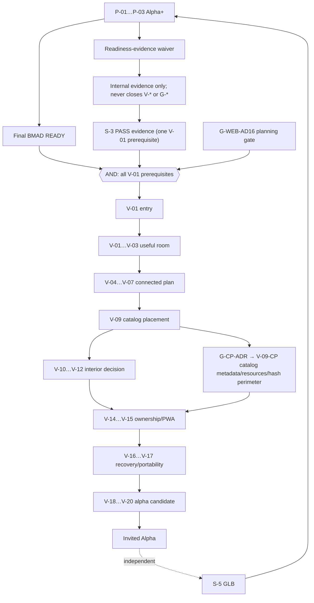

<!-- markdownlint-disable MD013 -->

# Plan: InteriorsEditor Alpha

**Branch:** не назначена  
**Status:** внутреннее readiness-evidence work разрешено waiver; Alpha-гейты и
release claim остаются заблокированы до final `READY`.  
**Implementation:** только трассируемые внутренние evidence-срезы по active
waiver; они не являются закрытием Alpha-gate.

**Scope correction (2026-08-24):** in-app Focus, native fullscreen и
fullscreen-specific controls/evidence исключены из Alpha. `FR-53`, `NFR-27`,
`V-03-Focus` и `V-15-Focus` permanently retired; normal phone-first Plan/3D
editor и оставшийся NFR-15 device/performance protocol сохраняются.

**Scope correction (2026-08-25):** licensing исключён из всех Alpha-срезов.
`AssetUsageGrant`, `assetUsageDeclaration`, legal/provenance admission,
attribution, notices, license ledger и rendered-output rights не имеют экранов,
контрактов, acceptance или evidence. Владелец продукта отбирает бесплатные
либо созданные им модели вне приложения. Технические format/size/hash, exact
pin, `BackupFeasibilityPolicy`, recovery и self-contained backup сохраняются.

**Scope correction (2026-08-25):** потолочные поверхности, свет и предметы,
покрытия пола/стен, независимое дублирование Project, PNG download/share и
recoverable Project removal исключены из Alpha. Остаются нейтральная проекция
Room, color/variant ItemInstance, Portable Backup и только confirmed permanent
Project deletion без промежуточного lifecycle или restore-route.

## Goal

Последовательно доставить минимальные наблюдаемые пользовательские поведения,
из которых складывается самостоятельно полезный phone-first редактор:
`точный план → связные комнаты → 3D-проверка → предметы и их варианты →
надёжное локальное восстановление`, с узким catalog metadata/resources/hash perimeter без
remote Project ownership.

Этот документ описывает будущую реализацию, но не разрешает её. Перед любым
production code:

1. Product Owner подтверждает acceptance criteria конкретного среза.
2. Для Alpha-gate closure и release claim BMAD implementation-readiness имеет
   финальный статус `READY`. Активный
   `readiness-evidence-program-waiver-2026-08-09` разрешает только внутренние
   source/test/documentation work, напрямую нужные для readiness evidence, и
   не превращает их в доказательство готового релиза.
3. Для Alpha `S-1`–`S-4` и `S-6` имеют `PASS`; `S-5` требуется только Alpha+.
4. Для зависимых от spike решений есть принятый ADR.
5. Назначены один implementation owner и независимый reviewer.
6. Созданы Git branch/worktree и CI policy с разрешения владельца.
7. До `V-09-CP` принят отдельный `G-CP-ADR`, который выбирает Kotlin build/test
   boundary, API/transport/resource delivery, PostgreSQL schema/operations и
   publisher/operator authentication, не создавая account/Project/sync/backup
   service.
8. До `V-01` `G-WEB-AD16` фиксирует exact adopted web baseline; только после
   final `READY` `WEB-BOOTSTRAP-01` может доказать frozen-lock install, Rspack
   build, Rstest и Playwright baseline. Это отдельная web-boundary проверка, не
   часть `G-CP-ADR` и не раннее разрешение на scaffold.

До общего `READY` каждый source-срез должен быть прямо трассируем к approved
Alpha requirement и evidence program; он не становится основанием для
самостоятельного закрытия V-*/G-* и остаётся subject to TDD/review.

## Overall acceptance

- [ ] `CAP-1`–`CAP-11` имеют трассируемое evidence; `CAP-12` не блокирует Alpha.
- [ ] active `FR-1`–`FR-47` (кроме retired `FR-3`, `FR-20`, `FR-24`,
      `FR-34`–`FR-37` и `FR-46`) и `FR-54` проверены
      через реальные production paths на appropriate contract/browser/device уровнях.
- [ ] Alpha-применимые `NFR-1`–`NFR-21`, `NFR-23`–`NFR-26` подтверждены на
      нужном уровне; `NFR-22` имеет явный статус `N/A by scope`.
- [ ] UJ-1–UJ-6 выполняются независимым участником без разработчика.
- [ ] Save/reopen/backup roundtrip не меняет канонические значения на 1 мм.
- [ ] Abrupt close, quota, migration, context loss и safe update не приводят к
      silent data loss.
- [ ] Reference scenes проходят финальные mobile budgets на утверждённой
      device matrix.
- [ ] Каталог и допустимые ItemInstance variants имеют technical
      format/size/hash, exact pin и backup readiness; telemetry соответствует
      consent и minimization policy.
- [ ] Каждый merged slice прошёл RED → GREEN → MUTATE → KILL → REFACTOR,
      независимый review и явное подтверждение commit.

## Порядок и зависимости

Параллельность разрешена только для действительно независимых research/review
задач. Shared contracts, domain model и один slice одновременно имеет одного
writer.

## Горизонтальные исключения: spikes

Spikes не являются «нулевым слоем приложения». Каждый отвечает на один
неопределённый вопрос, имеет наблюдаемый выход и называет вертикальный срез,
который без него нельзя безопасно начать.

Обязательный набор Alpha: `S-1`–`S-4` и `S-6`. `S-5` остаётся отдельным
Alpha+ spike и не блокирует V-01–V-20.

### S-1. Renderer selection

**Question:** какой путь — direct Three.js, Three.js + React Three Fiber или
Babylon.js — сохраняет архитектурную границу и проходит mobile budgets?

**Why horizontal:** выбор renderer влияет сразу на 3D projection, picking,
asset lifecycle, context recovery и adaptive quality; проверять его впервые
внутри пользовательского среза дороже и опаснее.

**Unlock:** V-03, V-09–V-10, V-12, V-18.

**Entry:**

- утверждены RS-1/RS-2 и provisional device matrix;
- одинаковый `SceneProjectionPort` и измерительный протокол описаны заранее;
- есть readiness `READY` либо spike-only waiver.

**Experiment:**

- построить одну и ту же сцену через каждого кандидата;
- измерить cold/warm start, chunks, frame p50/p95, draw calls, memory и idle;
- проверить touch picking, incremental walls/openings, render-on-demand;
- воспроизвести context loss, project switch и полное освобождение ресурсов.

**Observable evidence:**

- raw traces и воспроизводимая инструкция;
- comparison table с rejected alternatives;
- `ADR-001-renderer-and-react-binding.md`;
- подтверждение, что engine types не проникли в domain.

**Pass:** один кандидат проходит согласованные budgets на minimum devices,
восстанавливает context и dispose-ится без устойчивого роста ресурсов.

**Pause:** есть только desktop/emulation evidence либо reference scene
различается между кандидатами.

**Kill candidate:** crash, unrecoverable context loss, resource leak,
неприемлемая touch latency или необходимость хранить engine object как source
of truth.

**Production boundary:** spike code не сливается; V-03 реализует выбранный path
заново через подтверждённые acceptance и TDD.

### S-2. Topology kernel

**Question:** как детерминированно выполнять integer-mm constrained topology,
вывод Rooms, reconciliation identity, Openings и undo?

**Why horizontal:** ошибка kernel разрушает сразу CAP-2–CAP-5 и не может быть
надёжно обнаружена визуальным тестом editor UI.

**Unlock:** V-02, V-04–V-07.

**Entry:**

- Product Owner подтвердил grid/snap candidate и список открытых решений;
- golden corpus содержит rectangle, diagonal, T/X, split/merge и openings;
- есть readiness `READY` либо spike-only waiver.

**Experiment:**

- прогнать одинаковые command chains на всех целевых JS engines;
- проверить 0°/45°/90°, integer endpoints, intersection normalization;
- сравнить библиотечный и минимальный собственный path, не передавая библиотеке
  product semantics;
- проверить inverse, serialization и random valid command sequences.

**Observable evidence:**

- versioned golden/property corpus;
- зафиксированные tolerance, diagonal rounding, X/T и room identity rules;
- performance measurements на representative plans;
- `ADR-002-coordinate-and-topology-model.md`.

**Pass:** результаты детерминированы, каждый accepted state валиден, rejected
command семантически не меняет Revision, inverse восстанавливает исходное.

**Pause:** не определены split/merge metadata, half-mm intersection либо
opening relocation.

**Kill candidate:** platform-dependent topology, float drift, скрытая
normalization или невозможность объяснить stable reason code.

**Production boundary:** corpus сохраняется как requirement evidence; kernel
вводится только с V-02/V-04 через production TDD.

### S-3. Offline storage and PWA lifecycle

**Question:** какой versioned snapshot/journal/blob protocol переживает
mobile kill, quota, migration и service-worker update?

**Why horizontal:** локальная сохранность и schema boundary должны быть
проверены до размножения сущностей и assets.

**Unlock:** V-01, V-14–V-17.

**Entry:**

- определён project fixture и sequence fault injection;
- доступны минимум один iOS и один Android target;
- есть readiness `READY` либо spike-only waiver.

**Experiment:**

- проверить IndexedDB metadata/revisions и кандидатов Blob/OPFS;
- force-close на каждой command/persistence boundary;
- airplane-mode reopen, corrupt record, quota exhaustion и copy-on-write
  migration;
- browser↔Home Screen handoff на iOS как между независимыми storage-context;
- конкурирующие writer lease/fencing и stale-writer publish;
- автоматическая service-worker activation с несохранённым draft и
  `Durable Revision`.

**Observable evidence:**

- recovery demo на реальных устройствах;
- compatibility/support matrix;
- schema, checksum, journal и retention protocol;
- `ADR-003-persistence-and-recovery.md`.

**Pass:** один fixture после kill/restart/update и iOS-context handoff открывает
последнюю `Durable Revision` без semantic drift; stale writer не публикует
state, исходные bytes миграции не уничтожены.

**Pause:** доказан только happy path или devtools offline simulation.

**Kill candidate:** silent deletion/corruption, non-atomic publish либо
невозможность экспортировать последнюю readable revision.

**Production boundary:** storage prototype не становится repository adapter
без контрактных, migration и browser tests V-01/V-15–V-17.

### S-4. Mobile interaction contract

**Question:** какой gesture/numeric contract минимизирует ошибочные действия на
телефоне и сохраняет доступную альтернативу?

**Why horizontal:** один неверный жестовый фундамент затрагивает walls,
openings, objects и camera; менять его после build-out дорого.

**Unlock:** V-02, V-04, V-07, V-09, V-10, V-19.

**Entry:**

- сценарии и error taxonomy определены до теста;
- участники соответствуют primary-user profile;
- prototype не требует production architecture.

**Experiment:**

- одной и двумя руками выполнить wall, vertex, numeric dimension, Door,
  item placement/rotation, camera, undo и cancel;
- измерить accidental pan/drag, corrections, task completion и понимание mode;
- проверить DOM targets ≥44×44 CSS px и numeric/list alternatives.

**Observable evidence:**

- записи наблюдения без содержимого частных проектов;
- выбранные gesture thresholds/modes и rejected alternatives;
- accessibility notes;
- `ADR-005-mobile-interaction-model.md`.

**Pass:** core path выполним без hover/keyboard, пользователь отличает
camera/edit, а каждое критическое действие имеет видимый control.

**Pause:** участник завершает flow только после обучения либо gestures
конфликтуют с browser/OS.

**Kill interaction path:** устойчивая высокая доля accidental operations,
которую не устраняют handles, modes и numeric confirmation.

**Production boundary:** prototype не переносится как готовый UI; каждое
поведение входит через отдельный browser-tested slice.

### S-5. Constrained GLB import — Alpha+

**Question:** какие allowlist, decoded limits и cleanup protocol делают
self-contained static GLB безопасным на minimum device?

**Why horizontal:** parser/decoder, memory, security, storage и GPU lifecycle
должны быть проверены совместно до пользовательского commit path.

**Unlock:** P-01–P-03; не блокирует V-01–V-20.

**Entry:**

- Product Owner сохраняет CAP-12 в Alpha+ либо письменно меняет scope;
- есть corpus valid/boundary/hostile GLB и minimum devices;
- S-1 и S-3 решения доступны;
- есть readiness `READY` либо spike-only waiver.

**Experiment:**

- проверить magic bytes/container, required extensions, external URI;
- измерить decoded geometry/texture memory, timeout и cancellation;
- повторить import/delete и project switch, проверяя worker/blob/GPU cleanup;
- проверить Draco/Meshopt/KTX2 candidates и отсутствие network request.

**Observable evidence:**

- hostile corpus, memory/thermal traces и no-network assertion;
- подтверждённые hard/warning limits и allowlist;
- `ADR-004-glb-policy-and-budgets.md`.

**Pass:** bounded import не блокирует UI без cancel, отказ не меняет Project,
ресурсы освобождаются, limits подтверждены на minimum device.

**Pause:** решение основано только на compressed file size или desktop.

**Kill importer path:** OOM/tab reload, неожиданный network fetch, unbounded
decode или систематическая утечка после cancel/delete.

**Production boundary:** P-01 начинает новый TDD production path; spike parser
не публикуется пользователям.

### S-6. Asset catalog pipeline

**Question:** как воспроизводимо превратить бесплатный или созданный владельцем
source asset в оптимизированный, семантически полный, versioned и offline-aware
catalog asset без нарушения mobile budgets?

**Why horizontal:** один pipeline определяет technical resource manifest, units, dimensions,
footprint, AnchorClass, variants, geometry/textures, manifest и cache tier для
всех catalog items и finishes. Если впервые проверять эти правила внутри V-09
или V-12, контентный риск смешается с UI/domain behavior, а ошибка проявится
сразу в placement, offline и performance.

**Unlock:** V-09, V-09-CP, V-12, V-15, V-17, V-18.

**Entry:**

- утверждена representative catalog task matrix и обязательная semantic
  metadata;
- для каждого sample source owner заранее подтвердил бесплатное либо собственное
  происхождение вне приложения; в продукте проверяются только format/size/hash,
  exact pin и backup feasibility;
- доступны S-1 renderer measurement contract, S-3 cache/storage boundary и
  minimum device matrix;
- заранее определены warning/hard budgets и cache-tier semantics;
- есть readiness `READY` либо spike-only waiver.

**Experiment:**

- провести один небольшой representative set через source intake,
  dimensions/anchor/footprint/recolor metadata, geometry/texture optimization,
  thumbnail, validation, content hash, versioned manifest и cache-tier
  assignment;
- выполнить две чистые сборки из одного input и сравнить outputs/hashes;
- измерить download/decoded bytes, triangles, draw calls, texture/GPU estimate,
  first placement, project switch/dispose и повторное offline opening;
- проверить missing/stale resource, manifest upgrade и невозможность precache
  всего каталога как неявного требования.

**Observable evidence:**

- versioned sample manifest;
- technical manifest с format/size/hash, pin/backup результатами;
- validation report до и после optimization;
- deterministic content hashes и build recipe;
- raw device traces для download/decode/render/cache/dispose;
- recommendation по cache tiers и rejected optimization/source alternatives.

**Exit:**

- две чистые сборки дают один и тот же semantic manifest и content hashes;
- asset без valid technical format/size/hash, exact pin или backup readiness
  не публикуется;
- dimensions, units, anchor, footprint, variant slots и accessibility label
  проходят schema/semantic validation;
- каждый sample asset и representative set проходят согласованные device
  budgets после optimization;
- cache tiers поддерживают offline reopen уже использованного ресурса, не
  заставляя precache-ить весь catalog;
- missing/stale resource даёт стабильный placeholder и не удаляет
  AssetInstance;
- evidence достаточно, чтобы зафиксировать pipeline/cache policy в ADR либо
  Architecture update.

**Pause:**

- technical manifest, exact pin или backup feasibility не удаётся подтвердить
  для representative resource;
- measurements получены только на desktop либо без decoded/GPU accounting;
- manifest/schema, cache tier или representative task matrix остаются
  неоднозначны;
- optimization меняет физические dimensions, pivot или semantic footprint.

**RED:** до tooling prototype зафиксировать failing contract fixtures:
missing format/size/hash/pin/backup readiness, неверные units/dimensions,
превышенный triangle/texture budget, nondeterministic hash, unknown manifest
version и неверный cache tier.

**GREEN:** провести только один representative set через минимальный
воспроизводимый pipeline и получить versioned manifest/device traces; не
создавать полный каталог и универсальную content platform.

**MUTATE:** запустить `mutation-testing` для manifest validation,
format/size/hash gate, budget comparisons, hash/version policy и cache-tier
classification; сохранить report.

**KILL:** усилить contracts против meaningful surviving mutants; pipeline
candidate/source также отклоняется, если technical contract не проходит, clean
builds недетерминированы, optimization искажает semantics либо budgets нельзя
достичь без разрушения пользовательской полезности.

**REFACTOR:** выделить только подтверждённые deterministic transforms и
validation stages, повторив clean build и device traces; не проектировать
marketplace, branded ingestion или speculative CDN orchestration.

**Production boundary:** sample assets и spike tooling не становятся
production catalog автоматически. V-09 потребляет только принятый manifest
contract; production pipeline либо реализуется заново внутри подтверждённого
TDD scope, либо получает отдельный approved operational slice.

## Вертикальные Alpha-срезы

Для каждого среза acceptance сначала показывается человеку и утверждается.
Каждый срез — один независимо reviewable PR и оставляет приложение deployable.
Если описание перестаёт помещаться в один reviewable outcome, срез дробится с
обновлением этого плана после согласования.

### V-01. Создать и повторно открыть локальный Project

**Actor:** человек без аккаунта, впервые открывший приложение.  
**Trigger:** нажимает «Новый проект», задаёт имя, закрывает и снова открывает
приложение.  
**Outcome:** в списке виден тот же Project с устойчивым ID и последней
`Durable Revision`.  
**Path:** Project list → create form → application command → validated initial
state → ProjectRepositoryPort → reload → list/open → saved-state indicator.  
**Smallest deployable value:** надёжный пустой локальный контейнер будущего
плана.  
**Trace:** CAP-1; FR-1, FR-2, FR-5; NFR-3, NFR-11, NFR-26; AD-2–AD-4, AD-16.  
**Depends on:** final `G-READY`, S-3, `G-WEB-AD16`.

**Acceptance:**

- [ ] Создание не требует account или network после загрузки shell.
- [ ] Имя можно изменить без смены Project ID и дублирования.
- [ ] Reload показывает один и тот же Project и состояние `saved`.
- [ ] Ошибка записи не показывается как успех и не скрывает предыдущую revision.
- [ ] Empty/loading/corrupted states различимы и имеют безопасный выход.
- [ ] `WEB-BOOTSTRAP-01` на едином `apps/web` подтверждает frozen
      `pnpm-lock.yaml`, exact AD-16 React/TypeScript/Rspack/CSS Modules/Rstest/
      Playwright boundary, Rspack build, Rstest run и Playwright smoke; второй
      JS lockfile, Vite/Vitest и Kotlin test execution в JS runner отсутствуют.

**RED:** сначала contract tests для create/list/open/rename и browser test
`create → reload → open`; fault test доказывает, что failed publish не меняет
current revision.

**GREEN:** минимальный production path только для одного пустого Level и
локального repository; без geometry, catalog и cloud abstractions.

**MUTATE:** запустить `mutation-testing` для project lifecycle, revision
selection и error mapping; сохранить report.

**KILL:** усилить тесты против подмены ID, пропуска validation, ложного `saved`,
выбора staging revision и игнорирования repository error.

**REFACTOR:** оценить границу Application/Repository и naming по glossary;
менять структуру только при сохранении contract/browser tests.

**Done when:** acceptance подтверждён, все tests/typecheck/lint проходят,
mutation report рассмотрен, reviewer не нашёл альтернативного mutation path,
Product Owner явно разрешил commit.

### V-02. Создать точную прямоугольную Room одной обратимой командой

**Actor:** пользователь с внутренними размерами комнаты.  
**Trigger:** выбирает rectangular starter, вводит ширину, глубину и высоту в
мм и подтверждает.  
**Outcome:** видит одну Room с точными размерами, площадью/периметром; undo и
redo восстанавливают целые валидные состояния.  
**Path:** creation sheet → numeric validation → DraftCommand → CommandBus →
integer-mm PlanGraph → room derivation → history/revision → persistence → 2D
measurements.  
**Smallest deployable value:** первая измеряемая комната без свободного
рисования.  
**Trace:** CAP-2, CAP-3, CAP-8; FR-6, FR-13, FR-38–FR-40; NFR-1–NFR-4;
AD-1–AD-3, AD-7.  
**Depends on:** S-2, S-4, V-01.

**Acceptance:**

- [ ] Положительные значения создают ровно одну замкнутую Room.
- [ ] Persisted coordinates/dimensions — целые мм; display rounding не
      записывается обратно.
- [ ] Ноль, отрицательное или out-of-bounds значение даёт field/reason error и
      не создаёт history/autosave entry.
- [ ] Один confirm создаёт одну history entry; undo/redo восстанавливает всю
      Revision.
- [ ] Cancel draft возвращает исходный Project без мутации.
- [ ] Save/reopen сохраняет размеры без 1 мм drift.

**RED:** example/property tests rectangle invariants, invalid boundaries,
roundtrip и `undo(command(state)) = state`; browser test numeric confirm/cancel.

**GREEN:** минимальная command/policy/projection цепочка для rectangle и
measurements, без общего wall drawing.

**MUTATE:** мутировать comparison boundaries, unit conversion, history push,
rejected-command revision и room count.

**KILL:** добавить тесты на off-by-one mm, swapped dimensions, negative/zero,
двойной commit, пропавшую inverse и сохранение DraftCommand.

**REFACTOR:** проверить value objects с `Mm/Mm2`, чистоту domain и отсутствие
renderer/browser types.

**Done when:** acceptance и golden rectangle fixtures проходят, meaningful
mutants killed, roundtrip = 0 мм drift, reviewer и Product Owner одобрили.

### V-03. Увидеть одну Revision в согласованных 2D и 3D

**Actor:** пользователь, создавший первую Room.  
**Trigger:** переключает Plan на 3D, осматривает сцену и возвращается.  
**Outcome:** стены, нейтральный пол и размеры соответствуют той же Revision;
переключение не меняет Project.  
**Path:** mode switch → Revision snapshot → SceneProjectionPort → WebGL2
renderer → orbit/pan/zoom → dispose/recreate → Plan.  
**Smallest deployable value:** пространственная проверка первой комнаты.  
**Trace:** CAP-5, CAP-11; FR-21–FR-23; NFR-2, NFR-9, NFR-14, NFR-16;
AD-1, AD-2, AD-5, AD-10, AD-13.  
**Depends on:** S-1, V-02.

**Acceptance:**

- [ ] Одинаковая Revision строит семантически одинаковые 2D и 3D.
- [ ] Mode/camera и, когда ItemInstance существует, его selection changes не
      создают доменную command/history entry; derived Room surface не создаёт
      selection, picker или property panel.
- [ ] Renderer получает метры только через явный adapter.
- [ ] Reload/recreate сцены не меняет wall/room dimensions.
- [ ] WebGL2 unsupported показывает compatibility path, а Project остаётся
      доступен для диагностики/экспорта.
- [ ] Статичная сцена не рендерится бесконечно без причины.

**RED:** projection contract tests для canonical fixture, browser test mode
switch и test отсутствия revision change; renderer lifecycle test recreate.

**GREEN:** минимальная процедурная сцена одной Room через выбранный adapter,
без предметов, назначаемых покрытий и навигации между помещениями.

**MUTATE:** мутировать unit conversion, projection fields, mode-side effects и
render invalidation decisions.

**KILL:** тестами обнаружить ×1000 scale, missing surface, serialized camera,
mutation on switch и perpetual render loop.

**REFACTOR:** оценить projection cache/disposal и dependency direction; не
оптимизировать до измерений.

**Done when:** 2D/3D fixture согласован, lifecycle и baseline проверены,
mutation report принят, reviewer/Product Owner одобрили.

### V-04. Нарисовать точную constrained Wall

**Actor:** пользователь, расширяющий план пальцем.  
**Trigger:** выбирает Wall, задаёт начало/конец жестом либо точной длиной и
подтверждает preview.  
**Outcome:** добавляется один допустимый WallSegment по 0°/45°/90°, либо
понятный отказ оставляет Project прежним.  
**Path:** Plan tool → pointer/numeric draft → SnapPolicy → AddWallSegment →
validation → ChangeSet → Revision/history/persist → synchronized projections.  
**Smallest deployable value:** одно точное продолжение плана за пределами
rectangle starter.  
**Trace:** CAP-2, CAP-8; FR-7, FR-8, FR-12, FR-38–FR-40; NFR-1, NFR-3,
NFR-5, NFR-17–NFR-19; AD-1, AD-3, AD-7.  
**Depends on:** S-2, S-4, V-02.

**Acceptance:**

- [ ] Preview всегда показывает фактическое направление и длину в мм.
- [ ] Accepted endpoint принадлежит разрешённому направлению и сохраняется
      одинаково для touch/numeric input.
- [ ] Zero-length, duplicate, unsupported direction и self-intersection имеют
      stable reason code и не меняют Revision.
- [ ] Pan/pinch не подтверждает draft случайно; cancel не создаёт history.
- [ ] Commit обновляет 2D/3D и autosave одной command boundary.

**RED:** domain examples каждого reason code, property test directions и
browser mapping gesture/numeric/cancel.

**GREEN:** минимальный AddWallSegment path с утверждённой SnapPolicy, без
перемещения/удаления topology.

**MUTATE:** мутировать angular/length predicates, snap priority, commit/cancel
branch и error-to-history boundary.

**KILL:** покрыть near-zero, reverse duplicate, diagonal endpoints, микродвижок
tap и rejected autosave.

**REFACTOR:** отделить screen-space candidate selection от domain coordinates,
сохранив единый command path.

**Done when:** touch и numeric fixtures эквивалентны, invalid commands
атомарны, mutants killed, owner/reviewer одобрили.

### V-05. Изменить topology, не повреждая Project

**Actor:** пользователь, исправляющий существующий план.  
**Trigger:** перемещает Vertex, делит/двигает/удаляет Wall и подтверждает
preview последствий.  
**Outcome:** получается валидная нормализованная topology либо полная
атомарная отмена.  
**Path:** selection/property sheet → candidate command → intersection/split
policy → full invariant validation → room invalidation preview → commit/inverse
→ projections/persist.  
**Smallest deployable value:** исправление одной ошибки плана без пересоздания
Project.  
**Trace:** CAP-2, CAP-8; FR-9–FR-12, FR-38–FR-40; NFR-1–NFR-4; AD-3, AD-7.  
**Depends on:** V-04.

**Acceptance:**

- [ ] T intersection создаёт одну общую Vertex и нужные segments по ADR.
- [ ] X intersection следует утверждённой policy, а не случайному поведению
      библиотеки.
- [ ] Move/delete затрагивает только полный заявленный ChangeSet.
- [ ] Большой эффект удаления показывается до commit.
- [ ] Undo восстанавливает IDs, geometry, openings/rooms impact и adjacency.
- [ ] Random accepted command chains сохраняют все geometry invariants.

**RED:** golden T/X/split/delete tests, property command chains, inverse и
browser preview/confirm/cancel tests.

**GREEN:** добавить только утверждённые edit commands и normalization rules,
без room metadata UX.

**MUTATE:** мутировать intersection branch, affected set, orphan handling,
identity retention и inverse payload.

**KILL:** тесты против half-mm/near-coincident edge cases, скрытых дублей,
partial deletion и повреждённого undo.

**REFACTOR:** оценить чистые policies/spatial optimization только после
correctness и corpus performance.

**Done when:** golden/property corpus проходит на всех engines, rejected state
эквивалентен предыдущему, mutation/review/approval завершены.

### V-06. Получить устойчивые Rooms и задать их параметры

**Actor:** пользователь с замкнутым многокомнатным планом.  
**Trigger:** замыкает/изменяет контур, затем задаёт Room name/type/height.  
**Outcome:** ограниченные faces становятся Rooms, а однозначная правка
сохраняет правильные metadata.  
**Path:** topology commit → face derivation → RoomReconciliationPolicy →
preview ambiguous split/merge → SetRoomProperties → Revision → 2D/3D.  
**Smallest deployable value:** осмысленная вторая комната с устойчивым именем и
высотой.  
**Trace:** CAP-3; FR-14–FR-16; NFR-3, NFR-4; AD-1, AD-6, AD-7.  
**Depends on:** S-2, V-05.

**Acceptance:**

- [ ] Open contour и non-positive face не создают Room.
- [ ] Unchanged/uniquely matched face сохраняет `roomId`, name и finishes.
- [ ] Ambiguous split/merge не переносит metadata молча.
- [ ] Area/perimeter/boundary вычисляются из PlanGraph, а не редактируются
      вторым источником истины.
- [ ] Height меняет 3D projection после одной обратимой command.

**RED:** golden face and reconciliation tests, split/merge ambiguity, property
room traversal invariance и browser room-property flow.

**GREEN:** минимальная face derivation/reconciliation и name/type/height
command с preview для ambiguity.

**MUTATE:** мутировать outer-face filter, fingerprint normalization, matching
threshold/policy и metadata source.

**KILL:** добавить rotated boundary, reordered segments, equal-overlap split,
merge conflicts и undo property/topology combinations.

**REFACTOR:** отделить derived Face от persisted Room metadata; сверить
терминологию с glossary.

**Done when:** metadata не «прыгает» на другую Room, corpus/mutation проходят,
UX последствия понятны и owner/reviewer одобрили.

### V-07. Добавить валидные Door и Window

**Actor:** пользователь, задающий проёмы между Room и Exterior.  
**Trigger:** выбирает Wall, тип проёма, dimensions/offset и подтверждает.  
**Outcome:** Opening принадлежит Wall и одинаков в 2D/3D без navigation edge
или transition.  
**Path:** opening tool → wall selection → numeric/touch draft →
OpeningFitPolicy → Add/Move/Resize/DeleteOpening → Plan/3D projection →
history/persist.  
**Smallest deployable value:** одна межкомнатная дверь и одно проверяемое окно.  
**Trace:** CAP-4, CAP-8; FR-17–FR-19; NFR-1, NFR-3, NFR-4; AD-3, AD-6, AD-7.  
**Depends on:** S-2, S-4, V-06.

**Acceptance:**

- [ ] Door/Window полностью лежит в usable interval выбранной Wall.
- [ ] Overlap/out-of-bounds отклоняется атомарно со stable reason code.
- [ ] Door/Window не создают navigation edge или transition.
- [ ] 2D и 3D используют одинаковые offset/width/height/sill.
- [ ] Изменение Wall применяет утверждённую opening policy с preview.
- [ ] Move/resize/delete участвуют в undo/redo одной command.

**RED:** boundary/overlap/inverse tests и browser add/edit/remove
Opening flow.

**GREEN:** один Door и Window kind через общую validated Opening policy.

**MUTATE:** мутировать interval inequalities, kind branch, offset orientation
и wall-change policy.

**KILL:** тесты на проём у концов Wall, reversed Wall orientation, два
соприкасающихся openings, Exterior и rollback.

**REFACTOR:** устранить дубли Door/Window validation, не смешивая renderer с
Opening entity.

**Done when:** topology/openings и Plan/3D projection согласованы, mutation
report чист по meaningful branches, owner/reviewer одобрили.

### V-09. Найти и разместить предмет реального размера

**Actor:** пользователь, проверяющий покупку мебели/техники.  
**Trigger:** открывает каталог, ищет категорию/название и добавляет item в
текущую Room.  
**Outcome:** видит габариты до добавления и получает один AssetInstance в
понятной точке с footprint в 2D и object в 3D.  
**Path:** catalog sheet → manifest/query/filter → ObjectCard → placement
preview → PlacementPolicy → PlaceAsset command → definition reference/instance
→ projections/persist.  
**Smallest deployable value:** проверить, помещается ли один типовой предмет.  
**Trace:** CAP-6, CAP-9, CAP-11; FR-26–FR-28; cross-cutting FR-54; NFR-5,
NFR-6, NFR-10, NFR-21; AD-8, AD-14, AD-17.  
**Depends on:** S-1, S-4, S-6, V-03 / G-5 `PASS`.

**Acceptance:**

- [ ] Карточка до commit показывает category, physical W×D×H и technical
      resource state; licensing/notice не отображаются в Alpha.
- [ ] Loading/empty/search-empty/`control-plane-unavailable`/
      `unpinned-download-unavailable`/asset-failed различимы, имеют labelled
      retry/cancel и не делают healthy Project read-only.
- [ ] AnchorClass разрешает только совместимую surface.
- [ ] Preview различает valid/warning/invalid.
- [ ] Instance хранит definition reference и integer-mm transform, не mesh.
- [ ] Confirm pin-ит exact resource bytes и проходит BackupFeasibilityPolicy до
      Durable Revision; offline-unavailable resource остаётся preview/error.
- [ ] Missing runtime resource существующего Project даёт диагностируемый
      placeholder и read-only `ResourceRecoveryRequired`, но не считается
      backup-ready.

**RED:** manifest/placement policy contracts, missing asset test и browser
browse/search/place flow.

**GREEN:** минимальный versioned catalog subset и один floor item через
production asset path; без transform actions и богатого каталога.

**MUTATE:** мутировать dimensions/source mapping, anchor compatibility,
placement result, instance/definition link и missing-resource branch.

**KILL:** тесты на offline manifest, failed thumbnail/model, stale catalog
version, wrong Room target и duplicate commit.

**REFACTOR:** оценить catalog/query/cache boundaries и resource disposal, не
вводя marketplace/SKU abstractions.

**Done when:** один реальный alpha task проходит с technical-ready asset,
placeholder безопасен, budgets/mutation/review/approval закрыты.

### V-09-CP. Опубликовать и потребить каталог без remote Project ownership

**Actor:** curator/publisher выпускает versioned catalog revision;
пользователь просматривает её через editor без передачи своего Project.  
**Trigger:** publication flow выпускает catalog metadata/resources и hashes;
editor выполняет browse/download path.  
**Outcome:** `CatalogGatewayPort` получает только versioned catalog outcome;
service не принимает, не хранит и не синхронизирует account identity, User
Project, Revision, session History, Portable Backup или user-owned pinned bytes.  
**Path:** ADR-selected publisher path → Kotlin Catalog Control Plane →
PostgreSQL catalog boundary → ADR-selected resource delivery →
`CatalogGatewayPort` adapter → local pin/placement policy.  
**Smallest deployable value:** один approved catalog revision с честным
browse/outage состоянием и доказуемым no-Project-data perimeter.  
**Trace:** CAP-6, CAP-7, CAP-9; FR-54; cross-cutting FR-26, FR-28, FR-42;
NFR-10, NFR-13, NFR-21, NFR-24, NFR-26; AD-16, AD-17.  
**Depends on:** final `G-READY`, `G-CP-ADR`, S-6 и V-09.

**Screenshot checkpoint:** `SC-V09-CP` captures the actually running catalog or
outage UI only; it never proves service availability, physical-device
compatibility or the absence of server-side Project data by itself.

**Acceptance:**

- [x] Published catalog revision exposes version, hash и resource metadata
      before preview/placement.
- [x] Kotlin/PostgreSQL contract, schema and integration tests prove the
      perimeter cannot accept/store/synchronize account identity, Project,
      Revision, History, Portable Backup or user-owned pinned bytes.
- [x] `CatalogGatewayPort` maps ordinary service failure only to
      `control-plane-unavailable` or `unpinned-download-unavailable`; it does
      not emit `ResourceRecoveryRequired` for a healthy fully pinned Project.
- [x] Fully pinned local Project remains openable/editable/Durable-saveable with
      local undo/redo and Portable Backup during controlled service outage.
- [x] Missing/corrupt exact referenced bytes remains the separate blocking
      recovery path at either service reachability outcome.
- [x] `CATALOG-E2E-02` passes for published metadata/outage UI; Kotlin tests
      are selected by `G-CP-ADR`, not assigned to the JS Rstest runner by default.

**RED:** begin with failing ADR-selected backend contract/schema tests for the
no-Project-data perimeter and a failing Playwright `CATALOG-E2E-02` against
controlled `CatalogGatewayPort` outcomes.

**GREEN:** implement the minimum versioned catalog metadata/resources/hash path selected by
`G-CP-ADR`; do not add account, remote Project storage, sync, collaboration,
marketplace or speculative hosting features.

**MUTATE:** apply the ADR-selected mutation strategy to catalog validation,
format/size/hash and perimeter guards; preserve a report and explain any
meaningful survivor. The existing TypeScript mutation runner does not define
the Kotlin test stack.

**KILL:** add boundary/integration cases for accidental Project payloads,
missing technical metadata, wrong version/hash, outage misclassified as recovery and
fully pinned local continuity.

**REFACTOR:** keep publisher, resource delivery and `CatalogGatewayPort`
adapter boundaries explicit; do not leak transport/database concepts into
domain/application or turn browse cache into a user pin.

**Done when:** `G-CP-ADR`, backend contract/schema/integration evidence,
`CATALOG-E2E-02`, no-Project-data review and owner/reviewer approval are green;
the screenshot checkpoint is retained with its evidence limitation.

### V-10. Точно изменить и отменить размещение предмета

**Actor:** пользователь, подбирающий расстановку.  
**Trigger:** выбирает ItemInstance, двигает/поворачивает, блокирует,
дублирует либо удаляет.  
**Outcome:** одна confirmed manipulation даёт одну обратимую command и
согласованные 2D/3D.  
**Path:** object selection → gesture/numeric property → transform preview →
Place/Move/Rotate/Lock/Duplicate/Delete command → Revision/history →
projections/persist.  
**Smallest deployable value:** сравнить два положения одного предмета без
потери исходного.  
**Trace:** CAP-6, CAP-8; FR-29, FR-30, FR-38; NFR-1, NFR-3, NFR-5,
NFR-17–NFR-19; AD-3, AD-8.  
**Depends on:** S-4, V-09.

**Acceptance:**

- [ ] Gesture preview и numeric position/rotation приводят к одному canonical
      transform contract.
- [ ] Fixed-size asset нельзя неявно растянуть; resizable policy явна.
- [ ] Locked item не меняется случайным gesture и доступен для explicit unlock.
- [ ] Duplicate получает новый ID и независимую transform.
- [ ] Delete/undo восстанавливает тот же definition/variant/transform.
- [ ] Принудительный GC между delete → undo → redo не удаляет resource hashes
      обеих history-веток; новая команда после undo освобождает только
      отброшенную redo-ветку после Durable publication.
- [ ] Если union current+undo+redo превышает SessionRetentionPolicy, новая
      команда отклоняется до mutation и UI предлагает явную history boundary.
- [ ] Corrupt history-only resource требует exact repair либо явного
      confirm `DiscardSessionHistory`; cancel сохраняет undo/redo.
- [ ] Camera gesture не перемещает ItemInstance.

**RED:** transform/action/inverse domain tests и browser gesture-vs-camera,
numeric, lock, duplicate/delete flow.

**GREEN:** минимальные actions для одного placed item, без collision и custom
asset.

**MUTATE:** мутировать rotation step, lock guard, ID creation, allowed scale,
history grouping и selection target.

**KILL:** тесты на 0/360 boundary, duplicate aliasing, drag cancel, delete/undo
и camera conflict.

**REFACTOR:** выделить immutable transform/value policies и единый intent
grouping.

**Done when:** каждая action атомарна/обратима, 2D/3D совпадают, mutants/review
закрыты и commit одобрен.

### V-11. Увидеть конфликт и заменить отсутствующий предмет Placeholder

**Actor:** пользователь, проверяющий проход или предмет вне каталога.  
**Trigger:** двигает item к Wall/Door/item либо создаёт Box W×D×H.  
**Outcome:** видит понятный collision/clearance warning и может продолжить
эксперимент с честным Parametric Placeholder.  
**Path:** transform/placeholder form → Footprint/CollisionPolicy → semantic
warning → confirmed command → 2D annotation/3D object → persist.  
**Smallest deployable value:** проверить габариты любого предмета без custom
3D import.  
**Trace:** CAP-6, CAP-8; FR-31, FR-32; NFR-1, NFR-18, NFR-19; AD-3, AD-8.  
**Depends on:** V-10.

**Acceptance:**

- [ ] Wall/Opening/item/clearance conflicts различимы и не называются
      строительной нормой.
- [ ] Warning не меняет dimensions/position автоматически.
- [ ] Утверждённые blocking tiers блокируют только соответствующий commit.
- [ ] Placeholder требует name/W×D×H/color/AnchorClass и участвует в
      collision/save/export/3D.
- [ ] Placeholder визуально не выдаётся за catalog SKU.
- [ ] Undo возвращает предыдущее valid placement/удаляет placeholder целиком.

**RED:** pure collision tier examples, boundaries/clearance and placeholder
roundtrip/inverse tests; browser warning/confirm flow.

**GREEN:** 2D footprint + height range и простой Box; без physics engine.

**MUTATE:** мутировать overlap inequalities, category/tier branch, blocking
decision, placeholder dimensions и warning persistence.

**KILL:** тесты на touching edges, Door clearance, rotated footprint,
outside-room и warning-vs-blocking semantics.

**REFACTOR:** отделить diagnostic CollisionResult от PlacementPolicy и
renderer highlight.

**Done when:** representative missing-item task завершается, warning честен,
mutants/review/approval закрыты.

### V-12. Применить допустимый цвет или вариант предмета

**Actor:** пользователь, сравнивающий разрешённые варианты выбранного предмета.  
**Trigger:** выбирает recolorable slot `ItemInstance`, preview и подтверждает
допустимый preset.  
**Outcome:** выбранный slot получает обратимую domain reference варианта, которая
воспроизводится после reload/offline.  
**Path:** Item selection → applicable variants query → preview → confirm →
SetAssetVariant → Revision → 2D/3D projection → resource
pin/BackupFeasibilityPolicy → offline projection/fallback.  
**Smallest deployable value:** сравнить один вариант предмета без обещания
фотореализма.  
**Trace:** CAP-7, CAP-8; FR-33; NFR-3, NFR-4, NFR-10; AD-3, AD-8.  
**Depends on:** S-1, S-6, V-09.

**Acceptance:**

- [ ] Показываются только применимые варианты для выбранного recolorable slot;
      Room surface в Plan/3D не создаёт selection или picker.
- [ ] Preview не попадает в history; confirm — одна обратимая command.
- [ ] Отдельный runtime-resource варианта pin-ится и проходит
      BackupFeasibilityPolicy до Durable assignment.
- [ ] Reload/offline показывает ресурс либо явно обозначенный deterministic
      projection fallback, сохраняя exact referenced runtime bytes.
- [ ] Domain хранит versioned reference, не renderer material object.
- [ ] Missing/incompatible preset не повреждает Project.

**RED:** applicability/slot/inverse/roundtrip tests и browser
preview-confirm-cancel/offline fallback flow.

**GREEN:** минимальный preset set для ItemInstance, без material editor,
surface flow и photoreal effects.

**MUTATE:** мутировать compatibility, slot mapping, confirm branch,
fallback and version reference.

**KILL:** тесты на incompatible slot, stale preset, missing texture и
undo after reload.

**REFACTOR:** унифицировать immutable VariantPreset reference и projection
adapter без потери slot address.

**Done when:** ItemInstance variant точен и offline предсказуем, technical
resource contract и mutation/review/approval закрыты.

### V-13. Retired — независимый вариант Project

Отменено владельцем продукта 2026-08-25 вместе с `FR-3`. Сравнение правок
остаётся в границах session undo/redo; новый Project как копия не создаётся.

### V-14. Удалить Project навсегда после явного подтверждения

**Actor:** пользователь, очищающий локальный список.  
**Trigger:** выбирает удаление Project и подтверждает конкретное имя/политику.  
**Outcome:** confirmed permanent delete окончательно удаляет Project, а ошибка
оставляет его целым.  
**Path:** project card → named confirmation → fenced atomic repository operation
→ Project/Revision metadata removal → list/storage status.  
**Smallest deployable value:** управляемое локальное владение без частично
удалённых данных.  
**Trace:** CAP-1; FR-4; NFR-11–NFR-13; AD-3, AD-4.  
**Depends on:** S-3, V-01.

**Acceptance:**

- [ ] Confirm показывает точное имя и необратимость; после него нет
      delete-state, restore или undo route.
- [ ] Cancel ничего не меняет.
- [ ] Ошибка операции не оставляет metadata без Project или dangling blob
      accounting.
- [ ] Legacy pointer с obsolete lifecycle marker виден как обычный Project и
      никогда не удаляется автоматически.
- [ ] Повторно скачиваемый cache и пользовательские данные различаются.

**RED:** permanent-delete/cancel/failure/fenced-writer/reference-count
contracts и browser confirmation flow.

**GREEN:** один direct permanent-delete route без recoverable lifecycle;
shared immutable bytes оставляются global GC после доказательства
недостижимости.

**MUTATE:** мутировать confirmation target, atomic order, last-reference
condition и cancel branch.

**KILL:** тесты на два Projects с shared asset, storage error, repeated delete
и stale card.

**REFACTOR:** выделить deletion policy и resource accounting, сохранив
Project-first safety.

**Done when:** нет partial/dangling состояния, UX recovery честен,
mutants/review/approval закрыты.

### V-15. Установить PWA и продолжить Project в airplane mode

**Actor:** пользователь, ранее открывший Project на поддерживаемом телефоне.  
**Trigger:** устанавливает либо повторно открывает PWA без сети и выполняет
одну edit command до состояния `Durable`.  
**Outcome:** shell/Project/доступные assets открываются, изменение сохраняется
локально и восстанавливается.  
**Path:** browser/standalone launch → capability detection → service-worker
shell/cache → repository open → edit command → local persist → restart offline.  
**Smallest deployable value:** core planning не прекращается из-за отсутствия
сети.  
**Trace:** CAP-1, CAP-9; FR-41, FR-42; NFR-10, NFR-14–NFR-16; AD-4, AD-5,
AD-11, AD-14.  
**Depends on:** S-3, S-6, V-14.

**Acceptance:**

- [ ] После первого успешного setup browser и standalone запускают core shell
      offline на supported platforms.
- [ ] Installation не требуется для первого полезного browser result.
- [ ] Existing Project открывается, редактируется и сохраняется в airplane mode.
- [ ] Never-downloaded asset имеет честный placeholder, а не скрытый network
      dependency.
- [ ] Unsupported WebGL2/storage получает capability-specific screen/fallback.
- [ ] Test выполняется на реальных iOS Safari standalone и Android Chrome PWA.

**RED:** service-worker/cache contract, browser offline reopen/edit test и
real-device script с заранее зафиксированным fixture.

**GREEN:** минимальный shell и уже использованные resources; не precache всего
каталога и не добавлять backend sync.

**MUTATE:** мутировать capability/cache decisions, online guards, local persist
branch и fallback selection.

**KILL:** тесты на cold offline before setup, cached/missing asset, standalone
reload и online-to-offline transition.

**REFACTOR:** проверить cache tiers и platform adapter; не смешивать Cache
Storage с canonical Project repository.

**Done when:** реальный airplane-mode path проходит на minimum devices,
mutation/review/approval завершены.

### V-16. Пережить storage pressure и применить update безопасно

**Actor:** пользователь с активным Project при нехватке места или новой версии
PWA.  
**Trigger:** quota приближается/исчерпана либо waiting service worker сообщает
об обновлении.  
**Outcome:** последняя readable Revision сохранена; пользователь получает
storage/backup/retry или safe-update выход без внезапного reload.  
**Path:** platform event → StorageHealth/UpdateCoordinator → safe command
boundary → cache cleanup/backup prompt/defer → migration validation → explicit
apply/recovery.  
**Smallest deployable value:** lifecycle-сбой не превращается в потерю проекта.  
**Trace:** CAP-1, CAP-9; FR-43, FR-47; NFR-11–NFR-13, NFR-16; AD-4, AD-11.  
**Depends on:** S-3, V-15.

**Acceptance:**

- [ ] Storage usage/pressure отображается в доступной степени capability.
- [ ] LRU cleanup удаляет только unreferenced browse cache, не pinned Project
      resources.
- [ ] GC защищает current, recovery, staging, custom definitions и обе
      ветки активной session History.
- [ ] Quota error не помечает failed revision как saved и предлагает backup.
- [ ] Waiting update не перезагружает active editor/gesture автоматически.
- [ ] Автоматическая activation не подменяет active editor; новый runtime
      применяется только после `Durable` safe-save и migration handshake.
- [ ] Failed migration оставляет исходные bytes и export/read-only path.
- [ ] Missing/corrupt referenced hash открывает Project в read-only
      `ResourceRecoveryRequired`; обычные edits и undo/redo заблокированы.
- [ ] Exact-byte repair из локального hash, выбранного complete backup либо
      exact catalog version проверяет bytes/media/hash до выхода в Healthy.
- [ ] RecoveryChangeSet удаляет/заменяет все unresolved references и
      публикуется одной Revision только после полного
      BackupFeasibilityPolicy; частичного Durable repair нет.
- [ ] Offline без exact bytes честно предлагает backup, ожидание сети либо
      атомарное удаление/замену, а не бесконечный spinner.
- [ ] Для issue только в History при healthy current доступен отдельный
      confirm/cancel `DiscardSessionHistory`; без confirm ветки не меняются.
- [ ] History-only issue не блокирует complete backup healthy current; UI
      объясняет, что session History не переносится и не сбрасывается export-ом.

**RED:** quota/update/migration/resource-recovery state-machine contracts,
history-root GC fault injection и browser waiting-update flow.

**GREEN:** минимальные recoverable states и explicit update; без фоновой магии
и silent cleanup пользовательских данных.

**MUTATE:** мутировать safe-boundary guard, cache/project class, saved flag,
migration publish и defer/apply branch.

**KILL:** тесты на quota во время command, update во время draft, corrupt
migration, retry и repeated worker event.

**REFACTOR:** отделить platform signals от application decisions и сохранить
stable reason codes.

**Done when:** fault matrix проходит на реальных устройствах, последняя
revision читаема, mutation/review/approval закрыты.

### V-17. Вынести и восстановить Project через Portable Backup

**Actor:** пользователь, желающий сохранить данные вне browser storage.  
**Trigger:** экспортирует Portable Backup, затем импортирует backup в staging.  
**Outcome:** новый Project восстанавливается атомарно без semantic drift.  
**Path:** project menu → export serializer/checksum/manifest → file adapter →
import staging → schema validation/migration/integrity → atomic publish →
projection.  
**Smallest deployable value:** пользователь не заперт в одном browser profile.  
**Trace:** CAP-10, CAP-1; FR-44–FR-45; NFR-1, NFR-4, NFR-12, NFR-13, NFR-21;
AD-4, AD-11, AD-14.  
**Depends on:** S-6, V-16.

**Acceptance:**

- [ ] Backup содержит schema version, manifest и integrity metadata.
- [ ] Backup самодостаточен: включает точные версии/bytes всех используемых
      catalog и custom resources, кроме явно воспроизводимых shell-ресурсов.
- [ ] Manifest включает технические resource metadata и hashes; sample
      resource без valid format/size/hash, exact pin или backup readiness
      отклоняется catalog gate до Durable placement.
- [ ] Export → delete local → import создаёт семантически тот же Project с
      0 мм drift.
- [ ] Импорт в чистый browser profile без сети восстанавливает тот же Project
      и доступные пользователю ресурсы.
- [ ] Archive/path/decode/project limits проверяются до publish.
- [ ] Любой non-corrupt Durable Project на текущей limits policy экспортируется
      offline; boundary Project никогда не превышает backup envelope.
- [ ] Import всегда создаёт новый Project ID и не перезаписывает existing.
- [ ] Corrupt/unknown future schema отклоняется до изменения existing Project.
- [ ] Failed migration сохраняет source bytes и объясняет безопасный выход.

**RED:** serializer/migration/integrity/fuzz/roundtrip tests и browser
export-import offline flow.

**GREEN:** минимальный самодостаточный Alpha bundle без custom GLB.

**MUTATE:** мутировать schema/checksum validation, staging publish, units и
missing technical manifest.

**KILL:** test corpus на truncated/tampered/future/old backups, duplicate IDs
и 0-mm roundtrip.

**REFACTOR:** отделить portable schema от storage schema; оптимизировать только
после correct roundtrip.

**Done when:** golden/fuzz roundtrips безопасны, privacy и mutation/review
закрыты, owner одобрил commit.

### V-18. Сохранить управление reference scene при деградации 3D

**Actor:** пользователь на minimum supported устройстве с насыщенным Project.  
**Trigger:** открывает RS-2/RS-3, двигает item, осматривает 3D либо переживает
WebGL context loss.  
**Outcome:** editor остаётся управляемым, снижает только visual tier и
восстанавливает scene из Revision.  
**Path:** reference Project → performance instrumentation → AdaptiveQualityPolicy
→ DPR/shadow/texture/detail tiers → context loss → dispose/recreate → 2D
fallback/diagnostics.  
**Smallest deployable value:** сложный план не требует мощного компьютера и не
рискует данными.  
**Trace:** CAP-5, CAP-9, CAP-11; FR-25; NFR-5–NFR-9, NFR-14–NFR-20; AD-5, AD-10, AD-12, AD-13.  
**Depends on:** S-1, S-6, V-09–V-17.

**Acceptance:**

- [ ] Final RS fixtures проходят утверждённые startup/gesture/frame/memory/
      thermal budgets на device matrix.
- [ ] Idle scene использует render-on-demand.
- [ ] Quality ladder меняет только DPR/shadow/texture/detail/hydration.
- [ ] Ни один tier не меняет geometry, dimensions, history или persistence.
- [ ] Context loss сохраняет Project и восстанавливает scene либо даёт 2D/
      diagnostics path.
- [ ] 15-minute run не даёт crash, потерю input или unrecoverable state.

**RED:** AdaptiveQualityPolicy unit tests, projection lifecycle/context tests и
зафиксированный real-device performance protocol с fail thresholds.

**GREEN:** минимальная измеряемая degradation ladder и recovery; без WebGPU-only
path и декоративных effects.

**MUTATE:** мутировать thresholds/hysteresis, domain-vs-visual flags,
render-on-demand invalidation и recovery fallback.

**KILL:** тесты на oscillation, context-loss repetition, hidden domain changes,
idle loop и minimum-tier usability.

**REFACTOR:** оптимизировать только подтверждённый bottleneck; повторить
device/mutation/full regression после изменения.

**Done when:** raw traces приложены, budgets пройдены, domain snapshot
неизменен, mutation/review/approval завершены.

### V-19. Провести нового пользователя через доступный core flow

**Actor:** новый Alpha participant, включая пользователя screen reader,
увеличенного текста или reduced motion.  
**Trigger:** открывает приложение впервые и выполняет
`Project → Room → Door → Item → 3D → reopen`.  
**Outcome:** завершает flow без курса, имеет DOM/numeric alternatives и может
сформировать privacy-safe diagnostic report.  
**Path:** first-run → contextual tips → accessible controls/sheets → core
commands → errors/recovery → diagnostics/consent → feedback handoff.  
**Smallest deployable value:** продукт можно «щупать» самостоятельно, а сбой
можно воспроизвести без передачи плана.  
**Trace:** CAP-1–CAP-11; NFR-17–NFR-21, NFR-23–NFR-26; UX sections 8–13; AD-2, AD-12.  
**Depends on:** S-4, V-01–V-18.

**Acceptance:**

- [ ] Онбординг встроен в first task, пропускается и повторно открывается.
- [ ] Controls ≥44×44 CSS px, не требуют hover, focus/labels/errors доступны.
- [ ] Critical canvas action имеет numeric/list/control alternative.
- [ ] Text zoom 200% и safe areas не скрывают основное действие.
- [ ] Reduced motion не блокирует понимание состояния.
- [ ] Diagnostics содержит versions/capability tier/reason code, но не geometry,
      filenames, screenshots или asset bytes.
- [ ] Telemetry выключена либо включается только по утверждённому consent.

**RED:** accessibility component/browser checks, keyboard/screen-reader
contract where applicable, first-run flow и diagnostics redaction tests.

**GREEN:** только три contextual tips и нужные alternatives/states; без
обучающей карусели и analytics expansion.

**MUTATE:** мутировать consent/redaction, state/error mapping, control
availability и onboarding completion.

**KILL:** тесты против leaked content, hidden focus, missing numeric path,
reduced-motion regression и stale selection.

**REFACTOR:** унифицировать accessible controls/status patterns по DESIGN, не
переписывая domain semantics.

**Done when:** automated и manual accessibility review пройдены, новый
participant завершает flow, mutation/review/approval закрыты.

### V-20. Доказать самостоятельно полезную Alpha

**Actor:** независимый участник целевого профиля и Alpha operator.  
**Trigger:** получает supported phone, сценарий UJ-1–UJ-6 и известные
ограничения без инструкций от разработчика.  
**Outcome:** принимает конкретное решение о планировке, а команда получает
воспроизводимое evidence completion, correctness, recovery и performance.  
**Path:** clean first-run → guided core task → multi-room/45°/Door/catalog/
item variant/3D → kill/offline reopen → backup → feedback/diagnostics →
capability evidence record.  
**Smallest deployable value:** контролируемая invited Alpha, которую можно
использовать самостоятельно.  
**Trace:** CAP-1–CAP-11; FR-1–FR-47 (кроме retired FR-20/FR-24), FR-54; Alpha-применимые NFR
(`NFR-22 = N/A by scope`); SM-1–SM-6.  
**Depends on:** V-19, final device/content/privacy gates.

**Acceptance:**

- [ ] Участник без помощи завершает согласованный core task; target completion/
      time сравнивается с PRD, а не подгоняется после теста.
- [ ] Участник формулирует конкретное решение либо найденную проблему.
- [ ] Все golden projects дают 0 мм drift и fault-injection recovery.
- [ ] UJ-1–UJ-6 проходят на каждой minimum platform в browser/standalone,
      где заявлена поддержка.
- [ ] Catalog Control Plane evidence подтверждает version/resource/hash
      perimeter, а outage не ломает fully pinned local Project и не
      превращается в ложный `ResourceRecoveryRequired`.
- [ ] Reference run проходит final budgets без crash/data loss.
- [ ] Critical/high findings закрыты либо Product Owner явно отклоняет release.
- [ ] Known limitations, privacy и feedback path доступны до начала теста.

**RED:** до hardening зафиксировать failing integrated acceptance/evidence
matrix для всех journeys/devices/faults; не ослаблять threshold ради зелёного
результата.

**GREEN:** минимальные fixes, необходимые для проваленного user-observable
behavior; не добавлять новые showcase features.

**MUTATE:** запустить diff/full mutation по затронутым domain/application
модулям и сопоставить surviving mutants с journey risk.

**KILL:** усилить tests для всех meaningful survivors; ambiguous product
semantics вернуть Product Owner, не угадывать.

**REFACTOR:** только после green evidence оценить дубли/границы/performance;
каждое изменение повторно прогнать через integrated matrix.

**Done when:** Alpha gate G-8 = `PASS`, evidence package независимо проверен,
Product Owner явно разрешил приглашение тестеров и отдельно одобрил commit/
release action.

## Вертикальные Alpha+-срезы

Эти срезы не входят в Alpha entry. Они начинаются только после S-5 и явного
решения Product Owner, что CAP-12 оправдана evidence.

### P-01. Безопасно проверить или отклонить локальный GLB

**Actor:** пользователь, у которого нет нужного предмета в каталоге.  
**Trigger:** выбирает один локальный `.glb` после просмотра формата/лимитов.  
**Outcome:** получает cancellable progress и понятное accepted/rejected
preflight; Project и storage не меняются.  
**Path:** file picker → magic/container checks → isolated worker parse →
decoded budgets → extension/URI allowlist → report/cancel/dispose.  
**Smallest deployable value:** безопасно узнать, допустим ли файл, ещё не
добавляя его.  
**Trace:** CAP-12; FR-48, FR-49, FR-51; NFR-21, NFR-22; AD-9.  
**Depends on:** S-5.

**Acceptance:**

- [ ] Принимается только self-contained glTF 2.0 GLB; другие форматы отклоняются.
- [ ] Проверяются decoded geometry/textures/materials/nodes/extensions/URI, не
      только bytes.
- [ ] External/network URI, unknown required extension, animation/skin и hard
      limit дают stable error с actual/limit, где безопасно.
- [ ] Cancel/timeout освобождает worker/ArrayBuffer/ImageBitmap/GPU preview.
- [ ] Ни успех preflight, ни отказ не создаёт AssetDefinition/Project revision.
- [ ] Preview/import не инициирует network request.

**RED:** hostile corpus, parser/fuzz/resource/no-network/cancel tests и browser
file-progress-reject flow.

**GREEN:** только bounded validation report; без permanent blob и PlaceAsset.

**MUTATE:** мутировать allowlist/limit/timeout/cancel/commit guards.

**KILL:** тесты на boundary+1, malformed chunks, deceptive extension, huge
decoded texture, repeated cancel и unknown extensions.

**REFACTOR:** изолировать parser adapters и stable reason codes; повторить
memory/no-network evidence.

**Done when:** hostile corpus безопасен на minimum device, ресурсы очищены,
mutation/security review и Product Owner approval завершены.

### P-02. Подтвердить размеры и зарегистрировать CustomAssetDefinition

**Actor:** пользователь с успешно проверенным GLB.  
**Trigger:** открывает isolated preview, задаёт W×D×H, up/forward, pivot,
AnchorClass и подтверждает.  
**Outcome:** одна atomic command создаёт нормализованное definition, которое
можно разместить обычным PlaceAsset.  
**Path:** validated report → isolated preview → semantic form → normalization
→ RegisterCustomAssetDefinition → content hash/blob store → PlaceAsset.  
**Smallest deployable value:** один собственный статичный предмет появляется в
плане с честными физическими размерами.  
**Trace:** CAP-12, CAP-6; FR-50, FR-52; NFR-1, NFR-3, NFR-22; AD-8, AD-9.  
**Depends on:** P-01, V-09.

**Acceptance:**

- [ ] Пользователь явно подтверждает canonical mm dimensions и orientation.
- [ ] Scale применяется ровно один раз; resulting footprint соответствует form.
- [ ] Definition создаётся только после полной validation и storage capacity
      check.
- [ ] Blob дедуплицируется по content hash; instance хранит reference.
- [ ] Failure/cancel не оставляет partial definition/blob reference.
- [ ] Custom asset явно отличается от catalog asset.

**RED:** normalization/double-scale/hash/atomic persist tests и browser
preview-form-confirm-cancel flow.

**GREEN:** один floor-anchored static item без recolor/optimization magic.

**MUTATE:** мутировать axes/scale/pivot/hash/anchor/commit ordering.

**KILL:** tests на non-unit source transforms, zero/huge dimensions, hash reuse,
quota during commit и cancel after preview.

**REFACTOR:** общий AssetDefinition contract с catalog, сохраняя custom trust
boundary.

**Done when:** dimensions/placement/roundtrip точны, no partial state,
mutation/security/review/approval закрыты.

### P-03. Переиспользовать, удалить и перенести custom asset

**Actor:** пользователь с несколькими instances одного custom asset.  
**Trigger:** дублирует/удаляет instances, удаляет последнюю ссылку и делает
backup roundtrip.  
**Outcome:** binary не дублируется, ресурсы освобождаются по policy, а
самодостаточный backup восстанавливает asset/instances в чистом offline
profile.  
**Path:** instance actions → reference accounting → blob/GPU disposal →
portable bundle manifest/checksum → staging import → validation/publish →
scene recreate.  
**Smallest deployable value:** custom item не превращает локальный Project в
непереносимый или протекающий.  
**Trace:** CAP-12, CAP-10; FR-44, FR-45, FR-52; NFR-12, NFR-13, NFR-22; AD-4,
AD-8, AD-9.  
**Depends on:** P-02, V-17.

**Acceptance:**

- [ ] Несколько instances одного hash используют один binary resource.
- [ ] Удаление неиспользуемой последней ссылки следует явной retention policy.
- [ ] Object URLs/GPU resources освобождаются после delete/project switch.
- [ ] Portable bundle включает custom bytes, metadata, checksums и budgets.
- [ ] Incomplete/tampered/oversized bundle отклоняется в staging.
- [ ] Full roundtrip в чистом offline profile восстанавливает
      dimensions/instances без drift.

**RED:** reference-count/disposal/bundle integrity/budget/roundtrip tests и
browser repeated import/delete/backup flow.

**GREEN:** один documented bundle policy; без cloud asset library.

**MUTATE:** мутировать reference count, last-reference guard, manifest
completeness, checksum/budget и publish ordering.

**KILL:** тесты на shared blob across Projects, interrupted delete, missing
blob, duplicate hash и repeated project switch.

**REFACTOR:** оптимизировать storage только после leak/roundtrip evidence;
сохранить атомарную boundary.

**Done when:** corpus и repeated lifecycle не показывают drift/leak/partial
restore, mutation/security/review/approval завершены.

## Pre-PR Quality Gate

Перед каждым PR:

1. Product Owner подтвердил конкретные acceptance criteria; production code до
   подтверждения отсутствует.
2. RED-тест сначала падает по ожидаемой причине.
3. GREEN содержит минимальный production path без скрытого scope.
4. Запущен `mutation-testing`; report приложен.
5. Meaningful surviving mutants уничтожены тестами; неоднозначные semantics
   возвращены человеку.
6. Выполнен `refactoring` assessment; refactor делается только при пользе.
7. Все unit/property/contract/browser/device tests требуемого уровня проходят.
8. Typecheck, lint, dependency и asset technical manifest checks проходят.
9. DDD glossary check подтверждает канонические термины и unit suffixes.
10. Trace `CAP/FR/NFR/AD → acceptance → evidence` актуален.
11. Performance/fault/accessibility checks не ослаблены без Product Owner.
12. Независимый reviewer проверил отсутствие альтернативного mutation path,
    data loss и scope creep.
13. Агент показывает diff, test/mutation evidence и останавливается.
14. Commit выполняется только после явного одобрения пользователя.

## Изменение плана

Если evidence требует изменить порядок, scope или acceptance:

1. описать новый факт и затронутые `CAP/FR/NFR/AD`;
2. предложить минимальное изменение срезов;
3. при изменении смысла сначала обновить PRD → SPEC → Architecture;
4. получить явное подтверждение Product Owner;
5. только затем обновить roadmap/plan и продолжить.

Нельзя «временно» реализовать произвольный угол, cloud sync, GLB в Alpha или
desktop parity, а потом узаконить задним числом.

---

После завершения всех срезов evidence переносится в постоянные ADR/readiness/
release artifacts, а этот операционный plan удаляется согласно planning
workflow. До этого документ остаётся источником порядка, но не разрешением на
реализацию.
